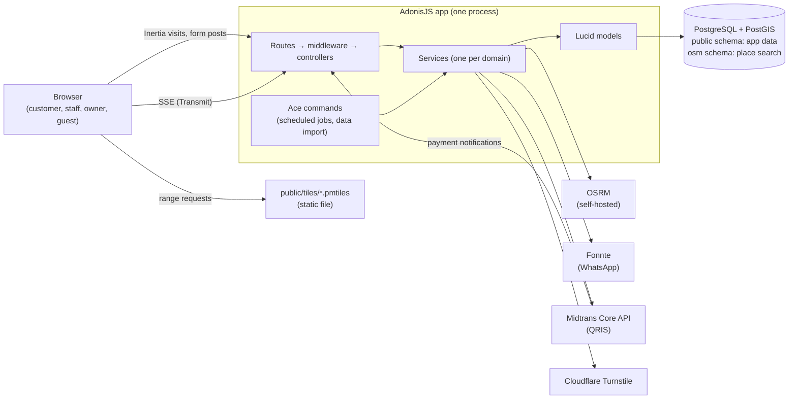
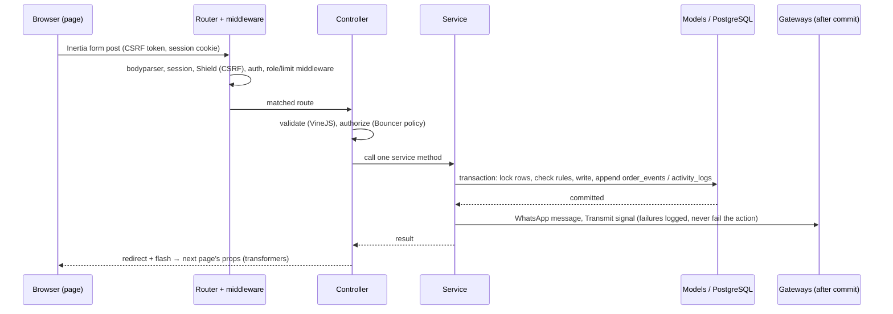
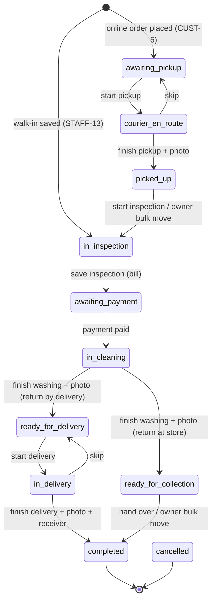
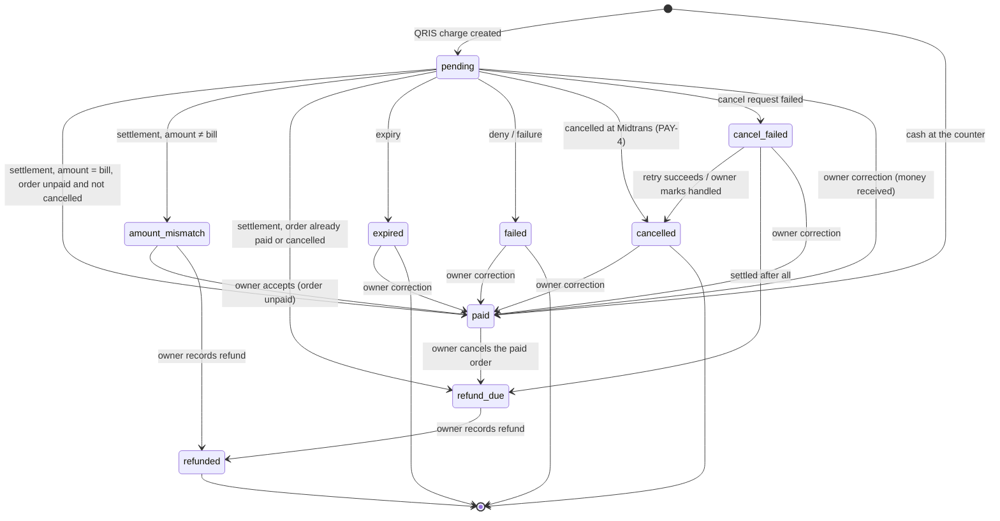

# Architecture

**§1 is set by the project owner.** Do not change it without asking; if you believe a decision must change, say so in your report and why. **§2 onward is written and kept current by the implementer** (first in M0, then whenever modules, routes, schema, state machines or decisions change).

---

## 1. Fixed decisions

### 1.1 Technology

| Area | Decision |
| --- | --- |
| Backend | What the repo already uses (discover it from `package.json`, `adonisrc.ts`, `config/`): AdonisJS 7, Lucid, VineJS, Japa (unit, functional, browser with Playwright). Add the official packages the PRD needs: `@adonisjs/bouncer` (authorization), `@adonisjs/limiter` (rate limits), `@adonisjs/transmit` (live updates over SSE). |
| Frontend | Inertia + React (already installed). **Tailwind CSS v4**, **shadcn/ui on the React Aria base** (`shadcn init --base aria`, style `aria-vega`), `react-aria-components`, **`@tabler/icons-react`**. Atomic components and styling rules in `docs/CONVENTIONS.md` §9. |
| Package manager | **npm**. `package-lock.json` is committed. |
| Database | **PostgreSQL with PostGIS**. `timestamptz` everywhere; business time zone **Asia/Jakarta**. Sessions in the database store. |
| Migrations | Until v1.0.0, schema changes **edit the original create migration** (no alter migrations); the development database is reset. From v1.0.0 on, new migrations. `database/schema.ts` is generated: never edit it by hand. |
| Local services | **PostgreSQL + PostGIS: my existing development container** (shared by my projects, not part of this repo, so no duplicate database instance). The project uses its own databases there (development and test) and enables the extensions it needs itself. **The PostgreSQL and PostGIS versions are chosen for production** (a current, supported, comfortable-to-run release); if my container runs an older version, it is upgraded to match production, never the other way round. **Rootless Podman** in this repo runs only the other local services (OSRM, data tools), with one reproducible, documented way to start, stop and reset them. No Docker-only features. |
| Maps | **Fully self-hosted.** **MapLibre GL JS** with the `pmtiles` protocol and the `@protomaps/basemaps` style, drawing a self-hosted PMTiles extract of Bandung Raya, loaded only on pages that show a map. Place search and labels from an `osm` schema in our PostgreSQL, filled from an OpenStreetMap extract by an ace command. Routing from a self-hosted **OSRM** with a motorbike profile. Map and OSM data files are never committed. |
| WhatsApp | **Fonnte**, called only from one service class. Without a token (outside production), messages go to the log. |
| Payments | **Midtrans Core API** (QRIS: charge, status, cancel, notification signature) over `fetch`, from one gateway class. Sandbox only in development. |
| Bot protection | **Cloudflare Turnstile** on public forms, on by default; Cloudflare's test keys in development and tests. |
| Scheduled jobs | Ace commands (`docs/PRD/shared.md` §10). |
| Uploads | Proof photos on disk outside `public/`, path from env, served through an authorized route. |
| Language | UI Indonesian only. Code, comments, docs, commit messages English. |
| Delivery | v1.0.0 ships a production `Containerfile` with a health check endpoint. Deployment automation is out of scope. |

### 1.2 Security requirements (all mandatory)

1. Sessions with secure cookie settings; CSRF and security headers via Shield. The client IP is read from `X-Forwarded-For` only when the request comes from a trusted proxy address (configurable), so per-IP limits see the real client behind a reverse proxy.
2. Authorization through **Bouncer policies**, checked on every route. Functional tests prove each role is refused where it doesn't belong (guest vs customer vs staff vs owner, and a customer vs another customer's order).
3. Rate limits exactly as the PRD states (ACC-2, ACC-3, ACC-4, GUEST-5, PAY-1), plus per-IP limits on the public area check and per-user limits on place search.
4. OTP stored only as a keyed hash, compared in constant time, never logged.
5. Midtrans notifications: verify the signature, confirm the status with Midtrans, process idempotently, never trust amounts from the client. At most one paid payment per order, enforced by the database.
6. Uploads: validate type and size; store outside `public/`; serve only to users allowed to see that order.
7. Secrets only in env, validated in `start/env.ts`; `.env` is never committed. Phone numbers masked in logs.
8. No personal data to any outside service except what `docs/PRD/shared.md` §11 lists.

---

## 2. Overview

Umima.Clean is **one AdonisJS 7 application** (a monolith) that renders React pages through Inertia, stores everything in **one PostgreSQL database with PostGIS**, and talks to a few outside services through one class each. There are no separate frontend or API apps, no queues and no cache servers.



- **Pages**: Inertia + React. The public pages (landing, terms, privacy, sign-in, sign-up) are server-rendered (Inertia SSR, `config/inertia.ts`), so they show at once on a phone and link previews read their tags (NFR-3, GUEST-3); signed-in pages render in the browser. Pages are grouped by role (`inertia/pages/{auth,customer,staff,admin}`); everything else is organized by domain.
- **Database**: PostgreSQL 18 with PostGIS 3.6, the versions chosen for production (§6.1, D17). In development the app uses its own databases on a shared local PostgreSQL server; production runs the same image.
- **Maps**: MapLibre GL JS draws the vector tiles of a PMTiles file in `public/tiles/` (read through the `pmtiles` protocol, styled with `@protomaps/basemaps`), loaded only on pages that show a map (MAP-2, NFR-3). The browser only talks to our own server: place search comes from the `osm` schema (MAP-1), routes from our OSRM (STAFF-6, STAFF-7).
- **Outside services**: Fonnte, Midtrans and Turnstile are called only from their gateway classes (§4.2). Each one failing degrades one feature, never the whole app (NFR-4).
- **Live updates**: Transmit (SSE) sends a small "changed" signal; the page reloads its own props over normal, authorized HTTP (§4.4).
- **Scheduled jobs**: ace commands, run by a system timer in production (§6.5).

## 3. Components

This section is the map of the code. It lists the planned modules by domain; each milestone adds what it builds and corrects names if needed. Names follow `docs/CONVENTIONS.md` (§2 naming, §3 snake_case files, §8 layers).

**Code map** (directories that exist today; start here to find a file):

- `app/controllers/`: one controller per page or action group; validates, authorizes, calls one service
- `app/services/`: business processes and gateways to outside services (`*_gateway.ts`, WhatsApp)
- `app/models/`: Lucid models with entity rules and reusable queries
- `app/validators/`: VineJS validators, one per action, and shared rules (`rules.ts`)
- `app/transformers/`: shape model data into page props
- `app/middleware/`: HTTP middleware (auth, role guards, Inertia shared props)
- `app/abilities/`: Bouncer abilities
- `app/enums/`: enums shared by the backend and, through generated types, the frontend
- `app/helpers/`: small pure functions (money, phone)
- `app/exceptions/`: the HTTP exception handler
- `inertia/pages/`: one React page per route, grouped by role (`auth/`, `customer/`, `staff/`, `admin/`, plus `legal/`, `errors/`)
- `inertia/components/`: `ui/` (shadcn), `atoms/`, `molecules/`, `organisms/`, `templates/`
- `inertia/lib/`: non-visual frontend logic (formatting, navigation, shared types)
- `inertia/css/`: `app.css`, the Tailwind entry with the shadcn theme variables
- `database/migrations/`: one create migration per table; `database/schema.ts` is generated from them
- `database/seeders/`: one seeder per domain, run from `main/index_seeder.ts`
- `database/data/`: committed source data (the service area GeoJSON, `docs/DEPENDENCIES.md` §4)
- `start/`: routes, middleware kernel, environment validation, validator messages
- `config/`: AdonisJS and package configuration
- `resources/views/`: the Edge root layout for Inertia
- `maps/`: OSM import style and SQL, OSRM motorbike profile, data tools image (§6)
- `public/`: static icons and images (`public/tiles/` is git-ignored map data)
- `tests/unit/`, `tests/functional/`, `tests/browser/`: Japa suites; `tests/helpers/`: fakes and the screenshot helper
- `scripts/`: process tooling (evidence runner, `npm run check`, suggested-commit check; D86)

### 3.1 Backend (`app/`)

**Layers** (CONVENTIONS §8): a controller validates, authorizes and calls one service; a service runs one business process (transactions, several models, outside calls); a model holds entity rules and reusable queries; a transformer shapes props for a page. Roles appear only in URL prefixes and route groups (`/staf`, `/admin`), never in folder names.

| Domain | Controllers | Service | Models | Policy | Milestone |
| --- | --- | --- | --- | --- | --- |
| Accounts | `session_controller`, `registration_controller`, `password_reset_controller`, `otp_controller`, `account_security_controller`, `profile_controller`, `phone_change_controller` | `AccountService` (sign-in, passwords, devices), `OtpService` (codes, limits, flow state in the session) | `User`, `OtpCode` (+ `remember_me_tokens`, `sessions`, `rate_limits` tables) | abilities per role (`app/abilities/main.ts`) | M2 |
| Price list | `services_controller` | `PriceListService` | `Service` | `ServicePolicy` | M3 |
| Service areas | `service_areas_controller`, `area_check_controller` | `AreaService` | `ServiceArea` (PostGIS polygon) | owner ability | M3 |
| Own profile, every role | `profile_controller`, `phone_change_controller` | `AccountService`, `OtpService` | `User` | role middleware per area (D108) | M2c, M4a-fix7 |
| Store settings | `store_settings_controller` | `SettingService` | `Setting` (key → JSON) | owner ability | M3 |
| Pickup slots | `pickup_slots_controller` | `PickupSlotService` (since M5a: `listPickupDates`, `listSlotsForDate`, `countTakenPlaces`; a slot with pending pickups keeps its times, D112) | `PickupSlot` (weekday, start, end, capacity, on/off; D106) | owner ability | M4a-fix4, M5a |
| Addresses and places | `addresses_controller` (M4b; `?dari=pesan` returns to `/pesan` from M5a stop 2), `area_check_controller` (`showPoint`, the pin check), `places_controller` (search) | `AddressService` (max 3, one primary, coverage on save; locks the customer's row), `PlaceService` (raw SQL on the `osm` schema; null while the schema is missing, D110) | `CustomerAddress` (`withCoverage` scope, D82) | customer middleware; every lookup is scoped to the signed-in customer, so another customer's address is a 404 (D109) | M4b |
| Orders | `orders_controller` (customer, M5a stop 2: `/pesan`, `/pesan/konfirmasi`), `order_tracking_controller` (4-digit unlock), `owner_orders_controller` | `OrderService`: placing, cancelling, and **the only place an order changes status** (§5.1); since M5a stop 1 `transitionOrder` and `placeOnlineOrder` (D111), stop 2 `validateDraft` and `listRepeatItems` (D114) | `Order` (`number()`, `canTransitionTo`, scopes `holdingSlotPlace`, `pickupPending`), `OrderAddress`, `OrderItem`, `OrderEvent`; enums `order_status_enum` (statuses, labels, stages, `ORDER_TRANSITIONS`), `order_address_kind_enum`, `bag_size_enum`; `createOrderValidator`, `confirmOrderValidator` | `OrderPolicy` | M5 |
| Staff trips | `trips_controller` | `TripService` (queues, one active trip per queue for the whole team, each staff member's queue order) | `Order` (trip state lives on the order and its events) | staff ability | M6 |
| Proof photos | `proof_photos_controller` | `ProofPhotoService` (store, serve, prune) | `OrderPhoto` | `OrderPolicy` | M6 |
| Workshop | `inspections_controller`, `washing_controller`, `collections_controller`, `print_controller` | `WorkshopService` (inspection → bill, washing, collection) | `Bill`, `BillLine` | staff ability | M7 |
| Payments | `payments_controller` (customer QRIS), `counter_payments_controller`, `midtrans_notifications_controller`, `payment_reconciliation_controller` | `PaymentService`: QRIS, cash, owner corrections, reconciliation, and **the only place a payment changes status** (§5.2) | `Payment` | `OrderPolicy` | M8 |
| Walk-in orders | `walk_in_orders_controller` | `OrderService` (walk-in placement) | as orders | staff ability | M9 |
| Owner area | `owner_summary_controller`, `customers_controller`, `reports_controller`, `operating_costs_controller`, `activity_logs_controller`, `staff_accounts_controller`, `come_back_reminders_controller`, `exports_controller` | `ReportService`, `StaffAccountService`, `ReminderService` (payment and come-back reminders) | `OperatingCost`, `ActivityLog` | owner ability | M10 |
| Public pages | `home_controller`, `legal_controller`, `seo_controller` | `SettingService` |  | none | M1, M3 |

**Gateways** (one class per outside service, swapped for a fake in every test with `app.container.swap`, CONVENTIONS §0 rule 4):

| Class | Calls | Without configuration |
| --- | --- | --- |
| `FonnteGateway` | `POST https://api.fonnte.com/send` | no token outside production → the message is written to the log (MSG-4) |
| `MidtransGateway` | Core API: charge (`payment_type: qris`), status, cancel; verifies notification signatures | no server key → QRIS shown as unavailable (PAY-5) |
| `TurnstileGateway` | `POST https://challenges.cloudflare.com/turnstile/v0/siteverify` | Cloudflare test keys in development and tests |
| `OsrmGateway` | our OSRM: `/route`, `/table` | no `OSRM_URL` or OSRM down → straight-line estimate marked "±", queue "Urutan belum dioptimasi" (STAFF-6, STAFF-7) |

**Other backend pieces**

- `app/enums/`: `role_enum`, `order_status_enum` (with stage and label), `payment_status_enum`, `payment_method_enum`, `item_kind_enum`, `service_type_enum`, `return_method_enum`, `order_source_enum`, `photo_kind_enum`, `skip_reason_enum`, `activity_category_enum`, `cost_category_enum`, `otp_purpose_enum`. Each exports an `as const` object, its type and an Indonesian `…Label` map (CONVENTIONS §8).
- `app/validators/`: one VineJS validator per action (`createOrderValidator`, …); the shared phone rule normalizes to `62…` (ACC-1). Messages in `start/validator.ts`.
- `start/limiter.ts`: HTTP-level limits: `areaCheckThrottle` for `GET /area/cek` and the signed-in pin check `GET /area/cek-titik`, 60 per minute per IP (D80, D94, D109); `placeThrottle` for `GET /tempat`, 30 per minute per signed-in user (D80, D110). Business limits (sign-in, OTP, unlock digits, QRIS charges) live in their service, because their keys (phone, order) come from the request body.
- `start/transmit.ts`: channel authorization (§4.4).
- `commands/`: `payments_remind` (`node ace payments:remind`, PAY-6) and `photos_prune` (`node ace photos:prune`, PHOTO-3); `osm_import` (`node ace osm:import <YYMMDD>`, development only, D91) runs the pipeline of §6.2.
- `database/migrations/`: one create migration per table (`docs/PRD/shared.md` §12), edited in place until v1.0.0. `database/seeders/`: one per domain, run in a fixed order from `database/seeders/main/index_seeder.ts`, which prints the demo accounts in development only (D79).

### 3.2 Frontend (`inertia/`)

| Folder | Holds |
| --- | --- |
| `components/ui/` | shadcn components (React Aria base, `aria-vega`), renamed to snake_case on generation (D29) |
| `components/atoms/` | logo, status badge (one map from order stage to Tailwind classes), tone badge, initials avatar, photo |
| `components/molecules/` | phone input, password input, OTP input, quantity stepper, search field, empty state, metric card, Turnstile widget, compare slider, address combobox |
| `components/organisms/` | site header and footer, landing sections, navigation per area (customer bottom bar, staff bottom bar, owner sidebar), order summary card, bill items, QRIS panel, map panels (location, route, queue), camera view, data table parts, dialogs per owner feature |
| `components/templates/` | one layout per area: public, auth, customer, flow (order steps), staff, owner, print |
| `lib/<feature>/` | non-visual logic shared by components: phone formatting, countdown, map setup (MapLibre + `pmtiles` protocol, loaded only by map components), camera, live updates, form drafts |
| `pages/` | `home.tsx`, `legal/`, `errors/`, `auth/`, `customer/`, `staff/`, `admin/` (one file per page in the PRD page tables) |

Since M1b: `ui/` holds the shadcn components in use (accordion, badge, button, card, carousel, checkbox, dialog, dropdown menu (`dropdown_menu.tsx`, M4a-fix5), field, input, label, separator, sheet, sonner); `atoms/` the logo (the brand SVG drawn in `currentColor`), the CSRF field, a photo (WebP with JPEG fallback), a note with one map of tones, the review stars; `molecules/` the flash toasts, a form field, a navigation item (a link, or plain text while its page doesn't exist yet), the before/after compare slider, the page head (`SeoHead`), the photo credit, the phone input (`PhoneInput`), the password input (`PasswordInput`), the 6-digit OTP input (`OtpInput`), and the Turnstile widget (`TurnstileWidget`), the dashboard number card (`StatCard`) and the sign-out button (`LogoutButton`, D107); `organisms/` the site header and footer, the auth brand panel, the customer, staff and owner navigation, the staff top bar, the owner page header, the flow header, the legal page frame and the landing sections (`organisms/landing/`); `templates/` the seven layouts (`public_`, `auth_`, `customer_`, `flow_`, `staff_`, `owner_`, `print_layout`). Navigation entries per area live in `lib/navigation/`; the shop's contact details in `lib/store/contact.ts` until the store settings exist (M3). Outside production, `/_preview/{alur,cetak,404,500}` render the templates and error pages that have no real page yet. In M2a, the real role dashboards (`/beranda`, `/staf`, `/admin`) and authentication pages (`/masuk`, `/staf/masuk`) are established. In M2b, registration (`/daftar`), OTP verification (`/verifikasi`), forgot password (`/lupa-kata-sandi`), and password reset (`/kata-sandi-baru`) are established. In M2c, the profiles (`/profil`, `/profil/ubah`, `/profil/nomor`, `/staf/profil`, `/admin/profil`) and the shared account security organism (`organisms/account_security.tsx`: identity card, password form, active devices card); the account security actions are shared by every role (`PUT /akun/kata-sandi`, `POST /akun/keluar-perangkat-lain`). In M4a, the maps: `lib/map/area_map.ts` (MapLibre setup, district layers), `organisms/service_area_map.tsx` (loads that module only when it renders), the map card on `/admin/pengaturan/area`, and in the hero `molecules/area_check_form.tsx` (kecamatan name check, `GET /area/cek?q=`, D100) and the shop's open or closed status (D101); `organisms/settings/settings_nav.tsx` (the settings pages' side navigation: Toko, Slot penjemputan, Area layanan; D106), `organisms/settings/pickup_slots_card.tsx` on `/admin/pengaturan/slot`, `organisms/settings/opening_hours_form.tsx` on `/admin/pengaturan/toko`, with the 24-hour time and date-time fields of `molecules/time_fields.tsx` (D103), the temporary closure in its own card (`organisms/settings/closure_card.tsx`); the slot capacity stepper is `molecules/number_stepper.tsx` (D105). In M4b: `ui/toggle.tsx` and `ui/toggle_group.tsx` (shadcn CLI, the label choice of an address), `ui/combobox.tsx` (shadcn CLI, trimmed to the parts in use); since 0.4.2 the address form is one page (D109): `molecules/place_search.tsx` (the address field that is also the place search, D110), `organisms/pin_picker.tsx` (the notice, the moving map from `md` up or the static preview with "Atur pin" below it, and the coverage line), `organisms/pin_sheet.tsx` (the phone's full-screen "Ubah lokasi" sheet), `molecules/coverage_status.tsx`, `molecules/locate_button.tsx` and `lib/map/pin_check.ts` (`usePinCheck`, the server's coverage answer for a point); `organisms/service_area_map.tsx` takes an optional `pin` (moving, or static for the preview; `followPin` and `movePinTo` in `lib/map/area_map.ts`) and floating buttons as children; every map draws its credits with `molecules/map_credits.tsx` (a 44 px ⓘ button); the address pages `customer/addresses/{index,form}` (`/profil/alamat`, `/profil/alamat/baru`, `/profil/alamat/:id/ubah`), linked from the customer's Profil.

Pages own state and navigation; they get data only through Inertia props (built by transformers) and send data only through Inertia forms. URLs come from the Tuyau route helper. Icons: `@tabler/icons-react`.

## 4. Data flow

### 4.1 One request, from click to database and back



Rules that hold for every flow:

1. **Validation and authorization at the edge.** Every route has a validator for its input and a Bouncer check (`docs/ARCHITECTURE.md` §1.2 rule 2). Customers can only reach their own records; guests reach an order only after the 4-digit unlock (GUEST-4).
2. **One transaction per business action.** The status change, its timeline event and its activity log entry are written together, or not at all (ORD-4, NFR-5).
3. **Concurrency is decided by the database**, not by checks before the transaction: row locks (`FOR UPDATE`) on the order or payment being changed, a lock per pickup slot for capacity (SLOT-3), a lock per queue for the single active trip (STAFF-3), and a partial unique index for "one paid payment per order" (PAY-3).
4. **Outside calls happen after commit** (messages, Midtrans cancels, live signals), so a slow or failing service never holds a lock or rolls back a finished action (MSG-3, NFR-4). The one exception is the QRIS charge, which must succeed before a payment row can be `pending`.

### 4.2 Outside services

| Service | Called from | When | Data sent (`docs/PRD/shared.md` §11) | When it fails |
| --- | --- | --- | --- | --- |
| Fonnte | `FonnteGateway` | OTP codes; the six customer messages (MSG-1) | phone number, message text | logged with context; the action continues (MSG-3); OTP screens say the code could not be sent |
| Midtrans Core API | `MidtransGateway` | "Bayar" pressed (charge), "Cek status", live QR cancel (PAY-4), reconciliation re-check | order reference, amount, customer name and phone | charge: error shown, no payment row; cancel: payment becomes `cancel_failed` (PAY-7) |
| Midtrans notifications | `midtrans_notifications_controller` → `PaymentService` | Midtrans posts a status | — | signature checked (SHA-512 of `order_id + status_code + gross_amount + server key`), status confirmed with `GET /v2/{order_id}/status`, processed idempotently; non-2xx makes Midtrans retry (up to 5 times over about 6 hours) |
| Turnstile | `TurnstileGateway` | public forms (sign-up, forgot password, OTP resend, order unlock); not sign-in, which the ACC-3 rate limits protect (D64) | token, client IP | the form shows "verification failed, try again" |
| OSRM | `OsrmGateway` | queue order, route line, distance/ETA | nothing leaves our servers | estimate "±", "Urutan belum dioptimasi" |
| Map data | `PlaceService`, static tiles | address search, pin label, base map | nothing leaves our servers | without the `osm` schema the search says "Pencarian tempat belum tersedia", the label is empty and the pin is placed by hand (MAP-1, D110); maps show a plain background (MAP-2) |

Midtrans facts that shape the design (checked 2026-11-13 in the Midtrans docs): a QRIS charge is `POST /v2/charge` with `payment_type: "qris"`; the response carries the QR image URL in `actions` (`generate-qr-code`) and the QR text in `qr_string`; the default QRIS expiry is 15 minutes, and `custom_expiry` can set it explicitly (we set 15 minutes, PAY-1). Statuses we act on: `pending`, `settlement`, `expire`, `cancel`, `deny`, `failure`. The exact response fields are verified against the sandbox in M8 before they are relied on.

### 4.3 Money and time

Money is whole rupiah in `integer` columns; a bill line stores the listed and the charged price (SVC-3). Timestamps are `timestamptz`; business dates (pickup days, report days, reminder windows) are computed in `Asia/Jakarta` with Luxon.

### 4.4 Live updates

Transmit (SSE) channels: `orders/:id` (one order's page), `staff/queues` (pickup, workshop, delivery queues), `admin/orders` (owner order list). After a status change commits, `OrderService` broadcasts a **signal without personal data** on the affected channels; the open page then asks for its own props again with an Inertia partial reload. The data itself therefore always comes through the normal HTTP route with its policy check, and Transmit's channel authorization (`start/transmit.ts`) only has to decide who may _hear_ that something changed: the order's customer or a session that unlocked it, staff and owner for queues, the owner for the list.

Transmit facts that shape the design (checked 2026-11-13): channel authorization through `transmit.authorize()`; one process needs no transport (Redis is only for several instances, which v1.0.0 doesn't have); the reverse proxy **must not compress** `text/event-stream`, or SSE breaks (recorded for deployment).

## 5. State machines

Both machines follow the same pattern (CONVENTIONS §0 rule 3):

- The allowed transitions are **one table in code** next to the enum (`ORDER_TRANSITIONS` in `app/enums/order_status_enum.ts`, `PAYMENT_TRANSITIONS` in `app/enums/payment_status_enum.ts`), copied from the PRD tables below. The model answers `order.canTransitionTo(status)` / `payment.canTransitionTo(status)`.
- **One service method writes the status**: `OrderService.transitionOrder(order, status, { actor, note }, transaction)` and `PaymentService.transitionPayment(payment, status, { actor, note }, transaction)`. Every flow that changes a status calls it inside its own transaction. It locks the row, refuses a transition that isn't in the table (HTTP 409 with an Indonesian message), writes the new status, appends the event (order: `order_events`; both: `activity_logs` when the actor is staff or owner) and queues the after-commit work (messages, live signal).
- **Tests**: a unit test walks the whole table: every allowed pair succeeds and every other pair (all statuses × all statuses) is refused. Functional tests cover each trigger below, named by its requirement ID.

### 5.1 Order status (ORD-2, ORD-3)



Plus: **any status except `completed` and `cancelled` → `cancelled`** (owner only), and `awaiting_pickup → cancelled` by the customer.

| From | To | Trigger (who) | Where | Side effects | Req |
| --- | --- | --- | --- | --- | --- |
| (new) | `awaiting_pickup` | customer places an online order | `OrderService.placeOnlineOrder` | slot capacity locked and re-checked; both addresses re-checked against active areas; "order received" message | CUST-6, SLOT-3, AREA-4, MSG-1.1 |
| (new) | `in_inspection` | staff save a walk-in | `OrderService.placeWalkInOrder` | 1–3 intake photos; no message yet | STAFF-12, STAFF-13 |
| `awaiting_pickup` | `courier_en_route` | staff start a pickup | `TripService.startTrip` | refused while anyone holds an active pickup (one lock for the whole team); "courier on the way" message | STAFF-3, STAFF-4, MSG-1.2 |
| `courier_en_route` | `picked_up` | trip holder or owner finishes | `TripService.finishTrip` | proof photo required | STAFF-4, PHOTO-1 |
| `courier_en_route` | `awaiting_pickup` | trip holder or owner skips | `TripService.skipTrip` | reason + note on the timeline; stop goes last today | STAFF-4, STAFF-5, STAFF-6 |
| `picked_up` | `in_inspection` | staff start inspection; owner bulk move | `WorkshopService.startInspection`, `OrderService.moveOrdersByOwner` |  | STAFF-9, OWN-3 |
| `in_inspection` | `awaiting_payment` | staff save the inspection | `WorkshopService.saveInspection` | bill created; a re-inspection before payment replaces it and cancels any live QRIS (PAY-4); "bill" message for online orders | STAFF-9, SVC-3, MSG-1.3 |
| `awaiting_payment` | `in_cleaning` | a payment becomes `paid` (QRIS settlement, cash, owner correction or accepted mismatch) | `PaymentService` (calls `transitionOrder` in the same transaction) | walk-in: "order received" message after counter payment | PAY-2, STAFF-14, OWN-4, OWN-5, MSG-1.1 |
| `in_cleaning` | `ready_for_delivery` / `ready_for_collection` | staff finish washing | `WorkshopService.finishWashing` | proof photo required; target chosen by the return method; items marked washed | STAFF-10 |
| `ready_for_delivery` | `in_delivery` | staff start a delivery | `TripService.startTrip` | refused while another delivery is active | STAFF-3, STAFF-4 |
| `in_delivery` | `completed` | trip holder or owner finishes | `TripService.finishTrip` | proof photo + receiver name | STAFF-4 |
| `in_delivery` | `ready_for_delivery` | trip holder or owner skips | `TripService.skipTrip` | reason on the timeline | STAFF-4, STAFF-5 |
| `ready_for_collection` | `completed` | staff hand over; owner bulk move | `WorkshopService.handOverOrder`, `OrderService.moveOrdersByOwner` |  | STAFF-11, OWN-3 |
| `awaiting_pickup` | `cancelled` | customer, with a reason | `OrderService.cancelOrderByCustomer` | no message | CUST-8 |
| any except `completed`, `cancelled` | `cancelled` | owner, with a reason (one or several orders) | `OrderService.cancelOrdersByOwner` | an active trip on that order ends and the queue is free again (STAFF-3); live QRIS cancelled (PAY-4); a `paid` payment → `refund_due` (PAY-7); "cancelled by the shop" message if the customer was already told about the order (MSG-1.5) | OWN-3, STAFF-3, PAY-4, PAY-7 |

### 5.2 Payment status (PAY-3, PAY-7)



| From | To | Trigger | Where | Req |
| --- | --- | --- | --- | --- |
| (new) | `pending` | "Bayar" pressed (customer online, staff at the counter); at most 5 new charges per order per 15 minutes; a live QR is shown again instead of a new one | `PaymentService.startQrisPayment` | PAY-1, CUST-10, STAFF-14 |
| (new) | `paid` | cash received at the counter | `PaymentService.recordCashPayment` | STAFF-14, PAY-4 |
| `pending` | `paid` / `amount_mismatch` / `refund_due` / `expired` / `failed` | a verified Midtrans notification or "Cek status", decided by the status Midtrans confirms | `PaymentService.applyMidtransStatus` | PAY-2, PAY-4, PAY-7 |
| `pending` | `cancelled` / `cancel_failed` | the bill was replaced, or the order was paid another way or cancelled; after commit the live charge is cancelled at Midtrans and the confirmed status decides | `PaymentService.cancelLiveQrisPayments` | PAY-4 |
| `cancel_failed` | `cancelled` | retry succeeds, or the owner marks it handled | `PaymentService.retryCancel`, `PaymentService.markCancelHandled` | OWN-5 |
| `cancel_failed` | `refund_due` | Midtrans reports it was settled | `PaymentService.applyMidtransStatus` | PAY-7 |
| `amount_mismatch` | `paid` | owner accepts while the order has no paid payment (the order then moves to `in_cleaning`) | `PaymentService.acceptMismatch` | OWN-5 |
| `amount_mismatch`, `refund_due` | `refunded` | owner records a refund made outside the app, with a note | `PaymentService.recordRefund` | OWN-5 |
| `paid` | `refund_due` | owner cancels a paid order | `OrderService.cancelOrdersByOwner` → `PaymentService.transitionPayment` | OWN-3, PAY-7 |
| `pending`, `expired`, `failed`, `cancelled`, `cancel_failed` | `paid` | owner correction with a reason: the money was in fact received (e.g. a QRIS recorded as cash) and the order has no other paid payment; the order then moves on like any payment | `PaymentService.correctPayment` | OWN-4, PAY-7 |

"At most one `paid` payment per order" is enforced by a partial unique index (`payments(order_id) WHERE status = 'paid'`); a violation inside `transitionPayment` becomes "Pesanan ini sudah dibayar." `expired`, `failed`, `cancelled` and `refunded` are final except for the owner correction to `paid`. An owner correction that only changes method, channel or amount keeps the status. Payment reminders (PAY-6) skip an order while it has a payment in `amount_mismatch`.

## 6. Local services and data

Complete zero-to-running bootstrap steps and teardown procedures from a clean environment are documented in [`docs/SETUP.md`](SETUP.md).

All commands run in the repository root and work in fish and bash unless marked otherwise. Database credentials come from `.env` (copy `.env.example` first). Map data files live in git-ignored folders (`storage/`, `public/tiles/`).

`compose.yaml` holds the routing service (`osrm`) and the one-off data tools (`psql`, `map-tools`, `osrm-build`, `pmtiles`, profile `tools`). Tools run with `podman compose --profile tools run --rm -T <tool> …` (`-T`: no terminal, so psql never opens a pager). The database server itself is not in `compose.yaml` (§6.1).

### 6.1 Database (PostgreSQL + PostGIS)

**Versions** (D17): **PostgreSQL 18 with PostGIS 3.6**, image `docker.io/postgis/postgis:18-3.6` (PostgreSQL 18.6, PostGIS 3.6.4 on 2026-11-13). Production runs this image, and so does the development server. Only these versions are supported.

**Development server**: development and tests use their own databases on a **shared local PostgreSQL server** (one instance for several projects, D18). On the development machine it is the container `postgres`, run by the systemd user unit from the Quadlet file `~/.config/containers/systemd/postgres.container`:

| Setting | Value |
| --- | --- |
| Image | `docker.io/postgis/postgis:18-3.6@sha256:4a43e3c3e5d55b9208240fc71db543b79c638766280c625a425bd0a2390989c4` (the same reference as `compose.yaml`) |
| Port | `127.0.0.1:5432` |
| Data | the volume `postgres18_data`, mounted at `/var/lib/postgresql` (PostgreSQL 18 images keep their data in a version folder below it) |
| Superuser | `user` (`POSTGRES_USER`), password set in the unit |
| Time zone | `TZ` and `PGTZ` `Asia/Jakarta` |
| Health check | `pg_isready -U user -d postgres` every 10 s |
| Control | `systemctl --user status postgres.service` and `systemctl --user restart postgres.service`; after editing the unit, `systemctl --user daemon-reload` |

Upgrade note: on 2026-11-13 the server moved from PostgreSQL 17.5 / PostGIS 3.5 (image `postgis/postgis:17-3.5`, volume `postgres_data`) to the versions above. Its data was development data only and was not carried over: the unit got the new image and a new volume, the old volume was deleted once the new server was healthy, and each project recreates its own databases and runs its migrations again (D21). The unit file before the change is kept at `~/pg-upgrade/postgres.container.17`.

This project needs:

| Database | Used by | `.env` file |
| --- | --- | --- |
| `umimaclean_dev` | `npm run dev`, seeders | `.env`: `DB_DATABASE=umimaclean_dev` |
| `umimaclean_dev_test` | `npm test` (migrates itself on every run) | `.env.test` (committed): `DB_DATABASE=umimaclean_dev_test`, `PORT=3334` (D71) |

`.env` also needs `DB_HOST`, `DB_PORT`, `DB_USER` and `DB_PASSWORD` of a role allowed to create databases and extensions (on the development machine: `127.0.0.1`, `5432`, the server's superuser).

**Create the databases** (once, safe to repeat; creates both databases from `template0` and enables `postgis`, `pg_trgm` and `unaccent`, D19):

```sh
podman compose --profile tools run --rm -T psql -d postgres -f /database/create_databases.sql
```

| Task | Command |
| --- | --- |
| Open psql on the development database | `podman compose --profile tools run --rm psql` |
| Reset the development database | `node ace migration:fresh` (the `osm` schema is outside `public` and survives; drop it with `DROP SCHEMA osm CASCADE` if needed) |
| Reset the test database | nothing to do: `npm test` migrates it at the start of the run and rolls back at the end |

### 6.2 Map data: OSM extract → `osm` schema (MAP-1)

Loads geocoding and place reference data into the `osm` schema. `node ace osm:import <YYMMDD>` (`commands/osm_import.ts`, development only, D91) runs every step after the download, each tool through its compose service:

1. Build the `map-tools` container image once (`maps/Containerfile`: `osmium-tool` and `osm2pgsql`).
2. Download a dated monthly Geofabrik snapshot of Java (`java-YYMM01.osm.pbf`) and its `.md5` (D87).
3. Check the snapshot's MD5, and that `maps/clip_polygon.geojson` covers every service area (`ServiceArea.findNamesOutside`, D88).
4. Clip the snapshot with that polygon (`osmium extract --polygon`) to `storage/osm/bandung-raya.osm.pbf`.
5. Load roads, places and boundaries into the staging schema `osm_import` with `osm2pgsql` and `maps/osm_import.lua`.
6. Write the production artifact: `pg_dump --format=custom` of `osm_import` to `storage/osm/osm-import-YYMMDD.dump`, with a `.sha256` (compose service `pg-client`, D89).
7. Refill `osm` in one transaction with `maps/osm_schema.sql` and `maps/osm_build.sql` (merge streets per kelurahan, normalized search columns, drop the staging schema), the same refill production runs after `pg_restore` (D89, D90).

Result on 2026-11-17 from `java-261101.osm.pbf`: 12,235 roads, 12,518 places, 302 boundaries, 25 MB with indexes; extract 57 MB, artifact 5.0 MB; the whole command 28 s (`docs/evidence/M4a/EVIDENCE.md`). Clipping peaks at about 4 GB of memory, osm2pgsql at about 230 MB (`docs/evidence/M3-0.3.2/EVIDENCE.md` §5). The schema is outside `public`, so migrations and test resets leave it alone. Files: `maps/clip_polygon.sql` and `maps/clip_polygon.geojson` (the clip, D88), `maps/osm_schema.sql` (tables, indexes, the `osm.normalize` search function), `maps/osm_import.lua` (what is kept from OSM), `maps/osm_build.sql` (merge streets per kelurahan, refill in one transaction).

To prevent drift, exact shell commands are maintained in [docs/SETUP.md §2 Step 5](SETUP.md#step-5-optional-map-data-and-routing-setup).

### 6.3 Routing: OSRM with the motorbike profile (STAFF-6, STAFF-7)

Builds and runs a local OSRM routing engine configured specifically for motorbikes in Bandung Raya using `storage/osm/bandung-raya.osm.pbf`:

1. Extract routing graph using `osrm-extract` with custom Lua profile `maps/motorbike.lua` (avoids highways/motorways and toll roads, models realistic urban street speeds, and leaves driving side to location data).
2. Prepare static graph using Contraction Hierarchies (`osrm-contract`, `--algorithm ch`), ensuring minimal RAM usage (~0.3 GB) and millisecond `/route` and `/table` response times without needing live traffic re-customization.
3. Serve routing via `osrm-routed` on port 5000 (`compose.yaml` service `osrm`).

Result: 23 files, 242 MB; extract 19 s (peak 1.0 GB RAM), contract 26 s (peak 0.3 GB RAM). The files only load in the OSRM version that built them, so `osrm` and `osrm-build` share one image reference in `compose.yaml`. Toll roads are avoided: a route from Pasteur to Cileunyi (`/route/v1/driving/107.5900,-6.8935;107.7465,-6.9395?steps=true`) takes surface streets and has no `motorway` or `toll` class, although the data contains the Padalarang–Cileunyi toll road.

Each staff member's queue order (STAFF-6) is one OSRM `/table` request from that staff member's position (or the shop without GPS); the plan is kept per staff member and recomputed only when a stop is finished or skipped or the queue changes.

To prevent drift, exact shell commands are maintained in [docs/SETUP.md §2 Step 5](SETUP.md#step-5-optional-map-data-and-routing-setup).

### 6.4 Base map: PMTiles extract (MAP-2)

Provides an offline, self-hosted vector map base for Bandung Raya:

1. Extract vector tiles inside the Bandung Raya bounding box directly from the Protomaps public daily builds (`https://build.protomaps.com/<YYYYMMDD>.pmtiles`) using `go-pmtiles` over HTTP range requests (~68 MB transferred in ~20 s).
2. Save single-file tileset to `public/tiles/bandung-raya-<YYYYMMDD>.pmtiles` (62 MB, zoom 0–15, Protomaps basemap tileset v4.15.2).
3. Client-side rendering (`inertia/lib/map/area_map.ts`, loaded only by `organisms/service_area_map.tsx`): MapLibre GL JS reads the file named by `MAP_TILES_FILE` through the `pmtiles` protocol and styles it with `layers()` of `@protomaps/basemaps` 5 (Styles 5 go with Tiles 4), fonts and sprites from `public/tiles/fonts/` and `public/tiles/sprites/` (D96). Without the setting a plain background is drawn; the districts (D95) and the pin work either way.

The file name carries the build date, so a new build is a new URL and browsers can cache tiles forever. Available builds are listed at `https://build-metadata.protomaps.dev/builds.json`; before switching builds, check its tileset version with `pmtiles show`.

To prevent drift, exact shell commands are maintained in [docs/SETUP.md §2 Step 5](SETUP.md#step-5-optional-map-data-and-routing-setup).

### 6.5 Scheduled jobs

| Job | Command (from M8 / M11) | Schedule |
| --- | --- | --- |
| Payment reminders (PAY-6) | `node ace payments:remind` | every 15 minutes; the command checks the 10:00–15:00 Asia/Jakarta window itself |
| Prune proof photos (PHOTO-3) | `node ace photos:prune` | daily |

Both commands are idempotent (running them twice in a row sends or deletes nothing twice), so a missed or doubled run is harmless.

- **Locally**: run them by hand when testing those features. Tests call the service method with a fixed "now" instead of waiting for a clock.
- **Production**: a **systemd timer** on the host runs each command in a one-shot container from the app image (`OnCalendar=*:0/15` and `daily`, `Persistent=true` so a run missed while the server was down happens at boot). This fits the rootless Podman setup (Quadlet units are systemd units), adds no dependency and keeps jobs out of the web process. The unit files come with the production `Containerfile` in M12.

### 6.6 Tests

`npm test` runs the unit, functional and browser suites against the test database (`.env.test`). The runner migrates that database before the first test and rolls the migrations back after the last one (`testUtils.db().migrate()` in `tests/bootstrap.ts`, without regenerating `database/schema.ts`), so a freshly created test database needs nothing else. Each test that touches data wraps itself in a global transaction.

## 7. Decisions log

Every decision not covered by §1, and **every workaround**, gets an entry: number, date, decision, reason, alternatives considered, and links.

- **D1** (2026-11-13): `compose.yaml` holds OSRM and the one-off data tools (profile `tools`), run with `podman compose` (provider `podman-compose`); the database server is not in it (D18)
  - **Why:** Readable, one file to start, stop and run everything this repository needs; only portable compose features (no Docker-only features). Tools read credentials from the same `.env` as the app
  - **Alternatives:** `podman kube play` (built in, but Kubernetes YAML is harder to read), Quadlet units (production-style, awkward for a dev checkout), plain `podman run` lines (long, repeated image references)
- **D2** (2026-11-13): Container images are pinned by tag **and** digest
  - **Why:** `postgis/postgis:18-3.6` is a moving tag (patch updates); the digest makes every machine run the same build (AGENTS.md: pin exact versions)
  - **Alternatives:** tag only
- **D3** (2026-11-13): PostGIS 3.6, not 3.7
  - **Why:** 3.7.0 was published days before M0; 3.6 is the mature line and still gets fixes. Revisit at M12
  - **Alternatives:** `18-3.7`
- **D4** (2026-11-13): OSRM image from GHCR (`v26.11.0-debian`), Contraction Hierarchies
  - **Why:** The project publishes on GHCR; Docker Hub stopped at v5.25.0 (2021). CH: see §6.3
  - **Alternatives:** Docker Hub image (stale), MLD
- **D5** (2026-11-13): `osmium` and `osm2pgsql` run from a small Debian image built from `maps/Containerfile` (compose service `map-tools`); `psql` runs from the production PostGIS image (compose service `psql`)
  - **Why:** No official images exist; DEPENDENCIES §4 prefers containers over host installs; Debian packages are maintained (osm2pgsql 2.3.1 from trixie-backports)
  - **Alternatives:** host packages (`dnf`/`apt`), the community image `iboates/osm2pgsql`
- **D6** (2026-11-13): For the OSM import superseded by D88 (OSRM, M6, still to decide). Map data covers the box 107.20–107.99 E, 7.37–6.76 S
  - **Why:** The extent of the 64 kecamatan of AREA-1 (107.25–107.93 E, 7.32–6.81 S) plus about 5 km, so streets and routes just outside a border still work
  - **Alternatives:** a larger box including Kabupaten Bandung Barat (not in AREA-1)
- **D7** (2026-11-13): The `osm` schema is created from `maps/osm_schema.sql`, not migrations; imports go to a staging schema and are swapped in one transaction
  - **Why:** It is reference data rebuilt from a file, not app data: migrations and test resets must not drop it, and a refresh must never show empty search results
  - **Alternatives:** Lucid migrations (would be wiped by `migration:fresh`), loading straight into the live tables
- **D8** (2026-11-13): **Workaround**: `osm.normalize` is marked `IMMUTABLE` although it calls `unaccent()`, which is `STABLE`
  - **Why:** Generated search columns need an immutable function. Passing the dictionary explicitly (`unaccent('public.unaccent', …)`) removes the search-path lookup that makes `unaccent` stable, so the label is safe. Without it, `CREATE TABLE` fails. Comment in `maps/osm_schema.sql`. See PostgreSQL docs on [function volatility](https://www.postgresql.org/docs/current/xfunc-volatility.html) and [unaccent](https://www.postgresql.org/docs/current/unaccent.html)
  - **Alternatives:** a trigger-maintained column (more code), searching without a stored column (no index)
- **D9** (2026-11-13): **Workaround**: `maps/motorbike.lua` replaces car.lua's global `WayHandlers.maxspeed` with a no-op
  - **Why:** Legal maxspeed tags would raise motorbike speeds above real city traffic, and car.lua has no option to skip them. Without it, ETAs on tagged roads are too optimistic. Comment in the profile; [OSRM profiles docs](https://github.com/Project-OSRM/osrm-backend/blob/master/docs/profiles.md)
  - **Alternatives:** copying car.lua's whole `process_way` minus one handler (60+ lines to keep in sync)
- **D10** (2026-11-13): The motorbike profile leaves the driving side unset
  - **Why:** Since OSRM v26.10, the driving side is resolved per way from location data, and car.lua says to leave `left_hand_driving` unset
  - **Alternatives:** forcing `left_hand_driving = true`
- **D11** (2026-11-13): Base map from a pinned Protomaps daily build, file named after the build date
  - **Why:** A dated file is reproducible and cacheable forever; Protomaps builds are ODbL data in a maintained schema
  - **Alternatives:** building tiles ourselves with planetiler (more tooling, more RAM), an OpenMapTiles build (different schema)
- **D12** (2026-11-13): The generated `.adonisjs/` directory stays committed
  - **Why:** The AdonisJS docs (Codegen): "The `.adonisjs` directory is generated, but it is not a disposable build artifact. You must commit it to Git." Without it a fresh clone does not typecheck. Refresh with `node ace codegen` after switching branches
  - **Alternatives:** ignoring it and generating in CI
- **D13** (2026-11-13): Scheduled jobs: idempotent ace commands, run by systemd timers in production, by hand locally (§6.5)
  - **Why:** No dependency, survives web restarts, catches missed runs (`Persistent=true`), fits rootless Podman + Quadlet
  - **Alternatives:** a sleep loop in a container (no missed-run handling, drifts), an in-process scheduler package (not official AdonisJS, runs twice with two web processes)
- **D14** (2026-11-13): Map data and future uploads live in git-ignored `storage/` and `public/tiles/`
  - **Why:** AGENTS.md › Never: map/OSM/OSRM data and uploads are never committed
  - **Alternatives:** a folder outside the repository (harder to find)
- **D15** (2026-11-13): The SQL and Lua files in `maps/` start with a short header comment
  - **Why:** Like migrations (CONVENTIONS §8), they define a schema or a profile whose purpose and limits aren't visible from the statements alone
  - **Alternatives:** no header (CONVENTIONS §10 default)
- **D16** (2026-11-13): Kecamatan boundaries: OCHA COD-AB for Indonesia (BPS data) on HDX, CC BY-IGO; the filtered file for the 64 kecamatan is produced in M3
  - **Why:** The only licensed public dataset with BPS kecamatan codes and names; the license allows reuse with credit (AREA-1). Credit text for pin maps: "Batas wilayah: BPS, via HDX (CC BY-IGO)"
  - **Alternatives:** OSM admin boundaries (incomplete for kecamatan outside Kota Bandung, names not BPS)
- **D17** (2026-11-13): Production database: **PostgreSQL 18 + PostGIS 3.6** (`postgis/postgis:18-3.6`); development servers match it
  - **Why:** PostgreSQL 18 is the current major version, released in September 2025 and supported until November 2030, with a year of patch releases behind it (18.6), so it is both current and comfortable to run. PostGIS 3.6 is its mature PostGIS line (D3). Development on the same versions means no surprises between the two
  - **Alternatives:** PostgreSQL 17 (one major behind, shorter support), 19 (not released yet)
- **D18** (2026-11-13): Development and tests use their own databases on a shared local PostgreSQL server instead of a container of their own
  - **Why:** The owner runs one PostgreSQL instance for several projects on purpose, so there is no duplicate server. The project only needs two databases and three extensions on it (§6.1)
  - **Alternatives:** a database container in `compose.yaml` (removed)
- **D19** (2026-11-13): Databases are created from `template0`, and the extensions (`postgis`, `pg_trgm`, `unaccent`) are created once by a superuser in `database/create_databases.sql`, not by migrations
  - **Why:** On a shared server, `template1` can carry objects or settings other projects added (on the development machine it also refuses `CREATE DATABASE` because of a collation version mismatch); `template0` is the pristine template. Creating extensions needs superuser rights that the app's database role should not have in production
  - **Alternatives:** `CREATE EXTENSION` in migrations (needs a superuser app role), copying `template1`
- **D20** (2026-11-13): Database names `umimaclean_dev` and `umimaclean_dev_test`
  - **Why:** The shared server already holds other databases named `umimaclean` and `umimaclean_test`; distinct names guarantee this project's test run (which migrates and rolls back its database) can never touch them
  - **Alternatives:** reusing `umimaclean_test` (would destroy another project's data)
- **D21** (2026-11-13): The shared development server was upgraded to PostgreSQL 18 / PostGIS 3.6 by switching its unit to the new image and a new, empty volume, without carrying data over; the old volume was deleted after the new server was healthy (§6.1)
  - **Why:** Major versions can't read each other's data files, and the server only held development data that every project can recreate with its migrations, so a fresh start is the simplest path. Keeping the old volume until the new server ran left a way back during the switch
  - **Alternatives:** dump and restore of every database (rehearsed in M1a; unnecessary for disposable data), `pg_upgrade` (needs both versions' binaries in one container)
- **D22** (2026-11-13): The test runner migrates its own database: `testUtils.db().migrate()` in `tests/bootstrap.ts` runs the migrations before the first test and rolls them back after the last one
  - **Why:** A freshly created test database works with no manual step, and every run starts from the current create migrations. The test utility runs `migration:run --no-schema-generate`, so `database/schema.ts` is never rewritten by a test run
  - **Alternatives:** migrating by hand before testing (forgotten after every migration change), `migration:fresh` in a hook (rewrites `schema.ts`)
- **D23** (2026-11-13): Two conventions are enforced by tooling: TypeScript's `noImplicitOverride` (CONVENTIONS §5, both `tsconfig.json` and `inertia/tsconfig.json`) and the type-aware `@typescript-eslint/no-deprecated` rule (CONVENTIONS §12, `eslint.config.js`, using the TypeScript project service; the generated `.adonisjs/` is excluded as before)
  - **Why:** A rule a tool checks can't be forgotten in review. Both already pass on the generated `database/schema.ts`
  - **Alternatives:** checking by hand in review
- **D24** (2026-11-13): Comments that the framework's generators wrote into `config/`, `bin/`, `start/` and `adonisrc.ts` were removed; the few that explain a choice were kept or rewritten (CORS origin, test hash cost, synchronous dev logs, the composite TypeScript project). `ace.js` is left as generated, because the build overwrites it
  - **Why:** CONVENTIONS §10: no file headers, no comments that repeat the code. The removed comments described what each option does, which the AdonisJS docs already cover
  - **Alternatives:** keeping the generated comments (most of these files would be two thirds comments)
- **D25** (2026-11-13): Unused starter code removed: `providers/api_provider.ts` (`ctx.serialize`, no caller), the settings layout and the `Section` component (no page used them), the `InertiaProps` type, and the exception handler's `handle` and `report` methods that only called the base class
  - **Why:** CONVENTIONS §1 and §6: no code for hypothetical needs, no wrappers that add nothing. Nothing called any of it, so behavior is unchanged
  - **Alternatives:** keeping them for later (they can be written when a feature needs them)
- **D26** (2026-11-13): The starter's signed-in page moved from `pages/dashboard.tsx` to `pages/customer/dashboard.tsx`; its URL `/dashboard` and route name stay
  - **Why:** CONVENTIONS §9: pages live in their role's folder. Only customers can sign up today; M2 replaces the page with the home pages per role
  - **Alternatives:** leaving it at the root until M2
- **D27** (2026-11-13): **One light theme.** No dark mode: no theme toggle, no `.dark` values or `@custom-variant dark` in `app.css`, `color-scheme: light`, the toast component fixed to `theme="light"` instead of `next-themes`, and every `dark:` class removed from the generated `ui/` components (a unit test fails if one comes back)
  - **Why:** The owner's decision. In Tailwind v4 a `dark:` class without a custom variant follows `prefers-color-scheme`, so leaving the generated `dark:` classes in would switch parts of the UI to dark colors on a phone in dark mode
  - **Alternatives:** keeping a dark variant that never matches (dead code in every component)
- **D28** (2026-11-13): **Workaround**: the root `tsconfig.json` declares the `~/*` path (`./inertia/*`)
  - **Why:** The shadcn CLI resolves the `~` aliases of `components.json` through the root `tsconfig.json`; without it, `shadcn add` writes into a folder literally named `~` and `shadcn init` asks whether the project uses TypeScript. Comment in `tsconfig.json`. [shadcn components.json aliases](https://ui.shadcn.com/docs/components-json)
  - **Alternatives:** running the CLI from `inertia/` (no `package.json` there), hand-copying components (CONVENTIONS §9 wants the CLI)
- **D29** (2026-11-16): Files in `inertia/components/ui/` follow every project rule: snake_case filenames, canonical Tailwind classes, function declarations, named imports, and zero ESLint exceptions. Components added with `shadcn add` are renamed and made to pass lint in the same change
  - **Why:** Eliminates the two-tier codebase and prevents silent linter degradation; UI components are fully owned code
  - **Alternatives:** keeping the generated kebab-case files with ESLint overrides for `ui/` (two sets of rules in one codebase)
- **D30** (2026-11-13): Links that look like buttons are Inertia `Link`s (or plain `<a>` for in-page anchors) styled with `cn(buttonVariants(…))`, not React Aria's `LinkButton`
  - **Why:** Inertia links navigate client-side without a React Aria router integration. `cn(...)` around `buttonVariants` lets a `hidden` passed in win over the variant's `inline-flex`, as the `Button` component already does
  - **Alternatives:** React Aria `RouterProvider` with a custom `navigate` (needs special handling for `#hash` links)
- **D31** (2026-11-13): The logo is a React component holding the brand SVG paths, drawn in `currentColor`
  - **Why:** The tone follows the text color (dark on light, white on the dark panels) without a build plugin
  - **Alternatives:** an `` (fixed color), `vite-plugin-svgr` (an extra dependency)
- **D32** (2026-11-13): Template previews at `/_preview/...`, registered only outside production
  - **Why:** The staff, owner, flow and print templates and the error pages have no real page until later milestones; the previews make them viewable and testable now. Each preview page names the page that replaces it
  - **Alternatives:** building throwaway real pages early
- **D33** (2026-11-16): Navigation entries whose page doesn't exist yet are hidden, not shown as plain text; each milestone adds its own items when it builds the page
  - **Why:** The user interface is for customers, staff, and the owner, not documentation or placeholder catalogs. Hiding unbuilt pages avoids confusion and dead-end clutter
  - **Alternatives:** rendering unbuilt items as disabled plain text (clutters navigation with dead ends)
- **D34** (2026-11-13): `schemaGeneration.excludeTables: ['spatial_ref_sys']` in `config/database.ts`
  - **Why:** PostGIS creates `spatial_ref_sys` in `public`; it is the extension's table, not the app's, so it gets no generated model class
  - **Alternatives:** accepting an unused model class in `database/schema.ts`
- **D35** (2026-11-13): M1b split into checkpoints M1b (foundation: look, templates, error pages) and M1c (landing, legal pages, SEO, version 0.1.0)
  - **Why:** AGENTS.md › Milestone loop: each stop must be reviewable in one sitting
  - **Alternatives:** one large milestone
- **D36** (2026-11-14): Inertia SSR for the public pages only (`ssr.pages` in `config/inertia.ts`, `serverEntryPoints` in `vite.config.ts`); the browser hydrates them (`hydrateRoot` in `inertia/app.tsx`)
  - **Why:** Link previews (WhatsApp, Facebook) don't run JavaScript, so titles, descriptions and Open Graph tags must be in the first HTML (GUEST-3), and a server-rendered page shows sooner on a mid-range phone (NFR-3). Signed-in pages gain nothing from it
  - **Alternatives:** SSR for every page (more server work, every component must be server-safe), tags in the root template only (one title and description for all pages)
- **D37** (2026-11-14): Every form carries a hidden `_csrf` field (`CsrfField`, token shared as the `csrfToken` prop)
  - **Why:** With SSR a form is visible before React takes over. A submit in that moment is a plain form post without Inertia's XSRF header, which Shield refused silently; with the field the post passes and the server redirects as usual. A browser test signs in with JavaScript off
  - **Alternatives:** disabling the submit button until hydration (the form still looks usable), no SSR on form pages
- **D38** (2026-11-14): The link preview image `public/images/og.png` is a 1200 × 630 screenshot of the development page `/_preview/og`
  - **Why:** One image made from the app's own fonts and colors, without the CC BY-SA photos (whose credit can't be shown in a preview image)
  - **Alternatives:** a hand-made image (drifts from the design)
- **D39** (2026-11-14): "Yang kami cuci" uses item photos (shoes, bag, helmet) from Unsplash under the Unsplash License
  - **Why:** Stock photos under the Unsplash License (free commercial and non-commercial use, no attribution required) provide concrete visual examples of cleaned items; served as WebP with JPEG fallback in 360 and 720 px widths (EXIF stripped). Shoes, bag and helmet: source page not recorded
  - **Alternatives:** icons (abstract, less visually engaging), commissioning custom photography
- **D40** (2026-11-14): Header and footer link only to landing sections that exist (Cara Kerja, Ulasan, Pertanyaan Umum); Harga and Area Layanan return with their sections in M3
  - **Why:** No dead anchors
  - **Alternatives:** linking to sections that don't exist yet
- **D41** (2026-11-14): WebKit screenshots run in the official Playwright image with the repository mounted
  - **Why:** Playwright's WebKit needs system libraries its installer only adds on Debian/Ubuntu; the image has them, and nothing is installed on the host
  - **Alternatives:** installing the libraries on the host by hand
- **D42** (2026-11-14): Every browser test page is checked with axe (WCAG 2.1 A and AA rules) and for horizontal scrolling at 360 px
  - **Why:** The owner's evidence rules from M1c on (CONVENTIONS §9.2); a check that fails the build is kept, a manual one is forgotten
  - **Alternatives:** manual audits only
- **D43** (2026-11-14): Official shadcn/ui primitives preferred over custom UI hooks; added shadcn Carousel (backed by `embla-carousel-react`), Card, and Badge
  - **Why:** Keeps UI primitives standardized, accessible and maintainable without hand-rolled custom hooks (CONVENTIONS §9)
  - **Alternatives:** custom bespoke hooks (e.g. `useSnapCarousel`)
- **D44** (2026-11-15): ESLint rule `tailwind-canonical-classes` set to `'error'` (not `'warn'`) in `eslint.config.js`
  - **Why:** Enforces canonical Tailwind CSS v4 class names as a hard error, surfacing red squiggles in IDEs and failing lint runs directly without depending on the `--max-warnings` CLI flag
  - **Alternatives:** leaving as `'warn'` with `--max-warnings 0` in the npm script (only enforced when the script runs)
- **D45** (2026-11-15): Phone-based authentication with WhatsApp numbers normalized to E.164 (`62...`) for all roles via `withAuthFinder` on `User` model
  - **Why:** Standardizes user identification across all authentication routes (`/masuk`, `/staf/masuk`) using WhatsApp numbers as defined in ACC-1 and GUEST-11, without requiring email
  - **Alternatives:** email-based auth, dual identifiers
- **D46** (2026-11-15): Persistent sessions use remember-me tokens with 180 days lifetime (`DbRememberMeTokensProvider.forModel(User)`)
  - **Why:** Meets requirement ACC-3 (remember me persists across browser restarts for 180 days); passing model class directly to the provider ensures proper instance resolution in AdonisJS auth
  - **Alternatives:** session-only cookies (short-lived), custom token implementation
- **D47** (2026-11-15): Bouncer abilities (`accessCustomer`, `accessStaff`, `accessAdmin`) enforce role boundaries with immediate redirects and refusals
  - **Why:** Centralizes edge authorization declaratively (`app/abilities/main.ts`); customer sessions cannot access `/staf` or `/admin`, staff cannot access `/admin`, and inactive accounts are rejected immediately (GUEST-11, STAFF-1, ACC-5)
  - **Alternatives:** checking roles imperatively in every controller method
- **D48** (2026-11-15): **Superseded by D63.** Session error flashes populate both `errors` and `inputErrorsBag` / `errorsBag`
  - **Why:** Satisfies Inertia's error bag parsing (`usePage().props.errors`) and Japa's `assertValidationError` macro simultaneously during authentication validation failures
  - **Alternatives:** relying on a single bag that breaks either Inertia frontend display or Japa test assertions
- **D49** (2026-11-15): Checkbox rebuilt on React Aria Components `CheckboxField` and `CheckboxButton` (`inertia/components/ui/checkbox.tsx`)
  - **Why:** RAC 1.22 deprecated `Checkbox` in favor of `CheckboxField` + `CheckboxButton`. Rebuilding eliminates deprecation warnings and ESLint disables without losing shadcn styling, while providing a 44 px target (`min-h-11`)
  - **Alternatives:** suppressing `@deprecated` with `eslint-disable`, custom checkbox without accessibility
- **D50** (2026-11-15): Outside production, WhatsApp messages are restricted to `WHATSAPP_ALLOWED_PHONES`; non-matching recipients are logged only
  - **Why:** Prevents accidental messaging to real phone numbers used in realistic demo seeders during development and testing
  - **Alternatives:** sending to mock APIs without recipient filtering, using obviously fake phone numbers that fail real-world validation
- **D51** (2026-11-15): Canonical Role enum object (`app/enums/role_enum.ts`) typed in `database/schema_rules.ts` and used across models, abilities, migrations, seeders, and tests
  - **Why:** Centralizes role constants (`Role.CUSTOMER`, `Role.STAFF`, `Role.ADMIN`) and labels; prevents typos and eliminates role string literals everywhere in the codebase
  - **Alternatives:** raw string literals throughout backend and frontend
- **D52** (2026-11-15): `PhoneInput` molecule built with official shadcn `InputGroup` (`+62` as `InputGroupAddon`, `InputGroupInput` as control)
  - **Why:** Automatically wraps prefix and input inside single border and focus ring (`has-[[data-slot=input-group-control]:focus-visible]`) without CSS overrides or `!important`
  - **Alternatives:** custom flex wrapper with manual border and focus ring overrides
- **D53** (2026-11-16): `PasswordInput` molecule built on `InputGroup` with show/hide toggle (`IconEye`/`IconEyeOff`), 44 px target, Indonesian `aria-label`/`aria-pressed`, and uniform 16 px (`text-base`) control sizing
  - **Why:** Protects against iOS input zoom, ensures consistent typography at all screen widths, and provides accessible password revelation without form submission
  - **Alternatives:** browser native password revealing (inconsistent across browsers), custom toggle overlays
- **D54** (2026-11-16): Strict code conventions enforced via ESLint: function declarations (`func-style: declaration`), ban on re-exports (`ExportAllDeclaration`, `ExportNamedDeclaration[source]`), and ban on namespace imports (`ImportNamespaceSpecifier`)
  - **Why:** Ensures immediate readability, explicit direct dependencies, and clear AST conventions across all modules and generated files without manual review overhead
  - **Alternatives:** relying on manual code reviews, allowing mixed arrow functions and namespace imports
- **D55** (2026-11-16): Pending registration data (`pending_registration`) and verification flows live exclusively in the database session store (`shared.md` §12)
  - **Why:** Sensitive registration data (passwords, normalized phone) must never be passed around in client cookies, local storage, or hidden form fields (GUEST-10)
  - **Alternatives:** storing unhashed drafts in cookies, client-side wizard state, hidden fields
- **D56** (2026-11-16): OTP codes stored exclusively as HMAC-SHA256 keyed hashes (`crypto.createHmac('sha256', appKey)`) with constant-time comparison (`crypto.timingSafeEqual`)
  - **Why:** Fulfills ACC-2 requirements: raw OTP digits are never persisted in the database and never written to application logs, preventing exposure via database leaks or log aggregators
  - **Alternatives:** storing plain text OTPs, bcrypt hashing (slow for short 5-minute codes)
- **D57** (2026-11-16): Multi-tiered OTP security controls: 5-attempt retry exhaustion locks code permanently; 60 s resend cooldown; hourly rate limits of 5 sends/number and 20 sends/IP via `@adonisjs/limiter`
  - **Why:** Protects against brute-force code guessing and prevents SMS/WhatsApp gateway credit exhaustion or SMS bombing attacks (ACC-2)
  - **Alternatives:** client-side only countdown, simple single rate limit
- **D58** (2026-11-16): Server-side Cloudflare Turnstile token verification (`TurnstileGateway`) on `/daftar`, `/lupa-kata-sandi` and the OTP resend; tests replace the gateway as described in D62
  - **Why:** Protects the public sign-up and password reset endpoints against automated bots; uses Cloudflare test keys in local development. `TURNSTILE_ENABLED=false` exists only for local development without keys (D62)
  - **Alternatives:** reCAPTCHA (privacy concerns), client-only verification
- **D59** (2026-11-16): Browser tests exclude Cloudflare Turnstile third-party iframe from Axe accessibility audits and wait for `load` event instead of `networkidle`
  - **Why:** Third-party Turnstile iframe executes background anti-bot network polling loops that keep `networkidle` pending indefinitely, and its internal DOM triggers third-party false positives in local axe scans
  - **Alternatives:** disabling Turnstile during browser tests, skipping axe checks on auth pages
- **D60** (2026-11-16): Log privacy for OTP and phone numbers outside development (ACC-1, ACC-2): phone numbers in logs are masked with `maskPhone`; message text is only logged when `NODE_ENV === 'development'`. In all other environments only `{ phone, kind }` is logged, never message text or raw digits
  - **Why:** Protects customer privacy and OTP secrecy in production, staging, and automated test environments while preserving developer ergonomics during local debugging
  - **Alternatives:** logging plain OTP codes in development and production, omitting logs entirely
- **D61** (2026-11-16): Centralized session tagging in `SilentAuthMiddleware` (ACC-5): active sessions are tagged with `user.id` upon any sign-in (customer `/masuk`, staff `/staf/masuk`, remember-me restoration) and untagged on logout in one shared middleware
  - **Why:** Guarantees that `signOutOtherDevices` finds and deletes every active database session for a user upon password reset, regardless of which route or mechanism authenticated the session, without duplicating tag logic across controllers
  - **Alternatives:** manually tagging sessions in every auth controller (error-prone, misses remember-me restores)
- **D62** (2026-11-16): Turnstile tested via container swap (`FakeTurnstileGateway`) and browser-client mock decorator instead of disabled in tests; `TURNSTILE_ENABLED` retained solely for local dev without keys
  - **Why:** Exercises the real controller verification path in tests without external network calls, runs the real React widget in browser tests by intercepting Cloudflare script requests and fulfilling with a local fake script, and aborts any other outside host requests
  - **Alternatives:** turning Turnstile off entirely with `TURNSTILE_ENABLED=false` in tests (leaves verification paths unexercised), calling Cloudflare's live verify endpoint in CI
- **D63** (2026-11-16): Validation errors reach the page only through the framework's own path: `request.validateUsing`, or a VineJS `E_VALIDATION_ERROR` thrown by a service for a business rule on a field. `@adonisjs/session` flashes them to `inputErrorsBag` and the Inertia middleware passes them as the `errors` prop. Tests follow the redirect and assert that prop with `assertInertiaPropsContains` (`tests/helpers/inertia.ts`). Replaces D48: the exception handler override and the sign-in controller's manual flashes were removed
  - **Why:** In `@adonisjs/session` 8.3.0, `flashValidationErrors` writes field errors to `inputErrorsBag` ([source](https://github.com/adonisjs/session/blob/v8.3.0/src/session.ts#L458-L496)), while the Japa macros `assertValidationError` and `assertHasValidationError` read the `errors` flash key ([source](https://github.com/adonisjs/session/blob/v8.3.0/src/plugins/japa/api_client.ts#L205-L216)), so they never see a real validation error. Production code must not change to suit a test helper (the override flashed every error twice); asserting the next page's props also tests what the user sees
  - **Alternatives:** flashing to both keys in production code (D48), patching the macro
- **D64** (2026-11-16): Sign-in and password change rate limits (ACC-3, ACC-4) count failed attempts only, in `AccountService` with `@adonisjs/limiter` (database store): sign-in 5 per number and 50 per client IP per 15 minutes, a successful sign-in clears that number's counter only; password change 5 wrong current passwords per account per 15 minutes. A blocked attempt shows "Terlalu banyak percobaan … Coba lagi dalam N menit." under the field. Sign-in has no Turnstile
  - **Why:** The owner's numbers. 50 per IP because Indonesian mobile carriers put many customers behind one IP (CGNAT). The IP counter is not cleared on success, so one valid account can't reset the limit for guesses at other numbers; that is why `limiter.multi().penalize()`, which clears every key on success, is not used. GUEST-11 asks for no Turnstile and the limits cover brute force
  - **Alternatives:** 20 per IP, the multi limiter's `penalize`, Turnstile on sign-in
- **D65** (2026-11-16): Trusted proxies: `http.trustProxy` in `config/app.ts` is compiled with `proxy-addr` from `TRUSTED_PROXIES` (comma-separated IPs, CIDR ranges or `proxy-addr` names), default `loopback`. Production sets it to the Podman network of the reverse proxy (`docs/SETUP.md`)
  - **Why:** §1.2 rule 1: per-IP limits must see the real client and nobody else may fake it. AdonisJS passes a string `trustProxy` to `proxyaddr.compile` as one entry ([`proxy-addr` 2.0.8 `compile`](https://github.com/jshttp/proxy-addr/blob/v2.0.8/index.js#L84-L97)), which doesn't split a list, so the list is compiled here
  - **Alternatives:** the string option (one address only), `trustProxy: true` (any client could choose its IP)
- **D66** (2026-11-16): **Interim** profile navigation: "Profil" sits next to "Keluar" in the staff sidebar and the owner sidebar (and its phone menu). On staff phones, which have no sidebar, a "Profil" tab is added and the staff profile page carries the "Keluar" button. In M10b the staff link moves to the "Lainnya" page (STAFF-16). Customers: a "Profil" tab on phones, their name in the header on desktop
  - **Why:** The owner's decision. Below 640 px the staff navigation had no sign-out at all; the profile page gives staff on phones both account security and sign-out until "Lainnya" exists
  - **Alternatives:** building "Lainnya" now (M10b scope)
- **D67** (2026-11-16): Active devices are the user's unexpired tagged sessions (`SessionCollection.tagged`). "Keluar dari perangkat lain", a password reset, a password change (D69) and a phone change destroy every other tagged session (`SessionCollection.destroy`) and delete every remember-me token except the current device's, found by decoding its `remember_web` cookie (`RememberMeToken.decode`) _The "Keluar dari perangkat lain" button and its route are removed in D107; the device count stays._
  - **Why:** ACC-4 and ACC-5. Without revoking the tokens, remembered devices would sign themselves back in. `SessionCollection` is the official session-management API of `@adonisjs/session` 8, replacing raw SQL on the `sessions` table. Limitation: a remembered device whose session expired is counted again only when it returns
  - **Alternatives:** counting remember-me tokens as devices (a token can't be matched to a session)
- **D68** (2026-11-16): `/verifikasi` serves every OTP purpose and is no longer guest-only: sign-up and password reset as a guest, phone change (`change_phone`) while signed in. A phone-change flow is accepted only from the signed-in account that started it
  - **Why:** The PRD page table has one OTP page for all purposes; the OTP code, limits and screen are shared
  - **Alternatives:** a separate `/profil/nomor/verifikasi` page
- **D69** (2026-11-16): A successful password change signs out every other device, through the same `AccountService.signOutOtherDevices` as "Keluar dari perangkat lain" (other sessions destroyed, remember-me tokens revoked except this device's). A refused change signs out nothing. PRD ACC-5 updated
  - **Why:** The owner's decision after M2c: whoever learned the old password must lose access as soon as it changes, on every device
  - **Alternatives:** keeping other devices signed in after a change (M2c behaviour)
- **D70** (2026-11-16): The brand blue (`--primary`, and the same value in `--ring`, `--chart-1`, `--sidebar-primary`) moves from `oklch(0.5 0.18 262)` to `oklch(0.46 0.18 262)` in `inertia/css/app.css`; no component changes
  - **Why:** The default button hovers at `bg-primary/80`. Composited over white, the old value gave #4f7bd3 under white text: 4.11:1, below WCAG AA 4.5:1 (axe `color-contrast`). With lightness 0.46 the hover is 4.7:1 on white and 4.8:1 on the page background, and the resting button 7.4:1. Fixing the token keeps the shadcn component unchanged (CONVENTIONS §9)
  - **Alternatives:** a darker `hover:` class in `ui/button.tsx` (a per-component override), a new hover token (no new variables, CONVENTIONS §9.1)
- **D71** (2026-11-16): The test environment runs on dedicated `PORT=3334` and `APP_URL=http://${HOST}:${PORT}` in `.env.test`
  - **Why:** Prevents port collisions when `npm test` runs while the development server is active on `3333`. AdonisJS's `@adonisjs/env` loader prioritizes `.env.test` over `.env` in `NODE_ENV=test`, so `npm test` works out of the box without inline shell environment variables
  - **Alternatives:** requiring `PORT=3334 npm test` on every run (easy to forget), stopping the development server before running tests
- **D72** (2026-11-16): Split milestone M3 into two checkpoints: M3a (services catalog, owner services management OWN-7, landing price list GUEST-1) and M3b (64-district boundaries AREA-1..3, owner area toggles OWN-9, store settings and pickup slots OWN-8, server-side point-in-polygon service AREA-4)
  - **Why:** Keeps the milestone reviewable in smaller increments and decouples services catalog management from geographic boundary processing
  - **Alternatives:** Delivering M3 as one massive monolithic milestone
- **D73** (2026-11-16): Defer WebGL interactive map libraries (`maplibre-gl`, `pmtiles`, `@protomaps/basemaps`), the map view on `/admin/pengaturan/area`, and the public landing coverage check UI (GUEST-1) to M4
  - **Why:** Aligns client-side map rendering dependencies strictly with M4 where the PMTiles vector pipeline and map canvas arrive; in M3b district toggles are grouped cleanly by kota/kabupaten without a map or placeholder (D33), and AREA-4 is built as a server-side service with unit tests
  - **Alternatives:** Introducing heavy WebGL map dependencies prematurely in M3 or showing static/placeholder maps (violating D33)
- **D74** (2026-11-16): Frontend service enum types (`ItemKind`, `ServiceType`) derived from transformer-generated types (`import type { Data } from '@generated/data'`), with runtime constants and Indonesian labels in `inertia/lib/service_enums.ts` verified via `satisfies Record<ItemKind, string>`
  - **Why:** Adheres to official AdonisJS Inertia guidance ([docs.adonisjs.com/guides/frontend/inertia](https://docs.adonisjs.com/guides/frontend/inertia)): transformers generate client types, imported via `import type` from `@generated/data`. Using `satisfies Record<..., string>` guarantees compile-time type safety against schema drift without importing runtime backend code or relaxing `@adonisjs/no-backend-import-in-frontend` in `eslint.config.js`
  - **Alternatives:** whitelisting `#enums/**` in `eslint.config.js` (weakens lint boundary), duplicating types manually without schema binding, passing raw enums on every Inertia request
- **D75** (2026-11-17): Key-value settings stored in `settings` table (`key` varchar(40) PK, `value` jsonb, `updated_at`) with per-key VineJS schema validation on both write and read _Pickup slots moved to their own table in D106._
  - **Why:** Cleanly accommodates dynamic store configurations (store identity, opening hours, pickup slots) and future settings (payment methods, inactivity thresholds in M10b) without table schema migrations, while enforcing strict type-safe runtime validation against schema corruption
  - **Alternatives:** hardcoded separate table per configuration type or unvalidated schema-less JSON blob
- **D76** (2026-11-17): Superseded by D84. Browser tests save screenshots and their axe logs through `tests/helpers/screenshots.ts` into the git-ignored `tmp/screenshots/`. Only when `EVIDENCE_DIR` names a folder are they also copied there, with `COPYFILE_EXCL`, so an existing file makes the test fail instead of being overwritten (`docs/SETUP.md` §3)
  - **Why:** A plain `npm test` rewrote committed evidence (the M3a-fix and M3b screenshots), which left the tree dirty after every run and changed what earlier reviews had approved. Evidence is a record of one run; writing it must be a deliberate step
  - **Alternatives:** a fixed evidence folder per spec (rewritten on every run), `git restore` after each run (easy to forget, hides real changes)
- **D77** (2026-11-17): The service areas are seeded from `database/data/service_areas_full.geojson`, the 64 kecamatan at the full resolution of the source (no simplification), and the simplified file is removed. Any simplified geometry the maps need is derived from these boundaries and used only for drawing, never for the coverage check
  - **Why:** AREA-4 decides coverage with these polygons, so a simplified copy judges pins near a border wrongly. Measured against the source in PostGIS: the removed file was up to 10.0 m away (mean 9.8 m per district, Hausdorff distance in EPSG:32748, cross-checked on geography; hausdorff.log: removed 2026-11-17, see git history before this change). The file grows from 335,125 to 2,253,838 bytes; a full test run takes the same 3 minutes. The processing recorded in M3 used field names (`admin2Pcod`, …) that the downloaded data does not have, and the same command with its real field names gives a different file, so the removed file's exact processing is unknown; the new file comes from a command that was run and is recorded in `docs/DEPENDENCIES.md` §4
  - **Alternatives:** keeping the simplified file (wrong at borders), simplifying with a smaller tolerance (still wrong, by less)
  - **Result** (exact lines from the removed hausdorff.log):

    ```text
    $ psql -d umimaclean_hausdorff_tmp -f hausdorff.sql
    == Summary over all 64 districts
     max_hausdorff_utm48s_m | mean_hausdorff_utm48s_m
    ------------------------+-------------------------
                       10.0 |                     9.8
    (1 row)

    exit 0
    ```

  - **Reproduction** (exact text of the removed hausdorff.sql, run as in the first line of the result above):

    ```sql
    \echo '== Server versions'
    SELECT version();
    SELECT postgis_full_version();

    \echo '== Features and vertices per file'
    SELECT 'simplified' AS file, count(*) AS districts, sum(ST_NPoints(geom)) AS vertices FROM simplified
    UNION ALL
    SELECT 'full', count(*), sum(ST_NPoints(geom)) FROM full_res;

    \echo '== Hausdorff distance per district, EPSG:32748 (WGS 84 / UTM zone 48S), metres'
    SELECT s.code, s.name, s.city,
           round(ST_HausdorffDistance(ST_Transform(s.geom, 32748), ST_Transform(f.geom, 32748))::numeric, 1) AS hausdorff_utm48s_m
    FROM simplified s JOIN full_res f USING (code)
    ORDER BY hausdorff_utm48s_m DESC;

    \echo '== Cross-check on geography (spheroid): farthest vertex of each boundary from the other boundary, metres'
    WITH simplified_to_full AS (
      SELECT s.code, max(ST_Distance(vertex.geom::geography, ST_Boundary(f.geom)::geography)) AS metres
      FROM simplified s JOIN full_res f USING (code)
      CROSS JOIN LATERAL ST_DumpPoints(s.geom) AS vertex
      GROUP BY s.code
    ), full_to_simplified AS (
      SELECT f.code, max(ST_Distance(vertex.geom::geography, ST_Boundary(s.geom)::geography)) AS metres
      FROM full_res f JOIN simplified s USING (code)
      CROSS JOIN LATERAL ST_DumpPoints(f.geom) AS vertex
      GROUP BY f.code
    )
    SELECT s.code, f.name,
           round(simplified_to_full.metres::numeric, 1) AS simplified_to_full_m,
           round(full_to_simplified.metres::numeric, 1) AS full_to_simplified_m,
           round(greatest(simplified_to_full.metres, full_to_simplified.metres)::numeric, 1) AS hausdorff_geography_m,
           round(ST_HausdorffDistance(ST_Transform(s.geom, 32748), ST_Transform(f.geom, 32748))::numeric, 1) AS hausdorff_utm48s_m
    FROM simplified s
    JOIN full_res f USING (code)
    JOIN simplified_to_full USING (code)
    JOIN full_to_simplified USING (code)
    ORDER BY hausdorff_geography_m DESC;

    \echo '== Summary over all 64 districts'
    SELECT round(max(ST_HausdorffDistance(ST_Transform(s.geom, 32748), ST_Transform(f.geom, 32748)))::numeric, 1) AS max_hausdorff_utm48s_m,
           round(avg(ST_HausdorffDistance(ST_Transform(s.geom, 32748), ST_Transform(f.geom, 32748)))::numeric, 1) AS mean_hausdorff_utm48s_m
    FROM simplified s JOIN full_res f USING (code);
    ```
- **D78** (2026-11-17): A point exactly on the border between an active and an inactive district counts as covered: `AreaService.checkCoverage` orders the matching districts by `is_active` descending, then `code`, before taking the first
  - **Why:** The owner's decision. On a shared border `ST_Intersects` matches both districts, and without an order PostgreSQL returned whichever row it read first, so the same pin could be covered or not. The test takes a vertex Cibiru (active) shares with Cileunyi (inactive) only
  - **Alternatives:** treating the border as outside (stricter, but refuses pins that are on a street the shop serves)
- **D79** (2026-11-17): One index seeder, `database/seeders/main/index_seeder.ts`, runs the domain seeders in a fixed order (users, settings, services, service areas); `seeders.paths` in `config/database.ts` points at its folder. It prints the demo accounts only when `app.inDev`, so tests and production print nothing
  - **Why:** CONVENTIONS §8 asks for one index seeder; without it Lucid runs seeders in filename order, which breaks as soon as a seeder depends on another (addresses need users, M4b). The banner was printed by the user seeder on every seeded test (43 times per run). Lucid's documented pattern: [Seeders, "Use a main seeder"](https://lucid.adonisjs.com/docs/seeders)
  - **Alternatives:** numbering seeder filenames (fragile), a test-only switch in the seeder (test code in production code)
- **D80** (2026-11-17): Rate limits for the map endpoints: the public coverage check 60 requests per minute per IP, place search 30 requests per minute per signed-in user; a blocked request gets an Indonesian message with the wait time, as for sign-in (ACC-3). Added to the PRD (AREA-4, MAP-1) as the source for `docs/ARCHITECTURE.md` §1.2 rule 3
  - **Why:** The owner's numbers. 60 per IP because Indonesian mobile carriers put many customers behind one address (CGNAT, as in D64); the coverage check sends one request each time a pin stops, so a customer moving a pin a few times stays well below it
  - **Alternatives:** —
- **D81** (2026-11-17): M4 is split into M4a (maps, the area map, the landing coverage check, no version bump) and M4b (place search and addresses, version 0.4.0)
  - **Why:** AGENTS.md › Milestone loop: each stop must be reviewable in one sitting; the map foundation and the address flows are separate concerns, and M4b builds on the map pieces of M4a
  - **Alternatives:** one 20-hour milestone
- **D82** (2026-11-17): A saved address whose district is turned off later is kept and shows "Di luar area layanan" in the address list; refusing it when ordering belongs to M5a (CUST-6 re-checks both addresses). The PRD does not cover this case
  - **Why:** The owner's decision. AREA-3 says placed orders are not re-checked but says nothing about saved addresses; deleting them would lose customer data, and hiding the problem would only surface at checkout
  - **Alternatives:** deleting or hiding the address, re-checking only when ordering
- **D83** (2026-11-17): The landing price list has one tab per item kind (shadcn Tabs, `inertia/components/ui/tabs.tsx`), only for kinds with an active main service. Each tab lists its main services as rows (name, price with "mulai dari" where flagged, description, estimated working days) in two columns on desktop, and its add-ons in one card; the helmet tab carries the store-only note (SVC-4). The badge, the intro paragraph, the reference-price callout, the "all services" filter, the counts and the per-card kind badges are gone. Unselected tabs use `text-muted-foreground` through `className`, because the generated `text-foreground/60` fails WCAG AA on the page background (axe `color-contrast`)
  - **Why:** The owner's choice of layout. A row list reads faster than a grid of cards and keeps prices aligned; tabs are the shadcn primitive for switching between groups (CONVENTIONS §9) and replace hand-made filter buttons. D33: only text a customer needs stays
  - **Alternatives:** keeping the card grid with filter buttons; changing the color in `ui/tabs.tsx` (a composition does it, CONVENTIONS §9)
- **D84** (2026-11-17): Supersedes D76. Raw logs and screenshots are never committed. Browser tests still save screenshots and axe logs into the git-ignored `tmp/screenshots/`; only when `EVIDENCE_MILESTONE` names a milestone are they also copied, with `COPYFILE_EXCL`, to `tmp/evidence/<milestone>/screenshots/` (git-ignored). The helper builds that path itself and accepts only a plain folder name, so it cannot write anywhere else. Verification logs go to `tmp/evidence/<milestone>/logs/` through `scripts/evidence_run.ts`. The committed record is `docs/evidence/<milestone>/EVIDENCE.md`: exact excerpts from those logs and a one-line description of every screenshot. Each `docs/evidence/<milestone>/` keeps only `EVIDENCE.md` (`.gitignore` and `scripts/check_commits.ts` enforce it). The logs, screenshots and other files committed until v0.3.2 were removed from `docs/evidence/` on 2026-11-17, and extra markdown was folded into each `EVIDENCE.md` (`docs/evidence/README.md`)
  - **Why:** The owner has reviewed every screenshot committed so far. The artifacts made up about 40 MB of the repository (271 PNG files, 112 logs) and are only needed while a milestone is being reviewed; a reviewer opens them locally from `tmp/evidence/`. The excerpts and one-line descriptions in EVIDENCE.md keep the proof in the repository, and the old files stay in git history
  - **Alternatives:** keep committing artifacts (the repository keeps growing with every milestone); Git LFS (another tool and server for files nobody reads after review); attach artifacts to the release (outside the repository, extra manual step)
- **D85** (2026-11-17): Markdown under `docs/` is formatted with Prettier's `proseWrap: "never"` (`prettier.config.js`, which extends `@adonisjs/prettier-config`), and this decisions log is a list instead of a table. `docs/evidence/` is in `.prettierignore`
  - **Why:** Prettier pads every table cell to the widest cell of its column; this log was about 107 KB of which about 62% was padding, and every agent session reads these documents. With `proseWrap: "never"` Prettier prints a table that does not fit `printWidth` without padding (Prettier's markdown printer, `printTable`), and the paragraphs in `docs/` are one line each, so nothing else changes. Tables keep their structure, which `docs/PLAN.md` M0 asks for (state machines as tables). Each decision is a paragraph rather than a row, so a list reads better than a compact table. Evidence must stay exactly as written (its excerpts are copied from logs), and Prettier would reformat earlier evidence files
  - **Alternatives:** converting every wide table to a list (changes the structure of the PRD and the state machine tables); adding `docs/` to `.prettierignore` (hand formatting, CONVENTIONS §13); keeping the padded tables
- **D86** (2026-11-17): Process tooling lives in `scripts/` as TypeScript files that Node runs directly (type stripping, Node 24): `scripts/evidence_run.ts` (one verification run into a log), `scripts/check.ts` (`npm run check`: lint, typecheck and tests with short output, the tests through Japa's built-in `dot` reporter) and `scripts/check_commits.ts` (static check of the suggested commits)
  - **Why:** `bin/` holds the AdonisJS entrypoints (server, console, test runner); these are development tools, not app entrypoints. TypeScript keeps them linted and type-checked with the rest of the code and needs no new dependency or build step. Long tool output fills an agent's context; the full output stays available in a log file or with `VERBOSE=1`
  - **Alternatives:** shell scripts (no type checking, harder to parse a commit plan); ace commands (boot the application for tasks that do not need it); a task runner package (a dependency for three small scripts)
- **D87** (2026-11-17): The OSM data comes from a dated monthly Geofabrik snapshot of Java (`java-YYMM01.osm.pbf`, the first of the month), not `java-latest.osm.pbf`. Its MD5 comes from Geofabrik's `.md5` file and `node ace osm:import` prints its SHA-256; both are recorded with the date in `docs/DEPENDENCIES.md` §4, as for the boundaries (D77)
  - **Why:** the owner's choice. `java-latest` is rebuilt every day, so the same command gives different data from one day to the next; Geofabrik keeps the first-of-month files for months and the first-of-January files for years, each with an MD5, so a recorded import can be repeated
  - **Alternatives:** `java-latest` (not reproducible); the whole of Indonesia (more data and memory for nothing)
- **D88** (2026-11-17): The extract is clipped with `maps/clip_polygon.geojson`: the union of the 64 kecamatan of `database/data/service_areas_full.geojson` buffered 5 km on the spheroid, produced by `maps/clip_polygon.sql` from that file (so it depends only on the committed boundaries). `node ace osm:import` first checks that the polygon covers every row of `service_areas` (`ServiceArea.findNamesOutside`). Replaces the box of D6 for the OSM import; OSRM (M6) decides its own clip
  - **Why:** the owner's choice. The polygon is 3,290 km² instead of the box's 5,888 km², and the extract 57 MB instead of 76 MB (`docs/evidence/M3-0.3.2/EVIDENCE.md` §5), with the same 5 km margin D6 gave for streets just outside a border
  - **Alternatives:** the box of D6 (more data outside every service area); the polygon without a buffer (cuts streets on the border)
- **D89** (2026-11-17): The `osm` data is built on the development machine and shipped to production as one artifact: `storage/osm/osm-import-YYMMDD.dump`, a `pg_dump --format=custom` of the staging schema `osm_import` that osm2pgsql fills, with a `.sha256` file. Production only restores it and runs the refill of `maps/osm_build.sql`. The compose service `pg-client` (`pg_dump`, `pg_restore` of the PostgreSQL image) writes and reads it in development
  - **Why:** the owner's choice. Clipping the Java extract needs about 4 GB of memory (killed at 3 GB, `docs/evidence/M3-0.3.2/EVIDENCE.md` §5) on a VPS with 8 GB whose containers get 512 MB by default; restoring the dump and refilling takes seconds and no memory to speak of, needs no map tools image on the server, and development and production load the very same file
  - **Alternatives:** the whole pipeline on the VPS (a 4 GB job, the map tools image on GHCR, a 900 MB download each refresh); clipping in development and running osm2pgsql on the VPS (still needs the map tools image)
- **D90** (2026-11-17): A bad import is rolled back by loading the previous artifact with the same two production commands; artifacts are kept with their `.sha256` until a newer one has been checked
  - **Why:** the owner's choice. The refill runs in one transaction (D7), so a failed load changes nothing; a load that succeeds with bad data is undone in seconds by loading the earlier file
  - **Alternatives:** keeping the previous tables in an `osm_previous` schema renamed on swap (instant, but changes `maps/osm_schema.sql` and keeps two copies in the database)
- **D91** (2026-11-17): `node ace osm:import <YYMMDD>` is a development command: it checks the snapshot's MD5 and the clip polygon, clips with osmium, loads the staging schema with osm2pgsql, writes the artifact (D89) and runs the same refill production runs, each tool through its compose service. Production uses two documented commands, `pg_restore` and `psql` (`docs/SETUP.md`, "OSM data in production"); the command refuses to run outside development
  - **Why:** the owner's choice. The tools and their 4 GB need exist only on the development machine; production's steps are plain PostgreSQL client commands in the database container
  - **Alternatives:** one ace command for both environments (`pg_restore` or the map tools would have to be in the app image)
- **D92** (2026-11-17): The OSM data is refreshed by hand, by the developer, with a newer monthly snapshot when there is a reason (new streets in the service areas, an import fix); there is no timer
  - **Why:** the owner's choice. Street names and places in a few kecamatan change slowly, each refresh is a reviewed artifact, and a timer would need the map tools on the server (D89)
  - **Alternatives:** a monthly systemd timer
- **D93** (2026-11-17): Production will run the PostGIS image mirrored to `ghcr.io/r3p-dev/` (same tag and digest as `docs/DEPENDENCIES.md` §3), because the deploy tooling accepts only `ghcr.io/r3p-dev/` and `docker.io/library/` images from CI. Recorded only; the mirror is set up with the production deployment (M12)
  - **Why:** the owner's choice. `docker.io/postgis/postgis` is neither an official library image nor under the owner's registry
  - **Alternatives:** deploying by hand with the Docker Hub image (allowed, but outside CI); adding `docker.io/postgis/` to the allowed images
- **D94** (2026-11-17): Partly replaced by D100 (the endpoint now takes a kecamatan name). Exception to CONVENTIONS §9 ("no client-side fetching where a prop or a form submit does the job"): the landing coverage check calls the JSON endpoint `GET /area/cek` (`area_check_controller`, `checkCoverageValidator`) with `fetch` and the Tuyau URL (`urlFor('area.check', {}, { qs })`); its response type comes from the generated registry. The endpoint is public and limited to 60 requests per minute per IP by the HTTP limiter `areaCheckThrottle` in `start/limiter.ts` (D80), whose 429 body carries the Indonesian wait message
  - **Why:** the owner's decision. A partial Inertia reload of `/` would put the 60-per-minute limit on normal landing visits too; a separate route keeps the limit on the check alone
  - **Alternatives:** a partial reload of `/` with the point as query (limits the landing); a form post per pin stop (a full Inertia visit and history entry each time)
- **D95** (2026-11-17): The landing part is replaced by D100 (no landing map). Maps draw display geometry from `AreaService.getAreaShapes`: `ST_CoverageSimplify` of the full boundaries with a tolerance of 0.0005° (64 shapes, 8,102 vertices, 171 KB of GeoJSON, at most 117 m from the real borders, valid and without gaps; measured on the development database), wrapped in `ST_SetSRID` because the function returns no SRID in PostGIS 3.6.4. Coverage is never decided from it (AREA-4 uses the full boundaries). The owner's area page gets the shapes as a prop; the landing gets them as an optional Inertia prop that its map asks for with a partial reload when the section comes within 400 px of the screen
  - **Why:** the full boundaries are 2.25 MB; coverage simplification keeps neighbours' shared borders shared, so the map shows no slivers; 117 m is under a pixel at the zoom that shows all of Bandung Raya. The landing is server-rendered for every visitor (NFR-3), so 171 KB it may never show stays out of the first response
  - **Alternatives:** 0.0001° (550 KB, 14 m), 0.001° (94 KB, 239 m); `ST_SimplifyPreserveTopology` per district (gaps and overlaps between neighbours); the shapes in the landing's first response
- **D96** (2026-11-17): The base map style is `layers()` of `@protomaps/basemaps` 5 (flavor `light`, labels `id`), drawn only when `MAP_TILES_FILE` names the PMTiles file in `public/tiles/`; without it maps show the flavor's background colour. The fonts and sprites the style needs are self-hosted in the git-ignored `public/tiles/fonts/` and `public/tiles/sprites/`, copied from `protomaps/basemaps-assets` at commit `028c18f713baecad011301ff7a69acc39bcc2ae7` (`docs/SETUP.md` Step 5)
  - **Why:** MAP-2 allows no request to a map provider, and the style's documented setup loads fonts and sprites from `protomaps.github.io`. The three Noto Sans font stacks are 14 MB, reproducible and large, so they are handled like the tiles file instead of committed (AGENTS.md "Never"). The Protomaps changelog releases Styles 5.x with Tiles 4.x, which matches the tiles file (v4.15.2); `docs/SETUP.md` said the major versions must be equal, which was wrong
  - **Alternatives:** committing the fonts (14 MB in history); only the Latin glyph ranges (labels with other scripts would fail silently); the style from `protomaps.github.io` (an outside host)
- **D97** (2026-11-17): **Workaround**: `inertia/lib/map/area_map.ts` imports MapLibre's worker file with Vite's `?url` suffix and passes it to `setWorkerUrl`
  - **Why:** MapLibre 6 looks for `maplibre-gl-worker.mjs` next to its own module (`new URL('./maplibre-gl-worker.mjs', import.meta.url)`), but Vite pre-bundles the module into `node_modules/.vite/deps/` in development and into `public/assets/` in the build, where that file does not exist; the map then logs "Worker failed to load" and draws no data. `?url` serves the file in development and emits it in the build ([Vite: explicit URL imports](https://vite.dev/guide/assets#explicit-url-imports))
  - **Alternatives:** excluding `maplibre-gl` from Vite's dependency optimisation (fixes development only); copying the worker into `public/` by hand (drifts from the installed version)
- **D98** (2026-11-17): **Workaround**: map layers and the pin get their colours from the theme tokens (`--primary`, `--muted-foreground`) converted to `rgb()` by drawing one canvas pixel
  - **Why:** the tokens are `oklch()` values and MapLibre 6's colour parser does not read `oklch()` (no such parser in its bundle); converting at runtime keeps the theme in `app.css` the only source of colour (CONVENTIONS §9.1)
  - **Alternatives:** hard-coded RGB values in the map module (a second copy of the theme)
- **D99** (2026-11-17): The landing parts (cooperative gestures, the pin, the check delay) are replaced by D100. Map interaction: the attribution control is never compact (MAP-2, AREA-1) and lists "© OpenStreetMap contributors" (link to the OSM copyright page) and "Batas kecamatan: BPS via OCHA/HDX, CC BY-IGO 3.0, diubah" (links to the dataset and the licence); MapLibre's own texts are Indonesian (`locale`); the landing map uses cooperative gestures (two fingers on phones, Ctrl/⌘ + scroll to zoom), so it never traps a scrolling page; the pin starts at Alun-alun Bandung, and the check runs 300 ms after the pin is dropped or after "Gunakan lokasi saya"
  - **Why:** licences (0.3.1 §6.4), NFR-6, and phone use of a landing that scrolls past a map; the delay folds a drop followed quickly by another drag into one request (D80)
  - **Alternatives:** compact attribution on phones (hides the credit behind a button)
- **D100** (2026-11-17): The landing coverage check is one text input in the hero: the guest types a kecamatan name and reads one line, "Coblong terjangkau." or "Cileunyi belum terjangkau." (`AreaCheckForm`). `GET /area/cek?q=` (still public, still 60 per minute per IP, D80) compares the name with the 64 rows of `service_areas` after lowercasing and dropping a "Kec."/"Kecamatan" prefix and every non-letter, and accepts the closest name within 1 letter of edit distance for names of up to 5 letters, 2 otherwise (`AreaService.findAreaByName`, `app/helpers/district_name.ts`); farther than that it answers nothing instead of guessing. The landing map section, its lazy shapes prop and the point (`lat`/`lng`) form of the endpoint are removed; the owner's area map stays
  - **Why:** the owner's decision after M4a: a guest knows the name of their kecamatan, and a map on the landing was heavy for that question. 64 names make a database search unnecessary; a fixed edit distance tells "coblog" from Coblong but refuses "Bandung", which is 5 letters from Bandung Kidul
  - **Alternatives:** trigram similarity in PostgreSQL ("bandung" scores 0.5 against Bandung Wetan, the same as a one-letter typo of a short name); kelurahan names (dropped by the owner); a list of candidates (more UI than the question needs)
- **D101** (2026-11-17): Opening hours are their own setting, `opening_hours` (D75): seven days, each open or closed with an opening and a closing time (`HH:mm`, closing after opening), and a temporary closure (on or off, until a date or open-ended, an optional note). `openingStatus` and `weeklyHours` (`app/helpers/opening_hours.ts`) turn it into the line the landing shows ("Buka · tutup pukul 20.00", "Tutup · buka besok pukul 09.00", "Tutup sementara sampai Jumat, 20 November") and the weekly lines of the footer, computed on the server in Asia/Jakarta and shared with every page. A closure ends by itself after its last day. The free-text `hours` field of the store setting is removed. _The closure "until a date or open-ended" is replaced by a start and an end (D103)._
  - **Why:** the owner's decision: the placeholder "Senin–Sabtu · 09.00–20.00" could not say whether the shop is open now or closed for a holiday. Computing on the server keeps the server-rendered landing right on first paint without the browser's clock
  - **Alternatives:** a free-text field plus an open/closed switch (the owner must remember to switch back); computing the status in the browser (a wrong device clock or zone gives a wrong answer)
- **D102** (2026-11-17): A base map that is not configured or not on disk is skipped in every environment (a plain background, no failing tile requests), and in development it is said out loud: `mapTiles()` (`app/helpers/map.ts`) logs a warning and the owner's map shows it ("Peta dasar tidak tampil: MAP_TILES_FILE kosong di .env …" or "… public/tiles/<file> tidak ditemukan."); a base map that fails to load in the browser is logged to the console, and shown on the map in development builds
  - **Why:** after M4a the owner saw a map without a base map and no hint why (most likely a development server started before `MAP_TILES_FILE` was set). A missing file used to produce failing range requests; skipping it is the degradation NFR-4 asks for
  - **Alternatives:** a warning at boot only (missed when the log scrolls); an error page (a map is never essential)
- **D103** (2026-11-18): Times are on a 24-hour clock everywhere, a temporary closure has a start and an end, and the pickup days are a setting. The owner's time and date-time fields are React Aria `TimeField` and `DateField` (`inertia/components/molecules/time_fields.tsx`) with `hourCycle={24}` inside an `id-ID` `I18nProvider`, so they read "15.00" and "19/11/2026 08.00" whatever the browser's language. The closure is `{ isClosed, startsAt, endsAt, note }` with local Asia/Jakarta stamps (`2026-11-19T20:00`), both required when it is on and the end after the start; `openingStatus` shows "Tutup sementara sampai Kamis 20.00" only while `startsAt ≤ now < endsAt`, says "tutup pukul 15.00" when a closure starts before the day's closing time, and skips a coming closure when it says when the shop opens next. Pickup days are the setting `pickup_days` (ISO weekdays, at least one, default Monday to Saturday), saved with the slots (`PUT /admin/pengaturan/slot`) and read by SLOT-1 from M5a _The pickup days setting is replaced by D104._
  - **Why:** the owner's decision after M4a-fix1: the native time input follows the browser's language (12-hour with AM/PM in English, clipped at 360 px), a closure could not be planned ahead or end mid-day, and the pickup days were a fixed rule in SLOT-1. Stamps without a zone sort as strings and are read in Asia/Jakarta like the rest of the hours (D101). The shadcn registry for this style has no date or time field, so the React Aria fields are used directly, styled like `Input`
  - **Alternatives:** a text input with an `HH.mm` pattern (no keyboard stepping, more validation by hand); a closure stored as UTC instants (the owner thinks in shop time, and the shop has one zone); pickup days as a field of each slot (the PRD's slots are the same every day)
- **D104** (2026-11-18): Pickup dates follow the opening hours; there is no pickup days setting. `pickupDates(hours, from, to)` (`app/helpers/opening_hours.ts`) lists the dates between two bounds, inclusive and in Asia/Jakarta, on which the shop opens and no temporary closure touches the day's opening hours (a closure that ends exactly at opening time or starts exactly at closing time leaves the day). SLOT-1 (M5a) calls it with tomorrow and seven days ahead. The `pickup_days` setting, its switches and its log action from D103 are removed
  - **Why:** the owner's decision after M4a-fix2: a second weekly switch list next to the opening hours could disagree with them (a pickup on a day the shop is closed). Removing a whole day touched by a closure is the simple rule for now; per-slot checks come with the order form
  - **Alternatives:** keep both settings and validate one against the other (two places to keep in step); check closures per slot now (M5a builds the slot picker)
- **D105** (2026-11-18): The landing hero and the store settings follow the owner's design, within the PRD. Hero: the area check sits in a card ("Cek dulu, alamat Anda bisa dijemput?") with the order button; it checks by itself 400 ms after typing stops (at least 3 letters) or at once on Enter, aborting a check that a newer keystroke replaced, and answers "Kec. Coblong, Kota Bandung masuk area layanan. Antar-jemput gratis.", "Kec. Cileunyi, Kabupaten Bandung belum masuk area layanan. …" or "Kecamatan tidak ditemukan. …"; the compare slider, the photo credit, the open-now line, the headline and "Sudah punya akun? Masuk" stay. Store settings: "Profil toko", "Jam operasional" (Buka/Tutup label, "Samakan Selasa–Sabtu dengan Senin"), "Slot penjemputan" with a − / + capacity stepper (React Aria `NumberField`; the shadcn registry for this style has none), and "Tutup sementara" in its own card on the right, which schedules or removes the one closure and shows "Berlangsung", "Terjadwal" or "Selesai" from `closurePhase` computed on the server. Each card still saves on its own, and the closure card sends the saved weekly hours back so it never saves the other card's edits. The landing order is hero, items, how it works, price list, reviews, FAQ _Per-day slots and the settings tabs are replaced by D106._
  - **Why:** the owner's design and the owner's answers on the conflicts it had with the PRD: no account-free ordering (GUEST-10), helmets are not picked up, no "Lacak Pesanan" or chip-based areas, one closure with times (D103), payment methods, inactivity and staff accounts only with their milestones (M8, M10), per-day slots deferred to M5a, no new mono font
  - **Alternatives:** one "Simpan perubahan" for the whole page (one endpoint for unrelated settings); a "Cek" button (the design checks as you type)
- **D106** (2026-11-18): Pickup slots are per weekday, in their own table `pickup_slots` (`weekday` 1–7, `starts_at` and `ends_at` as `time`, `capacity` 1–20, `is_active`; CHECK constraints for the weekday, the capacity and `ends_at > starts_at`), replacing the `pickup_slots` setting (D75) and the same-slots-every-day rule. The migration turns an existing setting into rows on every open day and deletes it; a fresh database gets the defaults on every open day from `PickupSlotSeeder`, which never touches existing slots. `/admin/pengaturan/slot` shows a row of day buttons (slot count, or "Tutup" for a day closed in the opening hours, which cannot be chosen), the chosen day's slots (switch, time range, capacity stepper, delete), "Mulai"/"Selesai" with "Tambah slot <hari>", "Salin slot <hari> ke hari buka lain" and "Simpan slot <hari>". A day is saved as a whole (`PUT /admin/pengaturan/slot/:weekday`): listed ids are updated, new entries created, missing ones deleted, so ids stay stable for orders; the validator refuses a slot that ends before it starts, overlapping slots of one day (touching is fine) and a closed day. Copying (`POST …/:weekday/salin`) replaces the slots of every other open day with the saved slots of this one. `pickupDates` also needs a weekday with an active slot (`PickupSlotService.weekdaysWithActiveSlots()`), and M5a reads a day's slots with `PickupSlotService.forWeekday()`. The settings pages lose their tabs for a side navigation (Toko, Slot penjemputan, Area layanan: a column on wide screens, a disclosure on phones), and the owner sidebar has one "Pengaturan" entry; "Layanan & Harga" stays a main entry
  - **Why:** the owner's decision in M4a-fix4: the shop's slots differ per day (a shorter Saturday), the design asked for it, and a table gives orders a slot id to reference and lock (SLOT-3). Saving a day at once keeps the stepper from sending a request per click; a plain disclosure, not the accordion, because the accordion's trigger is a heading. Deleting a slot that has orders is decided in M5a
  - **Alternatives:** keep the slots in the settings JSON per weekday (no ids to reference or lock); save every change at once (a request per stepper click); an exclusion constraint against overlaps (needs `btree_gist`; one owner edits the slots, so the validator is enough)
- **D107** (2026-11-18): A UI polish pass with shared pieces. (1) Signing out is one `LogoutButton` (`molecules/logout_button.tsx`) in two places for every role: the "Akun" card at the bottom of the Profil page (`AccountCard` in `organisms/account_security.tsx`), and the bottom of the desktop side nav for staff and owner; customers open an account menu in the header (their initials and name) with Profil and Keluar. (2) The owner summary and the staff queue use one `StatCard`. (3) Row actions (edit, delete) sit in a ⋯ `DropdownMenu` (shadcn `dropdown-menu`, React Aria `Menu`, saved as `dropdown_menu.tsx` for the snake-case rule, with its shadowed names and one arbitrary class fixed for the lint rules). (4) Dialogs keep one component but sit differently on phones (`lib/ui/dialog_layouts.ts`): a short form ("Tambah slot") is a bottom sheet, the service form takes the full screen; desktop keeps the centred dialog. (5) The services list is one compact row per service on every width (checkbox for the bulk on/off, name, price, duration, active switch, ⋯). (6) Pickup slot rows are one line (switch, time, stepper, ⋯ with "Hapus slot"), and the day buttons are at least 44 px and scroll sideways on phones. (7) The area page filters Semua / Aktif / Nonaktif with counts and shows a shorter map as a preview (8) Added in M4a-fix6: there is no "Keluar dari perangkat lain" button or `POST /akun/keluar-perangkat-lain` any more; users only get "Keluar". Other devices still end, remembered sign-ins included, after a password reset, a password change or a phone change (`AccountService.signOutOtherDevices`, ACC-5), and the Profil card shows only how many devices are signed in. A long name on the Profil identity card wraps instead of being cut next to "Ubah"
  - **Why:** the owner's review after M4a-fix4: the same action looked and sat differently per role and per page, phone rows wrapped into tall cards, and the "Bagian" disclosure was unevenly padded. Classes per breakpoint keep the dialogs server-rendered without detecting the screen in JavaScript
  - **Alternatives:** a separate bottom-sheet component (the shadcn drawer, another component to keep); sign-out only in the side nav (phones have none for staff); a table on desktop and cards on phones (two markups to keep in step)
- **D108** (2026-11-23): Every role edits its own profile on the same components (ACC-6). `organisms/profile_forms.tsx` holds the "Ubah" link, the name card and the phone card; each role has thin pages in its own layout (`customer/profile/{edit,phone}`, `staff/profile_{edit,phone}`, `admin/profile_{edit,phone}`) that name their area, and `ProfileController` and `PhoneChangeController` pick the page and the redirect from the route's area (`profileArea` in `app/helpers/profile_route.ts`), because the owner may also use the staff area. A phone change asks the current password first (`AccountService.verifyCurrentPassword`, the same 5-per-15-minutes limit and key as a password change, so the two forms share it), then the existing `change_phone` OTP, then signs out the other devices and returns to the Profil it started from (the OTP step has no route area, so the flow keeps `profileArea`; M4a-fix8). The owner changing a staff member's phone comes with OWN-10 in M10b: no OTP, every session of that staff member ends, logged
  - **Why:** the owner's decision in M4a-fix6/fix7: owner and staff could only change their password, and the number is the sign-in identity, so changing it must prove the person knows the password as well as owns the new number. One shared limit stops alternating the two forms to get ten guesses
  - **Alternatives:** role-agnostic `/akun/profil` routes (fewer routes, but customer URLs change and pages would sit outside the per-role page folders); an OTP to the old number as well (a lost phone could never change number); OTP for the owner's change of a staff phone (the staff member is usually without the old phone)
- **D109** (2026-11-24): Saved addresses (CUST-2, CUST-3, CUST-14, AREA-4), M4b stop 1. Table `customer_addresses` (the PRD §12 name): label, recipient name and phone (normalized to `62…`), address text, optional landmark, `lat`/`lng` as doubles, `is_primary`, with a partial unique index `(user_id) WHERE is_primary`, so the database allows at most one primary per customer. `AddressService` locks the customer's `users` row (`FOR UPDATE`) in every change, so two requests at once cannot both pass the limit of 3 or both move the primary mark; the first address is always primary, unticking "primary" on the primary address is ignored, and deleting the primary promotes the newest remaining one (`created_at`, then `id`). Saving checks the pin with `AreaService.checkCoverage` (an outside pin is a validation error on `lat`, shown under the map). The list reads coverage live with the `withCoverage` scope (`EXISTS … ST_Intersects` on active areas), so an address whose district was turned off later stays and shows "Di luar area layanan" (D82). Ownership: every lookup filters on the signed-in customer, so another customer's address answers 404 on every route, without a separate policy. The map: the pin stays in the centre of `organisms/service_area_map.tsx` and the map moves under it (drag, keyboard, four arrow buttons of 60 px); each stop is checked by `GET /area/cek-titik?lat=&lng=` (signed-in users of every role, for the walk-in delivery address in M9; `areaCheckThrottle`, 60 per minute per IP, D80), after a 300 ms pause so quick arrow presses send one request. "Gunakan lokasi saya" asks the browser's Geolocation API only to move the map; the normal check then runs. It is hidden when the browser has no geolocation or the permission is already denied, and disappears quietly after a refusal, timeout or unavailable position; the pin is then placed by hand. The position goes only to our server, as the pin. Buttons in these pages use `isDisabled` while busy, not React Aria's `isPending`, whose live announcement keeps pointing at the button after it unmounts (axe `role-img-alt`)
  - **Why:** The PRD's rules (CUST-2, CUST-3, AREA-4) with the database guaranteeing the one rule it can; the row lock is the smallest guard for the count rule, which an index cannot express. A 404 for someone else's address reveals nothing and needs no extra code beyond the scoped query. The owner asked for "Gunakan lokasi saya" as a helper that never decides anything (2026-11-24)
  - **Alternatives:** a PostGIS `geography(Point)` column (nothing needs spatial indexes on addresses; `checkCoverage` takes lat and lng); a Bouncer policy per address (403, more code, same protection); a deferrable constraint for "at least one primary" (the service already guarantees it, and it would complicate every delete); storing an "outside" flag (stale as soon as the owner toggles a district); filling the address text from the device position (reverse lookup belongs to stop 2's street label)
  - **Changed in 0.4.1 (M4b-fix1, owner's review, 2026-11-24):** (1) Every map's credits (ODbL, CC BY-IGO 3.0) sit behind MapLibre's compact ⓘ button at the bottom left, folded until pressed (`compact: true`); MapLibre opens a compact attribution expanded and folds it only on the first drag, with no option to start folded, so `createAreaMap` removes its `maplibregl-compact-show` class once after adding the control (workaround, comment in `lib/map/area_map.ts`). This replaces D99's never-compact rule and its 360 px limit. (2) "Gunakan lokasi saya" is a round icon button floating at the bottom right of the map (`aria-label`), with the same hide-when-refused behaviour. (3) The four arrow buttons are gone; the non-drag alternatives (WCAG 2.5.7) are a tap or click on the map, which eases that spot under the pin (`followPin`), and MapLibre's keyboard handler, which pans with the arrow keys while the map has focus; the map's accessible name (`Map.Title`) says both. (4) A save refused for an outside pin shows its error under the map only until the pin moves: `PinPicker` reports every new point (`onPointChange`) and the form calls Inertia's `clearErrors('lat', 'lng')`, so the live check speaks for the new point; the server still checks on save

  - **Changed in 0.4.2 (the owner's reviews, 2026-11-24):** the address form is one page, in the order of the owner's reference: **Kontak** (recipient name and WhatsApp, which CUST-3 requires; no helper texts), **Alamat** ("Nama jalan, gedung, no. rumah", which is also the place search, D110; "Detail lainnya (cth: blok / unit no., patokan)", optional; the map) and **Pengaturan** ("Tandai sebagai" Rumah, Kantor or Lainnya; "Jadikan alamat utama"), then the buttons. The map (`organisms/pin_picker.tsx`) sits under the fields with the notice "Tetapkan pin yang tepat…", and under it only the coverage line (`molecules/coverage_status.tsx`, from `usePinCheck` in `lib/map/pin_check.ts`). **From Tailwind's `md` (48rem) up** the map moves inside the form: centre pin, drag, tap and arrow keys (0.4.1), the round location button (`molecules/locate_button.tsx`), the ⓘ. **Below `md`** the form shows a static preview (`interactive: false`, no zoom control), so scrolling the page never moves it, with "Atur pin"; the button or a tap on the preview (an `aria-hidden` overlay with `tabIndex={-1}`, the button being the keyboard and screen-reader path) opens `organisms/pin_sheet.tsx`, the full-screen "Ubah lokasi" dialog with no input fields: a back arrow (`DialogClose`, 44 px) and the title; a read-only card "Alamat yang dipilih" with the form's address text and the kecamatan and kota of the coverage check's district (what the server stores), updated when the pin settles; the moving map with the pin, location button and ⓘ; the coverage line; and "Konfirmasi" at the bottom (disabled while checking or outside). Only "Konfirmasi" hands the point to the form; the back arrow keeps the old one. The form holds the address text so the card can show it. A browser test runs the sheet in a touch context (`hasTouch`, `isMobile`, taps) and checks that both buttons close it and that it does not open again. The breakpoint is read with `matchMedia` through `useSyncExternalStore`, so one map is mounted at a time. The form keeps one point (`lat`, `lng`) and a `target` for searches and the device's location; the target is cleared once the pin settles, otherwise a map mounted after a layout switch jumped back to an old search result. Builds dropped in review: a two-step "Pilih lokasi" flow; the street, kelurahan, kecamatan and kota lines under the map; a sheet with its own search field. Every dialog's close button is a 44 px target (`ui/dialog.tsx`, `ui/sheet.tsx`, CONVENTIONS §9.2). **Columns:** `address_text` (300) is what the customer leaves in the address field; `details` (160, nullable) replaces `landmark`; `street`, `kelurahan` (from our OSM data at the pin, null without it) and `kecamatan`, `city` (the service area at the pin) are read by `AddressService` on every save from `checkCoverage` and `PlaceService.describePoint`, never from the form, so they cannot overwrite the typed text and stay available for coverage and the trip list. Before 1.0.0 the create migration is edited in place (CONVENTIONS); no real addresses exist, and the seeded ones carry the merged text. A refused save's error (an address in a district turned off later, D82) shows under the map and clears when the pin moves. **Credits:** MapLibre's attribution control and its 0.4.1 workaround are gone; `molecules/map_credits.tsx` draws a 44 px ⓘ button (CONVENTIONS §9.2) that opens the same credits with their links. **Resize loop:** `followPin` ignores a `moveend` that keeps the centre within 1e-7° (about 1 cm; a resize can change the last float digits); otherwise each check's status text changed the map's height and set off another check without end, and a resize just after load could clear a refused save's error
  - **Fixed in M5a stop 1 (2026-11-25):** on the edit page the form's pin started as the whole saved address object, so the coverage check `GET /area/cek-titik` carried every field of it (recipient name and phone, address text) in its query string, and so in server and proxy logs. The pin state now holds only `lat` and `lng`; a browser test asserts that the check URL has no other parameter
- **D110** (2026-11-24): Place search, nearby places and the street label (MAP-1), M4b stop 2. `PlaceService` runs three raw SQL queries on the `osm` schema: search over `osm.roads` and `osm.pois` matching the normalized term with and without spaces (`LIKE` on `replace(search, ' ', '')`, the compact trigram index) or by `word_similarity` (`<%`, default threshold 0.6) for typos, ordered by names that start with the term, then similarity, then distance from the pin, at most 5; nearby places within 0.009° (about 1 km) of the pin by distance; the label is the nearest road within 0.002° (about 220 m) and the level-7 area (kelurahan) under the pin. Results carry "kelurahan, Kec. kecamatan" from `osm.areas`. Generic words (jalan, jl, jln, gang, gg, komplek, kompleks, komp, perumahan, perum) are dropped in `searchTerm` (`app/helpers/place_search.ts`) before `osm.normalize`; a search made only of them is kept as typed. Every method first asks `to_regclass('osm.roads')` and returns null when the schema is missing, instead of catching the query error, because a failed query aborts any surrounding transaction and the data can be loaded while the server runs. Endpoints: `GET /tempat?q=&lat=&lng=` (without `q`: nearby) answers `{ isAvailable, places }`, `GET /tempat/titik?lat=&lng=` answers `{ street, kelurahan }`; both for every signed-in role, each limited by `placeThrottle` to 30 per minute per user with its own count (the key holds the route name), so moving the pin does not use up the searches. The form's search field (`molecules/place_search.tsx`, shadcn combobox on React Aria) asks after a 400 ms pause, lists nearby places only while its list is open, and picking a result only moves the map; the address text stays the customer's own. Enter in the field never submits the address form. Tests load `maps/osm_schema.sql` and a few rows around Jalan Dipatiukur inside the test's global transaction (`tests/helpers/osm.ts`), so they roll back and other tests run without `osm`. Also from the stop 1 review: "Gunakan lokasi saya" moved from CUST-2 to CUST-3, the pin check keeps the shared 60 per minute per IP limit, and the edit page's "Hapus alamat" button is `outline` because the `destructive` variant on the page background measured 4.28:1 (axe)
  - **Why:** MAP-1 asks for typo and space tolerance and generic words ignored, from our own data; the `osm` tables were built for exactly these queries (trigram and compact indexes, D89). A separate count per endpoint follows D80's "30 searches per minute": the label is not a search, and the pin check already shares the 60 per IP limit. Filling the address text from a result would overwrite what the customer typed with an OSM name that lacks the house number
  - **Alternatives:** the label inside the pin check response (one request per stop, but it would join coverage and OSM data in one endpoint and change the limit the owner kept); catching PostgreSQL's undefined-table error (breaks inside transactions); a client-side list of streets (megabytes on a phone); search only inside the service areas' extent (the clip already limits the data to Bandung Raya plus 5 km)
  - **Changed in 0.4.1 (M4b-fix1, owner's review, 2026-11-24):** one field instead of two: "Alamat lengkap" is the search (`molecules/address_search_field.tsx`, the combobox submits its text as `addressText`). The typed text is the customer's and is saved; choosing a suggestion only moves the map (the combobox `value` stays `null` with `allowsCustomValue`, so the text is never replaced). React Aria then keeps the list open and puts focus back in the field after the press, so the field is left on the next tick, which closes the list and a phone's keyboard (workaround, comment in the component). The address text holds house details, so `searchTerm` now searches only the part before the first comma and drops "No.", "nomor", "Blok", "RT" and "RW" with their values ("Jl. Dipatiukur No. 35, RT 02/RW 05, Lebakgede" → "dipatiukur"); `q` accepts up to 300 characters, the length of the address text. The search starts after a 400 ms pause and does not run again when only the pin moves
  - **Changed in 0.4.2 (the owner's reviews, 2026-11-24):** "Nama jalan, gedung, no. rumah" is a textarea and the place search at once (`molecules/place_search.tsx`, React Aria `Autocomplete` with a `TextField` and `TextArea`; a combobox only takes a one-line input); the form holds its text, which the phone's "Ubah lokasi" card shows; the search lives only in this field. Typing at least 3 characters lists up to 5 places under the field after a 400 ms pause; choosing one (pointer, or the down arrow and Enter) writes its `fullName` ("Jalan Dipatiukur, Lebakgede, Coblong", built by `PlaceService`) into the field and moves the pin there, and the customer adds the house number in the same field. The field remembers the chosen name (or, when editing, the saved text before its first comma) and searches again only when the text before the first comma changes, so typing the house number never reopens the list; Escape or leaving the field closes it. The first suggestion is not focused on its own (`disableAutoFocusFirst`), so Enter still starts a new line. `Autocomplete` sends the field a `blur` when its virtual focus moves into the list; the field ignores a blur whose `relatedTarget` is inside the list, otherwise the list would close before the press lands (comment in the component). The nearby-places mode of `GET /tempat` (no `q`) is removed with its SQL and tests: `q` is required (owner, 2026-11-24). `GET /tempat/titik` was removed before M5a stop 2 as unused (`PlaceService.describePoint` remains for `AddressService` on save)
- **D111** (2026-11-25): Orders and placing an online order (ORD-1…ORD-3, CUST-4, CUST-6, SLOT-1, SLOT-3, AREA-4, MSG-1.1, MSG-3), M5a stop 1. Tables `orders` (customer, status, `pickup_date`, `pickup_slot_id` with a copy of the slot's times in `pickup_starts_at`/`pickup_ends_at`, note ≤ 300, `request_key` unique per customer), `order_addresses` (two copies per order, `pickup` and `delivery`, even when they are the same address), `order_items` (declared items: kind, optional brand, type, size) and `order_events` (the timeline, never edited). `ORDER_TRANSITIONS` in `app/enums/order_status_enum.ts` copies ORD-3, including the owner-only cancellation from every status but the two final ones; who may make a transition is checked by the method that makes it. `OrderService.transitionOrder` locks the row, refuses a pair outside the table with 409 and an Indonesian message, writes the status, appends the event and, for staff and owner actors, an activity log entry. `placeOnlineOrder` loads both addresses scoped to the customer (another customer's id is a 404), re-checks them with `checkCoverage` (an error on `pickupAddressId` / `deliveryAddressId`), checks the date against `listPickupDates`, then in one transaction locks the slot row (`FOR UPDATE`), looks for an order with the same `request_key`, checks that the slot is switched on and belongs to the date's weekday, counts the orders holding a place (every status but `cancelled`, M5a decision 5) and creates the order at `awaiting_pickup` with the copies, items and first event (actor: the customer). The first status is written with the order; every later change goes through `transitionOrder`. "Order received" (M5a decision 4) is sent after the commit and only for a new order; a crash is caught and logged (MSG-3). The order number is `Order.number()` (`UMC-` + the id padded to 5 digits). The draft's rules (`createOrderValidator`): at least one item, at most 20 shoes and 20 bags, no helmets (SVC-4), type required, brand optional, EU shoe sizes 20–50 in half steps, bag sizes S/M/L/XL (M5a decision 2)
  - **Why:** the PRD's rules and the owner's decisions of 2026-11-24. Locking the slot row makes two customers wait for each other at the last place, and makes two submits of the same form wait too, so the second finds the first order before any count; the unique `(user_id, request_key)` index backs it up. A copy of the slot's times keeps an order's schedule when the owner edits slots later
  - **Alternatives:** a `SERIALIZABLE` transaction with retries (more code, a retry loop to explain); counting with a `CHECK` or trigger (a business rule hidden in the database); an idempotency key from the session alone (lost when the session expires between submit and retry)
- **D112** (2026-11-25): M5a decision 1 in code: `PickupSlotService.replaceDay` and `copyDay` lock the slots they would change and refuse, as a validation error on `slots` (or `params.weekday` for copying), to delete or re-time a slot, or copy over a day, while that slot has an order with a pending pickup (`awaiting_pickup` or `courier_en_route`) on today or later. Switching it off and changing its capacity stay allowed; a capacity below the orders already placed keeps them and the slot shows as full. Past or cancelled orders do not block, and a deleted slot leaves their `pickup_slot_id` null (`ON DELETE SET NULL`), since they keep the copied times
  - **Why:** the owner's decision; without the lock an order could take the slot between the check and the delete
  - **Alternatives:** moving the orders to the edited slot (silently changes a customer's schedule); blocking every change to such a slot (the owner could not even switch it off)
- **D113** (2026-11-25): Demo orders and message logs. `order_seeder.ts` writes one order in every ORD-2 status for the demo customers, with addresses, items and a timeline along ORD-3, as plain rows (no `OrderService`, no message). It does nothing in the test environment: tests seed outside their transactions, so the orders would stay and their pending pickups would block the slot tests (D112); tests create the orders they need. `WhatsAppService.sendMessage` takes the message kind (`otp`, `order_received`) for the log line written instead of the text outside development. `fieldError` (a business rule reported as a validation error on a field) moved to `app/helpers/validation.ts`, now shared by three services
  - **Why:** a usable development database (AGENTS.md) without test pollution; the log line said "otp" for every message
  - **Alternatives:** seeding orders in tests and deleting them in each slot test (every test pays for it)
- **D114** (2026-11-25): Online order pages (`/pesan`, `/pesan/konfirmasi`, CUST-5, CUST-6), M5a stop 2. `OrdersController` keeps the validated draft in the server session (`order_draft`), so going back with "Ubah pesanan" keeps every entered value; `GET /pesan/konfirmasi` generates a fresh `requestKey` UUID carried as a hidden field by the confirmation form against double submits. Both pages use `FlowLayout` with the primary CTA sticky at the bottom on phones (`sticky bottom-0`, so content never hides behind it) and in normal flow from `sm` up. `/pesan` shows only the selected address as one compact card with "Ganti", opening `organisms/address_picker.tsx` (full-screen sheet on mobile, dialog on desktop) with radio cards, disabled out-of-area addresses, and "Tambah alamat baru". `GET /pesan?ulang=:id` loads `listRepeatItems` scoped to the signed-in customer (404 for another customer's order, helmets excluded). `GET /profil/alamat/baru?dari=pesan` returns to `/pesan` after saving (`returnTo` hidden field). "Pesan" is added to `CUSTOMER_NAVIGATION` and as a primary CTA on `/beranda`
  - **Why:** keeps the draft safe across redirects and browser back without client-only storage, and prevents double-submitting an order even if the customer reloads `/pesan/konfirmasi` after a network glitch
  - **Alternatives:** client-side state only (lost on `/profil/alamat/baru?dari=pesan` or reload); storing `requestKey` in the session instead of the confirmation form (a stale session key would not distinguish a new confirmation visit from a retry)
