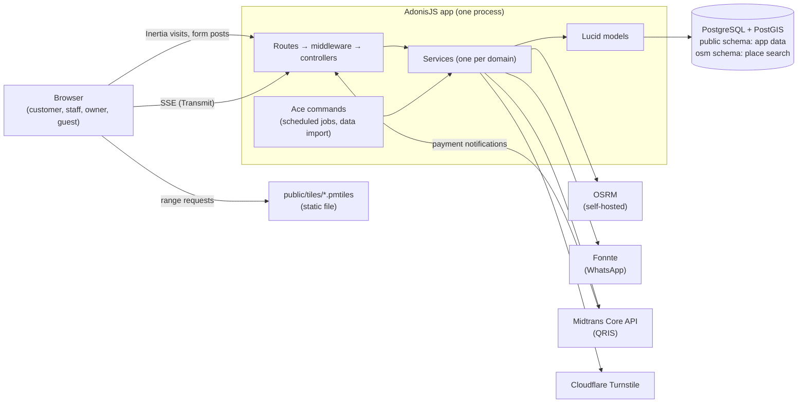
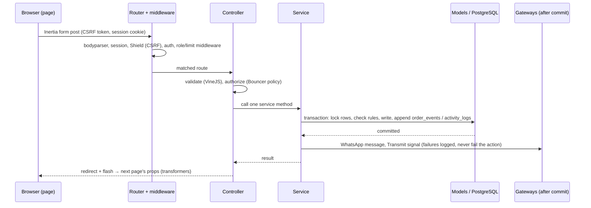
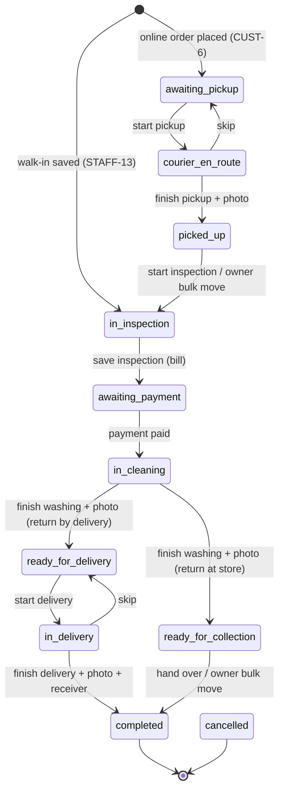
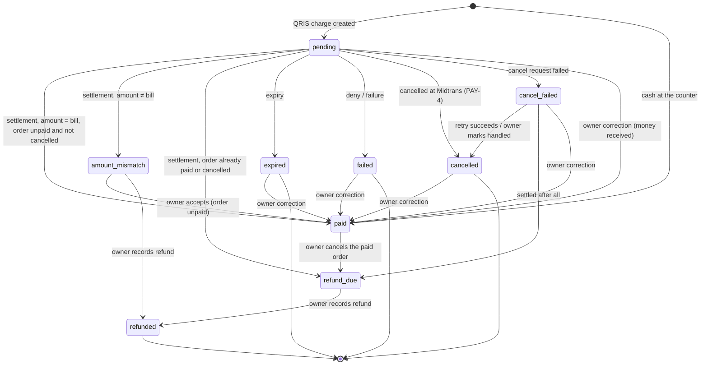

# Architecture

**§1 is set by the project owner.** Do not change it without asking; if you believe a decision must change, say so in your report and why. **§2 onward is written and kept current by the implementer** (first in M0, then whenever modules, routes, schema, state machines or decisions change).

---

## 1. Fixed decisions

### 1.1 Technology

| Area            | Decision                                                                                                                                                                                                                                                                                                                                                                                                                                                                                                                                                                                                                                                                     |
| --------------- | ---------------------------------------------------------------------------------------------------------------------------------------------------------------------------------------------------------------------------------------------------------------------------------------------------------------------------------------------------------------------------------------------------------------------------------------------------------------------------------------------------------------------------------------------------------------------------------------------------------------------------------------------------------------------------- |
| Backend         | What the repo already uses (discover it from `package.json`, `adonisrc.ts`, `config/`): AdonisJS 7, Lucid, VineJS, Japa (unit, functional, browser with Playwright). Add the official packages the PRD needs: `@adonisjs/bouncer` (authorization), `@adonisjs/limiter` (rate limits), `@adonisjs/transmit` (live updates over SSE).                                                                                                                                                                                                                                                                                                                                          |
| Frontend        | Inertia + React (already installed). **Tailwind CSS v4**, **shadcn/ui on the React Aria base** (`shadcn init --base aria`, style `aria-vega`), `react-aria-components`, **`@tabler/icons-react`**. Atomic components and styling rules in `docs/CONVENTIONS.md` §9.                                                                                                                                                                                                                                                                                                                                                                                                          |
| Package manager | **npm**. `package-lock.json` is committed.                                                                                                                                                                                                                                                                                                                                                                                                                                                                                                                                                                                                                                   |
| Database        | **PostgreSQL with PostGIS**. `timestamptz` everywhere; business time zone **Asia/Jakarta**. Sessions in the database store.                                                                                                                                                                                                                                                                                                                                                                                                                                                                                                                                                  |
| Migrations      | Until v1.0.0, schema changes **edit the original create migration** (no alter migrations); the development database is reset. From v1.0.0 on, new migrations. `database/schema.ts` is generated: never edit it by hand.                                                                                                                                                                                                                                                                                                                                                                                                                                                      |
| Local services  | **PostgreSQL + PostGIS: my existing development container** (shared by my projects, not part of this repo, so no duplicate database instance). The project uses its own databases there (development and test) and enables the extensions it needs itself. **The PostgreSQL and PostGIS versions are chosen for production** (a current, supported, comfortable-to-run release); if my container runs an older version, it is upgraded to match production, never the other way round. **Rootless Podman** in this repo runs only the other local services (OSRM, data tools), with one reproducible, documented way to start, stop and reset them. No Docker-only features. |
| Maps            | **Fully self-hosted.** **MapLibre GL JS** with the `pmtiles` protocol and the `@protomaps/basemaps` style, drawing a self-hosted PMTiles extract of Bandung Raya, loaded only on pages that show a map. Place search and labels from an `osm` schema in our PostgreSQL, filled from an OpenStreetMap extract by an ace command. Routing from a self-hosted **OSRM** with a motorbike profile. Map and OSM data files are never committed.                                                                                                                                                                                                                                    |
| WhatsApp        | **Fonnte**, called only from one service class. Without a token (outside production), messages go to the log.                                                                                                                                                                                                                                                                                                                                                                                                                                                                                                                                                                |
| Payments        | **Midtrans Core API** (QRIS: charge, status, cancel, notification signature) over `fetch`, from one gateway class. Sandbox only in development.                                                                                                                                                                                                                                                                                                                                                                                                                                                                                                                              |
| Bot protection  | **Cloudflare Turnstile** on public forms, on by default; Cloudflare's test keys in development and tests.                                                                                                                                                                                                                                                                                                                                                                                                                                                                                                                                                                    |
| Scheduled jobs  | Ace commands (`docs/PRD/shared.md` §10).                                                                                                                                                                                                                                                                                                                                                                                                                                                                                                                                                                                                                                     |
| Uploads         | Proof photos on disk outside `public/`, path from env, served through an authorized route.                                                                                                                                                                                                                                                                                                                                                                                                                                                                                                                                                                                   |
| Language        | UI Indonesian only. Code, comments, docs, commit messages English.                                                                                                                                                                                                                                                                                                                                                                                                                                                                                                                                                                                                           |
| Delivery        | v1.0.0 ships a production `Containerfile` with a health check endpoint. Deployment automation is out of scope.                                                                                                                                                                                                                                                                                                                                                                                                                                                                                                                                                               |

### 1.2 Security requirements (all mandatory)

1. Sessions with secure cookie settings; CSRF and security headers via Shield. The client IP is read from `X-Forwarded-For` only when the request comes from a trusted proxy address (configurable), so per-IP limits see the real client behind a reverse proxy.
2. Authorization through **Bouncer policies**, checked on every route. Functional tests prove each role is refused where it doesn't belong (guest vs customer vs staff vs owner, and a customer vs another customer's order).
3. Rate limits exactly as the PRD states (ACC-2, ACC-3, ACC-4, GUEST-5, PAY-1), plus per-IP limits on the public area check and per-user limits on place search.
4. OTP stored only as a keyed hash, compared in constant time, never logged.
5. Midtrans notifications: verify the signature, confirm the status with Midtrans, process idempotently, never trust amounts from the client. At most one paid payment per order, enforced by the database.
6. Uploads: validate type and size; store outside `public/`; serve only to users allowed to see that order.
7. Secrets only in env, validated in `start/env.ts`; `.env` is never committed. Phone numbers masked in logs.
8. No personal data to any outside service except what `docs/PRD/shared.md` §11 lists.

---

## 2. Overview

Umima.Clean is **one AdonisJS 7 application** (a monolith) that renders React pages through Inertia, stores everything in **one PostgreSQL database with PostGIS**, and talks to a few outside services through one class each. There are no separate frontend or API apps, no queues and no cache servers.



- **Pages**: Inertia + React, server-rendered on first load (NFR-3), then client-side visits. Pages are grouped by role (`inertia/pages/{auth,customer,staff,admin}`); everything else is organized by domain.
- **Database**: PostgreSQL 18 with PostGIS 3.6, the versions chosen for production (§6.1, D17). In development the app uses its own databases on a shared local PostgreSQL server; production runs the same image.
- **Maps**: MapLibre GL JS draws the vector tiles of a PMTiles file in `public/tiles/` (read through the `pmtiles` protocol, styled with `@protomaps/basemaps`), loaded only on pages that show a map (MAP-2, NFR-3). The browser only talks to our own server: place search comes from the `osm` schema (MAP-1), routes from our OSRM (STAFF-6, STAFF-7).
- **Outside services**: Fonnte, Midtrans and Turnstile are called only from their gateway classes (§4.2). Each one failing degrades one feature, never the whole app (NFR-4).
- **Live updates**: Transmit (SSE) sends a small "changed" signal; the page reloads its own props over normal, authorized HTTP (§4.4).
- **Scheduled jobs**: ace commands, run by a system timer in production (§6.5).

## 3. Components

This section is the map of the code. It lists the planned modules by domain; each milestone adds what it builds and corrects names if needed. Names follow `docs/CONVENTIONS.md` (§2 naming, §3 snake_case files, §8 layers).

### 3.1 Backend (`app/`)

**Layers** (CONVENTIONS §8): a controller validates, authorizes and calls one service; a service runs one business process (transactions, several models, outside calls); a model holds entity rules and reusable queries; a transformer shapes props for a page. Roles appear only in URL prefixes and route groups (`/staf`, `/admin`), never in folder names.

| Domain               | Controllers                                                                                                                                                                                                             | Service                                                                                                                 | Models                                                                       | Policy                                       | Milestone |
| -------------------- | ----------------------------------------------------------------------------------------------------------------------------------------------------------------------------------------------------------------------- | ----------------------------------------------------------------------------------------------------------------------- | ---------------------------------------------------------------------------- | -------------------------------------------- | --------- |
| Accounts             | `session_controller`, `registration_controller`, `password_reset_controller`, `otp_controller`, `account_security_controller`, `profile_controller`, `phone_change_controller`                                          | `AccountService` (sign-in, passwords, devices), `OtpService` (codes, limits, flow state in the session)                 | `User`, `OtpCode` (+ `remember_me_tokens`, `sessions`, `rate_limits` tables) | abilities per role (`app/abilities/main.ts`) | M2        |
| Price list           | `services_controller`                                                                                                                                                                                                   | `PriceListService`                                                                                                      | `Service`                                                                    | `ServicePolicy`                              | M3        |
| Service areas        | `service_areas_controller`, `area_check_controller`                                                                                                                                                                     | `AreaService`                                                                                                           | `ServiceArea` (PostGIS polygon)                                              | owner ability                                | M3        |
| Store settings       | `store_settings_controller`                                                                                                                                                                                             | `SettingService`                                                                                                        | `Setting` (key → JSON)                                                       | owner ability                                | M3        |
| Addresses and places | `addresses_controller`, `places_controller`                                                                                                                                                                             | `AddressService`, `PlaceService` (raw SQL on the `osm` schema)                                                          | `CustomerAddress`                                                            | `CustomerAddressPolicy`                      | M4        |
| Orders               | `orders_controller` (customer), `order_tracking_controller` (4-digit unlock), `owner_orders_controller`                                                                                                                 | `OrderService`: placing, cancelling, slots, and **the only place an order changes status** (§5.1)                       | `Order`, `OrderAddress`, `OrderItem`, `OrderEvent`                           | `OrderPolicy`                                | M5        |
| Staff trips          | `trips_controller`                                                                                                                                                                                                      | `TripService` (queues, one active trip per queue for the whole team, each staff member's queue order)                   | `Order` (trip state lives on the order and its events)                       | staff ability                                | M6        |
| Proof photos         | `proof_photos_controller`                                                                                                                                                                                               | `ProofPhotoService` (store, serve, prune)                                                                               | `OrderPhoto`                                                                 | `OrderPolicy`                                | M6        |
| Workshop             | `inspections_controller`, `washing_controller`, `collections_controller`, `print_controller`                                                                                                                            | `WorkshopService` (inspection → bill, washing, collection)                                                              | `Bill`, `BillLine`                                                           | staff ability                                | M7        |
| Payments             | `payments_controller` (customer QRIS), `counter_payments_controller`, `midtrans_notifications_controller`, `payment_reconciliation_controller`                                                                          | `PaymentService`: QRIS, cash, owner corrections, reconciliation, and **the only place a payment changes status** (§5.2) | `Payment`                                                                    | `OrderPolicy`                                | M8        |
| Walk-in orders       | `walk_in_orders_controller`                                                                                                                                                                                             | `OrderService` (walk-in placement)                                                                                      | as orders                                                                    | staff ability                                | M9        |
| Owner area           | `owner_summary_controller`, `customers_controller`, `reports_controller`, `operating_costs_controller`, `activity_logs_controller`, `staff_accounts_controller`, `come_back_reminders_controller`, `exports_controller` | `ReportService`, `StaffAccountService`, `ReminderService` (payment and come-back reminders)                             | `OperatingCost`, `ActivityLog`                                               | owner ability                                | M10       |
| Public pages         | `home_controller`, `legal_controller`, `seo_controller`                                                                                                                                                                 | `SettingService`                                                                                                        |                                                                              | none                                         | M1, M3    |

**Gateways** (one class per outside service, swapped for a fake in every test with `app.container.swap`, CONVENTIONS §0 rule 4):

| Class              | Calls                                                                                     | Without configuration                                                                                              |
| ------------------ | ----------------------------------------------------------------------------------------- | ------------------------------------------------------------------------------------------------------------------ |
| `FonnteGateway`    | `POST https://api.fonnte.com/send`                                                        | no token outside production → the message is written to the log (MSG-4)                                            |
| `MidtransGateway`  | Core API: charge (`payment_type: qris`), status, cancel; verifies notification signatures | no server key → QRIS shown as unavailable (PAY-5)                                                                  |
| `TurnstileGateway` | `POST https://challenges.cloudflare.com/turnstile/v0/siteverify`                          | Cloudflare test keys in development and tests                                                                      |
| `OsrmGateway`      | our OSRM: `/route`, `/table`                                                              | no `OSRM_URL` or OSRM down → straight-line estimate marked "±", queue "Urutan belum dioptimasi" (STAFF-6, STAFF-7) |

**Other backend pieces**

- `app/enums/`: `role_enum`, `order_status_enum` (with stage and label), `payment_status_enum`, `payment_method_enum`, `item_kind_enum`, `service_type_enum`, `return_method_enum`, `order_source_enum`, `photo_kind_enum`, `skip_reason_enum`, `activity_category_enum`, `cost_category_enum`, `otp_purpose_enum`. Each exports an `as const` object, its type and an Indonesian `…Label` map (CONVENTIONS §8).
- `app/validators/`: one VineJS validator per action (`createOrderValidator`, …); the shared phone rule normalizes to `62…` (ACC-1). Messages in `start/validator.ts`.
- `start/limiter.ts`: HTTP-level limits (area check per IP, place search per user). Business limits (sign-in, OTP, unlock digits, QRIS charges) live in their service, because their keys (phone, order) come from the request body.
- `start/transmit.ts`: channel authorization (§4.4).
- `commands/`: `payments_remind` (`node ace payments:remind`, PAY-6) and `photos_prune` (`node ace photos:prune`, PHOTO-3); in M4 `osm_import` (`node ace osm:import`) runs the pipeline of §6.2.
- `database/migrations/`: one create migration per table (`docs/PRD/shared.md` §12), edited in place until v1.0.0. `database/seeders/`: one per domain, run from one index seeder that prints the demo accounts.

### 3.2 Frontend (`inertia/`)

| Folder                  | Holds                                                                                                                                                                                                                                                           |
| ----------------------- | --------------------------------------------------------------------------------------------------------------------------------------------------------------------------------------------------------------------------------------------------------------- |
| `components/ui/`        | shadcn components (React Aria base, `aria-vega`), file names as the CLI generates them                                                                                                                                                                          |
| `components/atoms/`     | logo, status badge (one map from order stage to Tailwind classes), tone badge, initials avatar, photo                                                                                                                                                           |
| `components/molecules/` | phone input, password input, OTP input, quantity stepper, search field, empty state, metric card, Turnstile widget, compare slider, address combobox                                                                                                            |
| `components/organisms/` | site header and footer, landing sections, navigation per area (customer bottom bar, staff bottom bar, owner sidebar), order summary card, bill items, QRIS panel, map panels (location, route, queue), camera view, data table parts, dialogs per owner feature |
| `components/templates/` | one layout per area: public, auth, customer, flow (order steps), staff, owner, print                                                                                                                                                                            |
| `lib/<feature>/`        | non-visual logic shared by components: phone formatting, countdown, map setup (MapLibre + `pmtiles` protocol, loaded only by map components), camera, live updates, form drafts                                                                                 |
| `pages/`                | `home.tsx`, `legal/`, `errors/`, `auth/`, `customer/`, `staff/`, `admin/` (one file per page in the PRD page tables)                                                                                                                                            |

Today (after M1a) the folders hold the starter's pieces: `atoms/` (logo, navigation link, theme toggle), `molecules/` (flash toasts), `organisms/` (page frame) and `templates/` (app, auth and marketing layouts); M1b replaces them with the designed components.

Pages own state and navigation; they get data only through Inertia props (built by transformers) and send data only through Inertia forms. URLs come from the Tuyau route helper. Icons: `@tabler/icons-react`.

## 4. Data flow

### 4.1 One request, from click to database and back



Rules that hold for every flow:

1. **Validation and authorization at the edge.** Every route has a validator for its input and a Bouncer check (`docs/ARCHITECTURE.md` §1.2 rule 2). Customers can only reach their own records; guests reach an order only after the 4-digit unlock (GUEST-4).
2. **One transaction per business action.** The status change, its timeline event and its activity log entry are written together, or not at all (ORD-4, NFR-5).
3. **Concurrency is decided by the database**, not by checks before the transaction: row locks (`FOR UPDATE`) on the order or payment being changed, a lock per pickup slot for capacity (SLOT-3), a lock per queue for the single active trip (STAFF-3), and a partial unique index for "one paid payment per order" (PAY-3).
4. **Outside calls happen after commit** (messages, Midtrans cancels, live signals), so a slow or failing service never holds a lock or rolls back a finished action (MSG-3, NFR-4). The one exception is the QRIS charge, which must succeed before a payment row can be `pending`.

### 4.2 Outside services

| Service                | Called from                                            | When                                                                                    | Data sent (`docs/PRD/shared.md` §11)             | When it fails                                                                                                                                                                                                                   |
| ---------------------- | ------------------------------------------------------ | --------------------------------------------------------------------------------------- | ------------------------------------------------ | ------------------------------------------------------------------------------------------------------------------------------------------------------------------------------------------------------------------------------- |
| Fonnte                 | `FonnteGateway`                                        | OTP codes; the six customer messages (MSG-1)                                            | phone number, message text                       | logged with context; the action continues (MSG-3); OTP screens say the code could not be sent                                                                                                                                   |
| Midtrans Core API      | `MidtransGateway`                                      | "Bayar" pressed (charge), "Cek status", live QR cancel (PAY-4), reconciliation re-check | order reference, amount, customer name and phone | charge: error shown, no payment row; cancel: payment becomes `cancel_failed` (PAY-7)                                                                                                                                            |
| Midtrans notifications | `midtrans_notifications_controller` → `PaymentService` | Midtrans posts a status                                                                 | —                                                | signature checked (SHA-512 of `order_id + status_code + gross_amount + server key`), status confirmed with `GET /v2/{order_id}/status`, processed idempotently; non-2xx makes Midtrans retry (up to 5 times over about 6 hours) |
| Turnstile              | `TurnstileGateway`                                     | public forms (sign-up, sign-in, forgot password, order unlock)                          | token, client IP                                 | the form shows "verification failed, try again"                                                                                                                                                                                 |
| OSRM                   | `OsrmGateway`                                          | queue order, route line, distance/ETA                                                   | nothing leaves our servers                       | estimate "±", "Urutan belum dioptimasi"                                                                                                                                                                                         |
| Map data               | `PlaceService`, static tiles                           | address search, pin label, base map                                                     | —                                                | search returns nothing and the pin is placed by hand (MAP-1); maps show a plain background (MAP-2)                                                                                                                              |

Midtrans facts that shape the design (checked 2026-11-13 in the Midtrans docs): a QRIS charge is `POST /v2/charge` with `payment_type: "qris"`; the response carries the QR image URL in `actions` (`generate-qr-code`) and the QR text in `qr_string`; the default QRIS expiry is 15 minutes, and `custom_expiry` can set it explicitly (we set 15 minutes, PAY-1). Statuses we act on: `pending`, `settlement`, `expire`, `cancel`, `deny`, `failure`. The exact response fields are verified against the sandbox in M8 before they are relied on.

### 4.3 Money and time

Money is whole rupiah in `integer` columns; a bill line stores the listed and the charged price (SVC-3). Timestamps are `timestamptz`; business dates (pickup days, report days, reminder windows) are computed in `Asia/Jakarta` with Luxon.

### 4.4 Live updates

Transmit (SSE) channels: `orders/:id` (one order's page), `staff/queues` (pickup, workshop, delivery queues), `admin/orders` (owner order list). After a status change commits, `OrderService` broadcasts a **signal without personal data** on the affected channels; the open page then asks for its own props again with an Inertia partial reload. The data itself therefore always comes through the normal HTTP route with its policy check, and Transmit's channel authorization (`start/transmit.ts`) only has to decide who may _hear_ that something changed: the order's customer or a session that unlocked it, staff and owner for queues, the owner for the list.

Transmit facts that shape the design (checked 2026-11-13): channel authorization through `transmit.authorize()`; one process needs no transport (Redis is only for several instances, which v1.0.0 doesn't have); the reverse proxy **must not compress** `text/event-stream`, or SSE breaks (recorded for deployment).

## 5. State machines

Both machines follow the same pattern (CONVENTIONS §0 rule 3):

- The allowed transitions are **one table in code** next to the enum (`ORDER_TRANSITIONS` in `app/enums/order_status_enum.ts`, `PAYMENT_TRANSITIONS` in `app/enums/payment_status_enum.ts`), copied from the PRD tables below. The model answers `order.canTransitionTo(status)` / `payment.canTransitionTo(status)`.
- **One service method writes the status**: `OrderService.transitionOrder(order, status, { actor, note }, transaction)` and `PaymentService.transitionPayment(payment, status, { actor, note }, transaction)`. Every flow that changes a status calls it inside its own transaction. It locks the row, refuses a transition that isn't in the table (HTTP 409 with an Indonesian message), writes the new status, appends the event (order: `order_events`; both: `activity_logs` when the actor is staff or owner) and queues the after-commit work (messages, live signal).
- **Tests**: a unit test walks the whole table: every allowed pair succeeds and every other pair (all statuses × all statuses) is refused. Functional tests cover each trigger below, named by its requirement ID.

### 5.1 Order status (ORD-2, ORD-3)



Plus: **any status except `completed` and `cancelled` → `cancelled`** (owner only), and `awaiting_pickup → cancelled` by the customer.

| From                                | To                                            | Trigger (who)                                                                           | Where                                                               | Side effects                                                                                                                                                                                                                              | Req                                    |
| ----------------------------------- | --------------------------------------------- | --------------------------------------------------------------------------------------- | ------------------------------------------------------------------- | ----------------------------------------------------------------------------------------------------------------------------------------------------------------------------------------------------------------------------------------- | -------------------------------------- |
| (new)                               | `awaiting_pickup`                             | customer places an online order                                                         | `OrderService.placeOnlineOrder`                                     | slot capacity locked and re-checked; both addresses re-checked against active areas; "order received" message                                                                                                                             | CUST-6, SLOT-3, AREA-4, MSG-1.1        |
| (new)                               | `in_inspection`                               | staff save a walk-in                                                                    | `OrderService.placeWalkInOrder`                                     | 1–3 intake photos; no message yet                                                                                                                                                                                                         | STAFF-12, STAFF-13                     |
| `awaiting_pickup`                   | `courier_en_route`                            | staff start a pickup                                                                    | `TripService.startTrip`                                             | refused while anyone holds an active pickup (one lock for the whole team); "courier on the way" message                                                                                                                                   | STAFF-3, STAFF-4, MSG-1.2              |
| `courier_en_route`                  | `picked_up`                                   | trip holder or owner finishes                                                           | `TripService.finishTrip`                                            | proof photo required                                                                                                                                                                                                                      | STAFF-4, PHOTO-1                       |
| `courier_en_route`                  | `awaiting_pickup`                             | trip holder or owner skips                                                              | `TripService.skipTrip`                                              | reason + note on the timeline; stop goes last today                                                                                                                                                                                       | STAFF-4, STAFF-5, STAFF-6              |
| `picked_up`                         | `in_inspection`                               | staff start inspection; owner bulk move                                                 | `WorkshopService.startInspection`, `OrderService.moveOrdersByOwner` |                                                                                                                                                                                                                                           | STAFF-9, OWN-3                         |
| `in_inspection`                     | `awaiting_payment`                            | staff save the inspection                                                               | `WorkshopService.saveInspection`                                    | bill created; a re-inspection before payment replaces it and cancels any live QRIS (PAY-4); "bill" message for online orders                                                                                                              | STAFF-9, SVC-3, MSG-1.3                |
| `awaiting_payment`                  | `in_cleaning`                                 | a payment becomes `paid` (QRIS settlement, cash, owner correction or accepted mismatch) | `PaymentService` (calls `transitionOrder` in the same transaction)  | walk-in: "order received" message after counter payment                                                                                                                                                                                   | PAY-2, STAFF-14, OWN-4, OWN-5, MSG-1.1 |
| `in_cleaning`                       | `ready_for_delivery` / `ready_for_collection` | staff finish washing                                                                    | `WorkshopService.finishWashing`                                     | proof photo required; target chosen by the return method; items marked washed                                                                                                                                                             | STAFF-10                               |
| `ready_for_delivery`                | `in_delivery`                                 | staff start a delivery                                                                  | `TripService.startTrip`                                             | refused while another delivery is active                                                                                                                                                                                                  | STAFF-3, STAFF-4                       |
| `in_delivery`                       | `completed`                                   | trip holder or owner finishes                                                           | `TripService.finishTrip`                                            | proof photo + receiver name                                                                                                                                                                                                               | STAFF-4                                |
| `in_delivery`                       | `ready_for_delivery`                          | trip holder or owner skips                                                              | `TripService.skipTrip`                                              | reason on the timeline                                                                                                                                                                                                                    | STAFF-4, STAFF-5                       |
| `ready_for_collection`              | `completed`                                   | staff hand over; owner bulk move                                                        | `WorkshopService.handOverOrder`, `OrderService.moveOrdersByOwner`   |                                                                                                                                                                                                                                           | STAFF-11, OWN-3                        |
| `awaiting_pickup`                   | `cancelled`                                   | customer, with a reason                                                                 | `OrderService.cancelOrderByCustomer`                                | no message                                                                                                                                                                                                                                | CUST-8                                 |
| any except `completed`, `cancelled` | `cancelled`                                   | owner, with a reason (one or several orders)                                            | `OrderService.cancelOrdersByOwner`                                  | an active trip on that order ends and the queue is free again (STAFF-3); live QRIS cancelled (PAY-4); a `paid` payment → `refund_due` (PAY-7); "cancelled by the shop" message if the customer was already told about the order (MSG-1.5) | OWN-3, STAFF-3, PAY-4, PAY-7           |

### 5.2 Payment status (PAY-3, PAY-7)



| From                                                         | To                                                               | Trigger                                                                                                                                                                         | Where                                                                   | Req                      |
| ------------------------------------------------------------ | ---------------------------------------------------------------- | ------------------------------------------------------------------------------------------------------------------------------------------------------------------------------- | ----------------------------------------------------------------------- | ------------------------ |
| (new)                                                        | `pending`                                                        | "Bayar" pressed (customer online, staff at the counter); at most 5 new charges per order per 15 minutes; a live QR is shown again instead of a new one                          | `PaymentService.startQrisPayment`                                       | PAY-1, CUST-10, STAFF-14 |
| (new)                                                        | `paid`                                                           | cash received at the counter                                                                                                                                                    | `PaymentService.recordCashPayment`                                      | STAFF-14, PAY-4          |
| `pending`                                                    | `paid` / `amount_mismatch` / `refund_due` / `expired` / `failed` | a verified Midtrans notification or "Cek status", decided by the status Midtrans confirms                                                                                       | `PaymentService.applyMidtransStatus`                                    | PAY-2, PAY-4, PAY-7      |
| `pending`                                                    | `cancelled` / `cancel_failed`                                    | the bill was replaced, or the order was paid another way or cancelled; after commit the live charge is cancelled at Midtrans and the confirmed status decides                   | `PaymentService.cancelLiveQrisPayments`                                 | PAY-4                    |
| `cancel_failed`                                              | `cancelled`                                                      | retry succeeds, or the owner marks it handled                                                                                                                                   | `PaymentService.retryCancel`, `PaymentService.markCancelHandled`        | OWN-5                    |
| `cancel_failed`                                              | `refund_due`                                                     | Midtrans reports it was settled                                                                                                                                                 | `PaymentService.applyMidtransStatus`                                    | PAY-7                    |
| `amount_mismatch`                                            | `paid`                                                           | owner accepts while the order has no paid payment (the order then moves to `in_cleaning`)                                                                                       | `PaymentService.acceptMismatch`                                         | OWN-5                    |
| `amount_mismatch`, `refund_due`                              | `refunded`                                                       | owner records a refund made outside the app, with a note                                                                                                                        | `PaymentService.recordRefund`                                           | OWN-5                    |
| `paid`                                                       | `refund_due`                                                     | owner cancels a paid order                                                                                                                                                      | `OrderService.cancelOrdersByOwner` → `PaymentService.transitionPayment` | OWN-3, PAY-7             |
| `pending`, `expired`, `failed`, `cancelled`, `cancel_failed` | `paid`                                                           | owner correction with a reason: the money was in fact received (e.g. a QRIS recorded as cash) and the order has no other paid payment; the order then moves on like any payment | `PaymentService.correctPayment`                                         | OWN-4, PAY-7             |

"At most one `paid` payment per order" is enforced by a partial unique index (`payments(order_id) WHERE status = 'paid'`); a violation inside `transitionPayment` becomes "Pesanan ini sudah dibayar." `expired`, `failed`, `cancelled` and `refunded` are final except for the owner correction to `paid`. An owner correction that only changes method, channel or amount keeps the status. Payment reminders (PAY-6) skip an order while it has a payment in `amount_mismatch`.

## 6. Local services and data

All commands run in the repository root and work in fish and bash unless marked otherwise. Database credentials come from `.env` (copy `.env.example` first). Map data files live in git-ignored folders (`storage/`, `public/tiles/`).

`compose.yaml` holds the routing service (`osrm`) and the one-off data tools (`psql`, `map-tools`, `osrm-build`, `pmtiles`, profile `tools`). Tools run with `podman compose --profile tools run --rm -T <tool> …` (`-T`: no terminal, so psql never opens a pager). The database server itself is not in `compose.yaml` (§6.1).

### 6.1 Database (PostgreSQL + PostGIS)

**Versions** (D17): **PostgreSQL 18 with PostGIS 3.6**, image `docker.io/postgis/postgis:18-3.6` (PostgreSQL 18.6, PostGIS 3.6.4 on 2026-11-13). Production runs this image; the development server must run the same major versions. If the development server is older, it is upgraded to match (runbook below), never the other way round.

**Development server**: development and tests use their own databases on a **shared local PostgreSQL server** (one instance for several projects, D18). This project needs:

| Database              | Used by                                   | `.env` file                                                |
| --------------------- | ----------------------------------------- | ---------------------------------------------------------- |
| `umimaclean_dev`      | `npm run dev`, seeders                    | `.env`: `DB_DATABASE=umimaclean_dev`                       |
| `umimaclean_dev_test` | `npm test` (migrates itself on every run) | `.env.test` (committed): `DB_DATABASE=umimaclean_dev_test` |

`.env` also needs `DB_HOST`, `DB_PORT`, `DB_USER` and `DB_PASSWORD` of a role allowed to create databases and extensions (on the development machine: `127.0.0.1`, `5432`, the server's superuser).

**Create the databases** (once, safe to repeat; creates both databases from `template0` and enables `postgis`, `pg_trgm` and `unaccent`, D19):

```sh
podman compose --profile tools run --rm -T psql -d postgres -f /database/create_databases.sql
```

| Task                                  | Command                                                                                                                          |
| ------------------------------------- | -------------------------------------------------------------------------------------------------------------------------------- |
| Open psql on the development database | `podman compose --profile tools run --rm psql`                                                                                   |
| Reset the development database        | `node ace migration:fresh` (the `osm` schema is outside `public` and survives; drop it with `DROP SCHEMA osm CASCADE` if needed) |
| Reset the test database               | nothing to do: `npm test` migrates it at the start of the run and rolls back at the end                                          |

#### Upgrading the shared development server to the production versions

Needed when the server runs an older major version than §6.1 names (on the development machine on 2026-11-13: PostgreSQL 17.5 with PostGIS 3.5.2 from `docker.io/postgis/postgis:17-3.5`, run by the Quadlet unit `~/.config/containers/systemd/postgres.container`, data in the volume `postgres_data`). PostgreSQL major versions can't read each other's data directory, so the upgrade is: dump every database, start the new version on a **new** volume, restore, compare. The old volume is kept until the new server is verified, so the way back is always open. The procedure was rehearsed on 2026-11-13 by restoring dumps of every database into a throwaway PostgreSQL 18.6 container: all row counts matched and PostGIS came up as 3.6.4.

Run in **bash** (type `bash` first if your shell is fish). Stop every app that uses the server first.

```bash
mkdir -p ~/pg-upgrade && cd ~/pg-upgrade
PGUSER=user   # the server's superuser (POSTGRES_USER of the container)

# 1. What is there: every non-template database, and a row count per table to compare later
podman exec postgres psql -U "$PGUSER" -d postgres -Atc "SELECT datname FROM pg_database WHERE NOT datistemplate AND datname <> 'postgres' ORDER BY 1" > databases.txt
cat databases.txt
cat > counts.sql <<'EOF'
SELECT table_schema || '.' || table_name || ' ' ||
       (xpath('/row/c/text()', query_to_xml(format('SELECT count(*) AS c FROM %I.%I', table_schema, table_name), false, true, '')))[1]::text
FROM information_schema.tables
WHERE table_type = 'BASE TABLE' AND table_schema NOT IN ('pg_catalog', 'information_schema')
ORDER BY 1;
EOF
while read -r db; do podman exec -i postgres psql -U "$PGUSER" -d "$db" -At < counts.sql > "$db.counts.before"; done < databases.txt

# 2. Dump roles and every database (custom format); every dump must be listed as ok
podman exec postgres pg_dumpall -U "$PGUSER" --globals-only > globals.sql
while read -r db; do podman exec postgres pg_dump -U "$PGUSER" -Fc -d "$db" > "$db.dump" || echo "FAILED $db"; done < databases.txt
for f in *.dump; do podman exec -i postgres pg_restore -l < "$f" > /dev/null && echo "ok $f"; done

# 3. Stop the old server; keep its unit file and its volume for the way back
systemctl --user stop postgres.service
cp ~/.config/containers/systemd/postgres.container ~/pg-upgrade/postgres.container.17
podman volume inspect postgres_data > /dev/null && echo "old volume kept"

# 4. Point the unit at the new image and a new volume (PostgreSQL 18 images keep data under /var/lib/postgresql)
sed -i \
  -e 's|^Description=.*|Description=PostgreSQL 18 (development)|' \
  -e 's|^Image=.*|Image=docker.io/postgis/postgis:18-3.6@sha256:4a43e3c3e5d55b9208240fc71db543b79c638766280c625a425bd0a2390989c4|' \
  -e 's|^Volume=postgres_data:/var/lib/postgresql/data|Volume=postgres18_data:/var/lib/postgresql|' \
  ~/.config/containers/systemd/postgres.container
grep -E '^(Description|Image|Volume)=' ~/.config/containers/systemd/postgres.container
systemctl --user daemon-reload
systemctl --user start postgres.service
until podman exec postgres pg_isready -U "$PGUSER" -d postgres -q; do sleep 2; done
podman exec postgres psql -U "$PGUSER" -d postgres -Atc 'SELECT version()'

# 5. Restore: roles ("role … already exists" for the superuser is expected), then each database.
#    The database named after the superuser is created by the image itself, so it is restored without -C.
podman exec -i postgres psql -U "$PGUSER" -d postgres < globals.sql
while read -r db; do
  if [ "$db" = "$PGUSER" ]; then
    podman exec -i postgres pg_restore -U "$PGUSER" -d "$db" --exit-on-error < "$db.dump" || echo "FAILED $db"
  else
    podman exec -i postgres pg_restore -U "$PGUSER" -C -d postgres --exit-on-error < "$db.dump" || echo "FAILED $db"
  fi
done < databases.txt

# 6. Verify: same tables and row counts in every database (the superuser's database gains the
#    PostGIS tables the new image installs there; that difference is expected)
while read -r db; do
  podman exec -i postgres psql -U "$PGUSER" -d "$db" -At < counts.sql > "$db.counts.after"
  diff -q "$db.counts.before" "$db.counts.after" > /dev/null && echo "same $db" || echo "DIFF $db"
done < databases.txt
podman exec postgres vacuumdb -U "$PGUSER" --all --analyze-in-stages
```

**Way back** (if anything above fails): `systemctl --user stop postgres.service`, copy `~/pg-upgrade/postgres.container.17` back to `~/.config/containers/systemd/postgres.container`, `systemctl --user daemon-reload`, `systemctl --user start postgres.service`. The old volume `postgres_data` was never touched.

**Afterwards**, once every project works on the new server: delete the dumps in `~/pg-upgrade` (they hold every project's data) and remove the old volume with `podman volume rm postgres_data`.

### 6.2 Map data: OSM extract → `osm` schema (MAP-1)

Loads the `osm` schema into the development database. In M4 an ace command (`node ace osm:import`) runs steps 3–5; until then these are the documented commands.

```sh
# 1. Tools image (once): osmium-tool + osm2pgsql
podman compose --profile tools build map-tools

# 2. Download the Java extract (899 MB) and check it
mkdir -p storage/osm
curl -fL -o storage/osm/java-latest.osm.pbf https://download.geofabrik.de/asia/indonesia/java-latest.osm.pbf
curl -fL -o storage/osm/java-latest.osm.pbf.md5 https://download.geofabrik.de/asia/indonesia/java-latest.osm.pbf.md5
cd storage/osm && md5sum -c java-latest.osm.pbf.md5 && cd ../..

# 3. Clip to Bandung Raya (73 MB)
podman compose --profile tools run --rm -T map-tools osmium extract --bbox=107.20,-7.37,107.99,-6.76 --strategy=smart --option=types=multipolygon,boundary --overwrite --output=/data/bandung-raya.osm.pbf /data/java-latest.osm.pbf

# 4. Create the osm schema and load the staging tables
podman compose --profile tools run --rm -T psql -q -f /maps/osm_schema.sql
podman compose --profile tools run --rm -T psql -q -c 'CREATE SCHEMA IF NOT EXISTS osm_import'
podman compose --profile tools run --rm -T map-tools sh -c 'PGPASSWORD="$DB_PASSWORD" osm2pgsql --create --output=flex --style=/maps/osm_import.lua --schema=osm_import --host="$DB_HOST" --port="$DB_PORT" --user="$DB_USER" --database="$DB_DATABASE" /data/bandung-raya.osm.pbf'

# 5. Swap the staging data into the osm tables in one transaction
podman compose --profile tools run --rm -T psql -q --single-transaction -f /maps/osm_build.sql
```

Result on 2026-11-13 (data up to 2026-11-12T21:23Z): 13,213 roads, 14,457 places, 500 boundaries (10 kota/kabupaten, 64 kecamatan, 426 kelurahan/desa), 30 MB with indexes; clip 15 s, osm2pgsql 11 s, swap 3 s. The schema is outside `public`, so migrations and test resets leave it alone. Files: `maps/osm_schema.sql` (tables, indexes, the `osm.normalize` search function), `maps/osm_import.lua` (what is kept from OSM), `maps/osm_build.sql` (merge streets per kelurahan, swap).

### 6.3 Routing: OSRM with the motorbike profile (STAFF-6, STAFF-7)

Needs `storage/osm/bandung-raya.osm.pbf` from §6.2 step 3.

```sh
mkdir -p storage/osrm
cp storage/osm/bandung-raya.osm.pbf storage/osrm/
podman compose --profile tools run --rm -T osrm-build osrm-extract --profile=/opt/motorbike.lua /data/bandung-raya.osm.pbf
podman compose --profile tools run --rm -T osrm-build osrm-contract /data/bandung-raya.osrm
rm storage/osrm/bandung-raya.osm.pbf
podman compose up -d osrm
curl -s --retry 10 --retry-connrefused 'http://127.0.0.1:5000/nearest/v1/driving/107.6186,-6.9026'   # {"code":"Ok",…}
```

Stop with `podman compose stop osrm`, remove with `podman compose down`. Result: 23 files, 242 MB; extract 19 s (peak 1.0 GB RAM), contract 26 s (peak 0.3 GB RAM). Contraction Hierarchies (`osrm-contract`, `--algorithm ch`) because the graph is static (no live traffic), so MLD's fast re-customization buys nothing while CH answers `/route` and `/table` faster. The files only load in the OSRM version that built them, so `osrm` and `osrm-build` share one image reference in `compose.yaml`. Check that toll roads are avoided: a route from Pasteur to Cileunyi (`/route/v1/driving/107.5900,-6.8935;107.7465,-6.9395?steps=true`) takes surface streets and has no `motorway` or `toll` class, although the data contains the Padalarang–Cileunyi toll road.

Each staff member's queue order (STAFF-6) is one OSRM `/table` request from that staff member's position (or the shop without GPS); the plan is kept per staff member and recomputed only when a stop is finished or skipped or the queue changes.

### 6.4 Base map: PMTiles extract (MAP-2)

```sh
mkdir -p public/tiles
podman compose --profile tools run --rm -T pmtiles extract https://build.protomaps.com/20261112.pmtiles /out/bandung-raya-20261112.pmtiles --bbox=107.20,-7.37,107.99,-6.76
```

Reads only the tiles inside the box from the public Protomaps daily build over HTTP range requests (68 MB transferred, 17–27 s). Result: `public/tiles/bandung-raya-20261112.pmtiles`, 62 MB, zoom 0–15, Protomaps basemap tileset v4.15.2. MapLibre GL JS reads it through the `pmtiles` protocol and draws it with a style from `@protomaps/basemaps`, whose major version must match the tileset's (v4). The file name carries the build date, so a new build is a new URL and browsers can cache tiles forever. Available builds are listed at `https://build-metadata.protomaps.dev/builds.json`; before switching builds, check its tileset version with `podman compose --profile tools run --rm -T pmtiles show /out/<file>`.

### 6.5 Scheduled jobs

| Job                          | Command (from M8 / M11)    | Schedule                                                                        |
| ---------------------------- | -------------------------- | ------------------------------------------------------------------------------- |
| Payment reminders (PAY-6)    | `node ace payments:remind` | every 15 minutes; the command checks the 10:00–15:00 Asia/Jakarta window itself |
| Prune proof photos (PHOTO-3) | `node ace photos:prune`    | daily                                                                           |

Both commands are idempotent (running them twice in a row sends or deletes nothing twice), so a missed or doubled run is harmless.

- **Locally**: run them by hand when testing those features. Tests call the service method with a fixed "now" instead of waiting for a clock.
- **Production**: a **systemd timer** on the host runs each command in a one-shot container from the app image (`OnCalendar=*:0/15` and `daily`, `Persistent=true` so a run missed while the server was down happens at boot). This fits the rootless Podman setup (Quadlet units are systemd units), adds no dependency and keeps jobs out of the web process. The unit files come with the production `Containerfile` in M12.

### 6.6 Tests

`npm test` runs the unit, functional and browser suites against the test database (`.env.test`). The runner migrates that database before the first test and rolls the migrations back after the last one (`testUtils.db().migrate()` in `tests/bootstrap.ts`, without regenerating `database/schema.ts`), so a freshly created test database needs nothing else. Each test that touches data wraps itself in a global transaction.

## 7. Decisions log

Every decision not covered by §1, and **every workaround**, gets an entry: number, date, decision, reason, alternatives considered, and links.

| #      | Date        | Decision                                                                                                                                                                                                                                                                                                                               | Reason                                                                                                                                                                                                                                                                                                                                                                                                                                                             | Alternatives considered                                                                                                                                                                        |
| ------ | ----------- | -------------------------------------------------------------------------------------------------------------------------------------------------------------------------------------------------------------------------------------------------------------------------------------------------------------------------------------- | ------------------------------------------------------------------------------------------------------------------------------------------------------------------------------------------------------------------------------------------------------------------------------------------------------------------------------------------------------------------------------------------------------------------------------------------------------------------ | ---------------------------------------------------------------------------------------------------------------------------------------------------------------------------------------------- |
| D1     | 2026-11-13  | `compose.yaml` holds OSRM and the one-off data tools (profile `tools`), run with `podman compose` (provider `podman-compose`); the database server is not in it (D18)                                                                                                                                                                  | Readable, one file to start, stop and run everything this repository needs; only portable compose features (no Docker-only features). Tools read credentials from the same `.env` as the app                                                                                                                                                                                                                                                                       | `podman kube play` (built in, but Kubernetes YAML is harder to read), Quadlet units (production-style, awkward for a dev checkout), plain `podman run` lines (long, repeated image references) |
| Domain | Controllers | Service                                                                                                                                                                                                                                                                                                                                | Models                                                                                                                                                                                                                                                                                                                                                                                                                                                             | Policy                                                                                                                                                                                         | Milestone |
| D2     | 2026-11-13  | Container images are pinned by tag **and** digest                                                                                                                                                                                                                                                                                      | `postgis/postgis:18-3.6` is a moving tag (patch updates); the digest makes every machine run the same build (AGENTS.md: pin exact versions)                                                                                                                                                                                                                                                                                                                        | tag only                                                                                                                                                                                       |
| D3     | 2026-11-13  | PostGIS 3.6, not 3.7                                                                                                                                                                                                                                                                                                                   | 3.7.0 was published days before M0; 3.6 is the mature line and still gets fixes. Revisit at M12                                                                                                                                                                                                                                                                                                                                                                    | `18-3.7`                                                                                                                                                                                       |
| D4     | 2026-11-13  | OSRM image from GHCR (`v26.11.0-debian`), Contraction Hierarchies                                                                                                                                                                                                                                                                      | The project publishes on GHCR; Docker Hub stopped at v5.25.0 (2021). CH: see §6.3                                                                                                                                                                                                                                                                                                                                                                                  | Docker Hub image (stale), MLD                                                                                                                                                                  |
| D5     | 2026-11-13  | `osmium` and `osm2pgsql` run from a small Debian image built from `maps/Containerfile` (compose service `map-tools`); `psql` runs from the production PostGIS image (compose service `psql`)                                                                                                                                           | No official images exist; DEPENDENCIES §4 prefers containers over host installs; Debian packages are maintained (osm2pgsql 2.3.1 from trixie-backports)                                                                                                                                                                                                                                                                                                            | host packages (`dnf`/`apt`), the community image `iboates/osm2pgsql`                                                                                                                           |
| D6     | 2026-11-13  | Map data covers the box 107.20–107.99 E, 7.37–6.76 S                                                                                                                                                                                                                                                                                   | The extent of the 64 kecamatan of AREA-1 (107.25–107.93 E, 7.32–6.81 S) plus about 5 km, so streets and routes just outside a border still work                                                                                                                                                                                                                                                                                                                    | a larger box including Kabupaten Bandung Barat (not in AREA-1)                                                                                                                                 |
| D7     | 2026-11-13  | The `osm` schema is created from `maps/osm_schema.sql`, not migrations; imports go to a staging schema and are swapped in one transaction                                                                                                                                                                                              | It is reference data rebuilt from a file, not app data: migrations and test resets must not drop it, and a refresh must never show empty search results                                                                                                                                                                                                                                                                                                            | Lucid migrations (would be wiped by `migration:fresh`), loading straight into the live tables                                                                                                  |
| D8     | 2026-11-13  | **Workaround**: `osm.normalize` is marked `IMMUTABLE` although it calls `unaccent()`, which is `STABLE`                                                                                                                                                                                                                                | Generated search columns need an immutable function. Passing the dictionary explicitly (`unaccent('public.unaccent', …)`) removes the search-path lookup that makes `unaccent` stable, so the label is safe. Without it, `CREATE TABLE` fails. Comment in `maps/osm_schema.sql`. See PostgreSQL docs on [function volatility](https://www.postgresql.org/docs/current/xfunc-volatility.html) and [unaccent](https://www.postgresql.org/docs/current/unaccent.html) | a trigger-maintained column (more code), searching without a stored column (no index)                                                                                                          |
| D9     | 2026-11-13  | **Workaround**: `maps/motorbike.lua` replaces car.lua's global `WayHandlers.maxspeed` with a no-op                                                                                                                                                                                                                                     | Legal maxspeed tags would raise motorbike speeds above real city traffic, and car.lua has no option to skip them. Without it, ETAs on tagged roads are too optimistic. Comment in the profile; [OSRM profiles docs](https://github.com/Project-OSRM/osrm-backend/blob/master/docs/profiles.md)                                                                                                                                                                     | copying car.lua's whole `process_way` minus one handler (60+ lines to keep in sync)                                                                                                            |
| D10    | 2026-11-13  | The motorbike profile leaves the driving side unset                                                                                                                                                                                                                                                                                    | Since OSRM v26.10, the driving side is resolved per way from location data, and car.lua says to leave `left_hand_driving` unset                                                                                                                                                                                                                                                                                                                                    | forcing `left_hand_driving = true`                                                                                                                                                             |
| D11    | 2026-11-13  | Base map from a pinned Protomaps daily build, file named after the build date                                                                                                                                                                                                                                                          | A dated file is reproducible and cacheable forever; Protomaps builds are ODbL data in a maintained schema                                                                                                                                                                                                                                                                                                                                                          | building tiles ourselves with planetiler (more tooling, more RAM), an OpenMapTiles build (different schema)                                                                                    |
| D12    | 2026-11-13  | The generated `.adonisjs/` directory stays committed                                                                                                                                                                                                                                                                                   | The AdonisJS docs (Codegen): "The `.adonisjs` directory is generated, but it is not a disposable build artifact. You must commit it to Git." Without it a fresh clone does not typecheck. Refresh with `node ace codegen` after switching branches                                                                                                                                                                                                                 | ignoring it and generating in CI                                                                                                                                                               |
| D13    | 2026-11-13  | Scheduled jobs: idempotent ace commands, run by systemd timers in production, by hand locally (§6.5)                                                                                                                                                                                                                                   | No dependency, survives web restarts, catches missed runs (`Persistent=true`), fits rootless Podman + Quadlet                                                                                                                                                                                                                                                                                                                                                      | a sleep loop in a container (no missed-run handling, drifts), an in-process scheduler package (not official AdonisJS, runs twice with two web processes)                                       |
| D14    | 2026-11-13  | Map data and future uploads live in git-ignored `storage/` and `public/tiles/`                                                                                                                                                                                                                                                         | AGENTS.md §7: map/OSM/OSRM data and uploads are never committed                                                                                                                                                                                                                                                                                                                                                                                                    | a folder outside the repository (harder to find)                                                                                                                                               |
| D15    | 2026-11-13  | The SQL and Lua files in `maps/` start with a short header comment                                                                                                                                                                                                                                                                     | Like migrations (CONVENTIONS §8), they define a schema or a profile whose purpose and limits aren't visible from the statements alone                                                                                                                                                                                                                                                                                                                              | no header (CONVENTIONS §10 default)                                                                                                                                                            |
| D16    | 2026-11-13  | Kecamatan boundaries: OCHA COD-AB for Indonesia (BPS data) on HDX, CC BY-IGO; the filtered file for the 64 kecamatan is produced in M3                                                                                                                                                                                                 | The only licensed public dataset with BPS kecamatan codes and names; the license allows reuse with credit (AREA-1). Credit text for pin maps: "Batas wilayah: BPS, via HDX (CC BY-IGO)"                                                                                                                                                                                                                                                                            | OSM admin boundaries (incomplete for kecamatan outside Kota Bandung, names not BPS)                                                                                                            |
| D17    | 2026-11-13  | Production database: **PostgreSQL 18 + PostGIS 3.6** (`postgis/postgis:18-3.6`); development servers match it                                                                                                                                                                                                                          | PostgreSQL 18 is the current major version, released in September 2025 and supported until November 2030, with a year of patch releases behind it (18.6), so it is both current and comfortable to run. PostGIS 3.6 is its mature PostGIS line (D3). Development on the same versions means no surprises between the two                                                                                                                                           | PostgreSQL 17 (one major behind, shorter support), 19 (not released yet)                                                                                                                       |
| D18    | 2026-11-13  | Development and tests use their own databases on a shared local PostgreSQL server instead of a container of their own                                                                                                                                                                                                                  | The owner runs one PostgreSQL instance for several projects on purpose, so there is no duplicate server. The project only needs two databases and three extensions on it (§6.1)                                                                                                                                                                                                                                                                                    | a database container in `compose.yaml` (removed)                                                                                                                                               |
| D19    | 2026-11-13  | Databases are created from `template0`, and the extensions (`postgis`, `pg_trgm`, `unaccent`) are created once by a superuser in `database/create_databases.sql`, not by migrations                                                                                                                                                    | On a shared server, `template1` can carry objects or settings other projects added (on the development machine it also refuses `CREATE DATABASE` because of a collation version mismatch); `template0` is the pristine template. Creating extensions needs superuser rights that the app's database role should not have in production                                                                                                                             | `CREATE EXTENSION` in migrations (needs a superuser app role), copying `template1`                                                                                                             |
| D20    | 2026-11-13  | Database names `umimaclean_dev` and `umimaclean_dev_test`                                                                                                                                                                                                                                                                              | The shared server already holds other databases named `umimaclean` and `umimaclean_test`; distinct names guarantee this project's test run (which migrates and rolls back its database) can never touch them                                                                                                                                                                                                                                                       | reusing `umimaclean_test` (would destroy another project's data)                                                                                                                               |
| D21    | 2026-11-13  | Upgrading the development server: dump every database, start the new major version on a new volume, restore, compare row counts, keep the old volume until verified (§6.1)                                                                                                                                                             | PostgreSQL major versions can't read each other's data files; a dump and restore is the simplest path and leaves the old data untouched for the way back. Rehearsed against a throwaway PostgreSQL 18.6 container: all row counts matched                                                                                                                                                                                                                          | `pg_upgrade` (needs both versions' binaries in one container), upgrading in place on the old volume (no way back)                                                                              |
| D22    | 2026-11-13  | The test runner migrates its own database: `testUtils.db().migrate()` in `tests/bootstrap.ts` runs the migrations before the first test and rolls them back after the last one                                                                                                                                                         | A freshly created test database works with no manual step, and every run starts from the current create migrations. The test utility runs `migration:run --no-schema-generate`, so `database/schema.ts` is never rewritten by a test run                                                                                                                                                                                                                           | migrating by hand before testing (forgotten after every migration change), `migration:fresh` in a hook (rewrites `schema.ts`)                                                                  |
| D23    | 2026-11-13  | Two conventions are enforced by tooling: TypeScript's `noImplicitOverride` (CONVENTIONS §5, both `tsconfig.json` and `inertia/tsconfig.json`) and the type-aware `@typescript-eslint/no-deprecated` rule (CONVENTIONS §12, `eslint.config.js`, using the TypeScript project service; the generated `.adonisjs/` is excluded as before) | A rule a tool checks can't be forgotten in review. Both already pass on the generated `database/schema.ts`                                                                                                                                                                                                                                                                                                                                                         | checking by hand in review                                                                                                                                                                     |
| D24    | 2026-11-13  | Comments that the framework's generators wrote into `config/`, `bin/`, `start/` and `adonisrc.ts` were removed; the few that explain a choice were kept or rewritten (CORS origin, test hash cost, synchronous dev logs, the composite TypeScript project). `ace.js` is left as generated, because the build overwrites it             | CONVENTIONS §10: no file headers, no comments that repeat the code. The removed comments described what each option does, which the AdonisJS docs already cover                                                                                                                                                                                                                                                                                                    | keeping the generated comments (most of these files would be two thirds comments)                                                                                                              |
| D25    | 2026-11-13  | Unused starter code removed: `providers/api_provider.ts` (`ctx.serialize`, no caller), the settings layout and the `Section` component (no page used them), the `InertiaProps` type, and the exception handler's `handle` and `report` methods that only called the base class                                                         | CONVENTIONS §1 and §6: no code for hypothetical needs, no wrappers that add nothing. Nothing called any of it, so behavior is unchanged                                                                                                                                                                                                                                                                                                                            | keeping them for later (they can be written when a feature needs them)                                                                                                                         |
| D26    | 2026-11-13  | The starter's signed-in page moved from `pages/dashboard.tsx` to `pages/customer/dashboard.tsx`; its URL `/dashboard` and route name stay                                                                                                                                                                                              | CONVENTIONS §9: pages live in their role's folder. Only customers can sign up today; M2 replaces the page with the home pages per role                                                                                                                                                                                                                                                                                                                             | leaving it at the root until M2                                                                                                                                                                |
