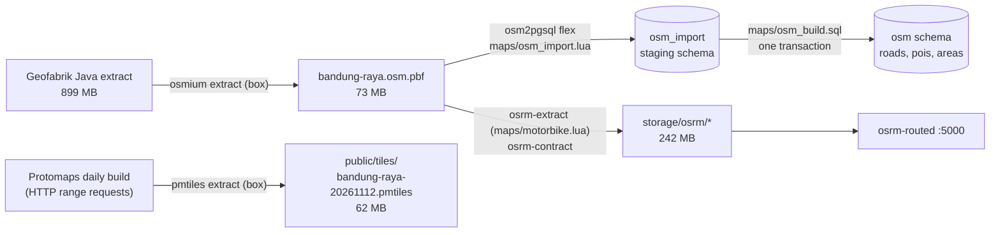

# M0 evidence: spikes and plan

Date: 2026-11-13. Version: none (M0 has no version bump). No application code was written.

This is the record of M0 as it was run. Since M1a the database is no longer a `compose.yaml` service: development and tests use their own databases on a shared PostgreSQL server, and the data tools run through `compose.yaml` (`docs/ARCHITECTURE.md` §6).

## 1. Summary

M0 prepared everything the later milestones depend on, without application code:

- **PRD review**: questions and gaps listed in §8.
- **Local services** with rootless Podman (`compose.yaml`): PostgreSQL 18.6 + PostGIS 3.6.4 (with the test database) and OSRM v26.11.0, both pinned by tag and digest.
- **Map data pipeline** (`maps/`): OpenStreetMap extract → `osm` schema (place search), OSRM motorbike routing graph, PMTiles base map for Bandung Raya. Tools, versions, sources, licenses, sizes, timings and commands in `docs/ARCHITECTURE.md` §6 and `docs/DEPENDENCIES.md` §3–§4.
- **Documentation check** of Midtrans Core API QRIS, Fonnte, Turnstile, Transmit, shadcn's React Aria base, Leaflet and protomaps-leaflet (§6).
- **Decisions**: `.adonisjs/` stays committed; scheduled jobs run as idempotent ace commands, by hand locally and by systemd timers in production (`docs/ARCHITECTURE.md` §6.5, D12, D13).
- **Docs**: `docs/ARCHITECTURE.md` §2–§7 (overview, components, data flow, both state machines as tables, local services and data, decisions log D1–D16), `docs/PLAN.md` with acceptance criteria and hours for every milestone (M5 and M10 split into checkpoints), `docs/DEPENDENCIES.md` §3–§5.

## 2. How to run and see it

From a clean checkout, with Podman and a compose provider (`podman-compose`) installed:

```sh
cp .env.example .env            # set DB_PORT=5433 if 5432 is taken on your machine
podman compose up -d db
podman compose ps               # umimaclean_db_1 … (healthy)
```

Then follow `docs/ARCHITECTURE.md` §6.2 (OSM → `osm` schema), §6.3 (OSRM build, then `podman compose up -d osrm`) and §6.4 (PMTiles). Total about 6 minutes, most of it the 899 MB download. Check:

```sh
podman compose exec db sh -c 'psql -U "$POSTGRES_USER" -d "$POSTGRES_DB" -c "select count(*) from osm.roads"'
curl -s 'http://127.0.0.1:5000/route/v1/driving/107.5900,-6.8935;107.7465,-6.9395?overview=false'
ls -la public/tiles/
```

No accounts or pages: M0 has no application code.

## 3. Screens

None: M0 adds no pages, so this folder holds no screenshots.

## 4. How it works



Place search (MAP-1, from M4) queries `osm.roads` and `osm.pois` through trigram indexes on `osm.normalize(name)`; routes and queue order (STAFF-6/7, from M6) ask OSRM; maps (MAP-2, from M4) read the PMTiles file as a static file.

## 5. Code tour (reading order)

1. `compose.yaml`: the two local services, credentials from `.env`.
2. `database/create_test_database.sql`: creates `umimaclean_test` on the first start.
3. `maps/Containerfile`: the map tools image (osmium-tool, osm2pgsql).
4. `maps/osm_schema.sql`: the `osm` schema, tables, search function and indexes.
5. `maps/osm_import.lua`: what osm2pgsql keeps from OpenStreetMap.
6. `maps/osm_build.sql`: merges streets per kelurahan and swaps the data in.
7. `maps/motorbike.lua`: the OSRM motorbike profile.
8. `.gitignore`: `/storage` and `/public/tiles` (map data, future uploads) are never committed.
9. `docs/ARCHITECTURE.md` §2–§7, `docs/DEPENDENCIES.md` §3–§5, `docs/PLAN.md`.

## 6. Decisions and deviations

Decisions are in `docs/ARCHITECTURE.md` §7 (D1–D16). Workarounds added: D8 (`osm.normalize` marked IMMUTABLE) and D9 (motorbike profile ignores maxspeed tags), each with a comment in its file.

Documentation check (2026-11-13):

| Tool                                                                      | Maintained?                                                       | What affects the design                                                                                                                                                                                                                                                                                                                                                                                                                                                                                                                                            |
| ------------------------------------------------------------------------- | ----------------------------------------------------------------- | ------------------------------------------------------------------------------------------------------------------------------------------------------------------------------------------------------------------------------------------------------------------------------------------------------------------------------------------------------------------------------------------------------------------------------------------------------------------------------------------------------------------------------------------------------------------ |
| Midtrans Core API (QRIS)                                                  | yes (docs current)                                                | Charge `POST /v2/charge` with `payment_type: "qris"`; QR image in `actions` (`generate-qr-code`), QR text in `qr_string`; default expiry 15 min, `custom_expiry` available; notification signature = SHA-512 of `order_id + status_code + gross_amount + server key`; confirm with `GET /v2/{order_id}/status`; Midtrans retries failed notifications up to 5 times (2, 10, 30, 90, 210 min). Exact QRIS response fields to be verified in the sandbox in M8. We call it over `fetch` (§1.1); the official Node client was last released 2025-06 and is not needed |
| Fonnte                                                                    | yes                                                               | `POST https://api.fonnte.com/send`, token in `Authorization` (no "Bearer"), `target` + `message`, `countryCode` defaults to 62; failure is `status: false` with `reason`; a success can still be "pending" on their side. No documented rate limit: OWN-14 spacing is ours                                                                                                                                                                                                                                                                                         |
| Cloudflare Turnstile                                                      | yes                                                               | `POST /turnstile/v0/siteverify` with `secret`, `response`, optional `remoteip` and `idempotency_key`; tokens live 300 s and are single-use; test keys: site `1x00000000000000000000AA`, secret `1x0000000000000000000000000000000AA` (pass), `2x…AA` (fail), `3x…AA` (already spent)                                                                                                                                                                                                                                                                               |
| Transmit (`@adonisjs/transmit` 3.0.2, client 1.1.0)                       | yes (2026-08 / 2026-01)                                           | channel authorization with `transmit.authorize()`; Redis transport only for several instances; the proxy must not compress `text/event-stream`                                                                                                                                                                                                                                                                                                                                                                                                                     |
| shadcn, React Aria base (`shadcn` 4.23.0, `react-aria-components` 1.22.1) | yes                                                               | `shadcn init --base aria`; style `aria-vega` exists in the schema; the registry installs `cn` (maintained by shadcn, replaces clsx + tailwind-merge), `class-variance-authority`, `react-aria-components`, `tw-animate-css` and **`lucide-react`** → set `iconLibrary` to Tabler and remove lucide in M1                                                                                                                                                                                                                                                           |
| Leaflet                                                                   | stable 1.9.4 (2023); 2.0 still in beta (2.0.0-beta.4, 2026-11-12) | 1.9.4 is the only stable line; 2.0 brings breaking changes                                                                                                                                                                                                                                                                                                                                                                                                                                                                                                         |
| protomaps-leaflet 5.1.0                                                   | **maintenance mode**                                              | README: "This library is now in maintenance mode … New projects starting from scratch should probably use MapLibre GL." See the §1 proposal in the report                                                                                                                                                                                                                                                                                                                                                                                                          |

## 7. Evidence

### 7.1 Clean run of the documented commands

Before the run, this project's containers, database volume, images (`postgis/postgis:18-3.6`, `osrm-backend:v26.11.0-debian`, `go-pmtiles:v1.31.2`, `debian:trixie-20261104-slim`, `umimaclean-map-tools`) and all data files (`storage/`, `public/tiles/`) were removed. The commands were then extracted verbatim from the code blocks of `docs/ARCHITECTURE.md` §6.1–§6.4 into a script and run with `bash -x` and `DB_PORT=5433` (port 5432 is taken on the development machine).

Full log: [`clean-run.log`](clean-run.log) (progress-bar lines of curl, osm2pgsql and pmtiles removed with `grep -vE 'fetching chunks|^Processing: |^\s*[0-9]+ +[0-9.]+[kMG]? +[0-9]+ +[0-9.]+[kMG]?'`; nothing else changed). Key lines from it:

```text
2026-11-13T13:29:18Z
+ podman compose up -d db
Trying to pull docker.io/postgis/postgis@sha256:4a43e3c3e5d55b9208240fc71db543b79c638766280c625a425bd0a2390989c4...
umimaclean_db_1
+ '[' healthy = healthy ']'
+ podman build -t umimaclean-map-tools maps/
Successfully tagged localhost/umimaclean-map-tools:latest
+ md5sum -c java-latest.osm.pbf.md5
java-latest.osm.pbf: OK
2026-11-13 20:33:24  osm2pgsql version 2.3.1
2026-11-13 20:33:35  osm2pgsql took 11s overall.
[2026-11-13T13:34:14] [info] extraction finished after 12.5705s
[2026-11-13T13:34:20] [info] RAM: peak bytes used: 1019400192
[2026-11-13T13:34:45] [info] finished preprocessing
[2026-11-13T13:34:45] [info] RAM: peak bytes used: 310792192
+ podman compose up -d osrm
umimaclean_osrm_1
{"code":"Ok","waypoints":[{"nodes":[5293711561,5293711560],"hint":"AAAAAAAAAAAAAAAAAAAAAAAAAAAAAAAAAAAAAAAAAAAAAAAAAAAAAAAAAAAAAAAAAAAAAAAAAAAAAAAAAAAAAAAAAAAAAAAAAAAAAAAAAAAAAAAA","location":[107.618599,-6.902237],"name":"","distance":40.14447418}]}
2026/11/13 13:35:20 extract.go:606: Completed in 26.96023681s with 4 download threads (209.64206461433074 tiles/s).
2026/11/13 13:35:20 extract.go:612: Extract transferred 68 MB (overfetch 0.05) for an archive size of 65 MB
real	6m1,835s
exit=0
```

### 7.2 Results after the run

```text
$ podman compose ps --format '{{.Names}} {{.Image}} {{.Status}} {{.Ports}}'
umimaclean_db_1 docker.io/postgis/postgis@sha256:4a43e3c3e5d55b9208240fc71db543b79c638766280c625a425bd0a2390989c4 Up 6 minutes (healthy) 127.0.0.1:5433->5432/tcp
umimaclean_osrm_1 ghcr.io/project-osrm/osrm-backend@sha256:e1929ae2818226284d7ef007329098a30851c11528ab3712bc9c8d68da78278b Up About a minute 127.0.0.1:5000->5000/tcp

$ psql: counts, versions, databases
 roads | pois  | areas
-------+-------+-------
 13213 | 14457 |   500
 postgis_lib_version |        server_version
---------------------+-------------------------------
 3.6.4               | 18.6 (Debian 18.6-1.pgdg13+2)
     datname
-----------------
 umimaclean_dev
 umimaclean_test

$ route Pasteur → Cileunyi (steps, classes of every intersection)
Ok 20.5 km 32 min classes on route: []

$ ls -la public/tiles; du -sh storage/osrm
-rw-r--r--. 1 r3p r3p 64903477 Nov 13 20:35 bandung-raya-20261112.pmtiles
242M	storage/osrm
```

The data contains toll roads (`SELECT highway, name FROM osm.roads WHERE highway = 'motorway'` → "Jalan Tol Padalarang–Cileunyi", "Jalan Tol Cileunyi–Sumedang–Dawuan", …), and the motorbike route between the two ends of that toll road uses none of them.

Fuzzy search check (first spike run, same data):

```text
         name         |   highway   | sim
----------------------+-------------+------
 Jalan Adipati Ukur 1 | residential | 0.83
 Jalan Dipatiukur     | secondary   | 0.64
 Jalan Dipatiukur     | secondary   | 0.64
```

### 7.3 Reset

`podman compose down -v` followed by `podman compose up -d db` removed the `osm` schema (`select to_regnamespace('osm') is null` → `t`) and recreated both databases (`umimaclean_dev,umimaclean_test`). The `osm` data was then loaded again with §6.2 steps 4–5 (`osm2pgsql took 11s overall.`, 13213 roads).

### 7.4 Lint, typecheck, tests

```text
$ npm run lint
> eslint .
lint exit=0

$ npm run typecheck
> tsc --noEmit && tsc --noEmit --project inertia/tsconfig.json
typecheck exit=0

$ DB_PORT=5433 npm test     (fresh test database)
Tests  4 passed, 7 failed (11)      → "relation \"users\" does not exist"

$ NODE_ENV=test DB_PORT=5433 node ace migration:run --no-schema-generate
Migrated in 109 ms
$ DB_PORT=5433 npm test
 PASSED
Tests  11 passed (11)
```

Cause of the first failure: the starter's `tests/bootstrap.ts` has an empty `runnerHooks.setup`, so tests expect an already migrated test database. Not changed in M0 (no application code); M1 adds the migration step to the test setup.

## 8. Open questions and known limitations

- The "clean machine" run removed this project's containers, volume, images and data files on the development machine and ran the documented commands again; it was not a freshly installed computer.
- Port 5432 on the development machine is used by another PostgreSQL container, so the runs used `DB_PORT=5433` as a shell override.
- The kecamatan GeoJSON is produced in M3 (its source and license are checked and recorded now).
- The starter's tests need a migrated test database (§7.4); fixed in M1.
- Open questions for the owner (also in the report):
  1. OWN-4 payment correction: PAY-4 names "owner correction" as a way to pay, but PAY-7 has no transition for it. Can a correction change a payment's status, or only method, channel and amount?
  2. PAY-6: should payment reminders pause while the order has an `amount_mismatch` payment (the customer did pay, just a different amount)?
  3. When the owner cancels an order that is in an active trip, the trip ends and the queue frees up for the team (assumed in `docs/ARCHITECTURE.md` §5.1).
  4. STAFF-6 with 3–4 staff: the queue order is one plan for the team; whose GPS position starts it when several staff have the queue open?
  5. Seed data: two staff accounts instead of one (AGENTS.md §2 step 4) so the team-wide trip lock can be shown.
  6. Proposal to change `docs/ARCHITECTURE.md` §1.1 Maps: protomaps-leaflet is in maintenance mode and recommends MapLibre GL for new projects.
