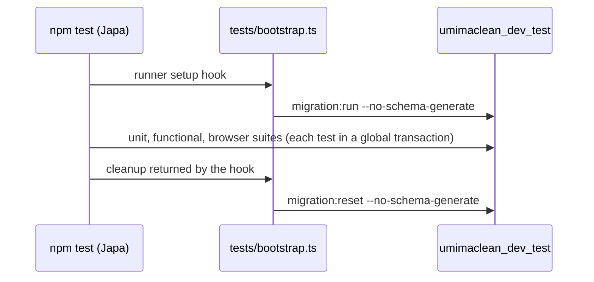

# M1a evidence: conventions across the existing code

Date: 2026-11-13. Checkpoint of 0.1.0: no version bump (the bump to 0.1.0 comes at the end of M1b). No behavior change.

## 1. Summary

- **Conventions** (`docs/CONVENTIONS.md`) applied to every hand-written file of the starter: naming, file locations (atomic component folders, templates, pages by role), TypeScript rules, comments, `override`, no getters, no unused code. The list per rule, with files, is in §6; what was left for later, and why, in §6.2.
- **Tooling** now enforces two rules: `noImplicitOverride` (CONVENTIONS §5) and `@typescript-eslint/no-deprecated` (§12).
- **Tests** migrate their own database at the start of every run and pass on a freshly created test database (`tests/bootstrap.ts`).
- **Database**: development and tests use this project's own databases, `umimaclean_dev` and `umimaclean_dev_test`, on the shared PostgreSQL server, created by `database/create_databases.sql` with `postgis`, `pg_trgm` and `unaccent`. The database service is gone from `compose.yaml`, which now holds OSRM and the data tools (`psql`, `map-tools`, `osrm-build`, `pmtiles`). Production versions chosen: PostgreSQL 18 + PostGIS 3.6 (D17), with a rehearsed upgrade runbook for the shared server (`docs/ARCHITECTURE.md` §6.1).
- **Docs**: `docs/ARCHITECTURE.md` §2–§7 (MapLibre, shared database, payment correction to `paid`, per-staff queue plans, decisions D17–D26), `docs/DEPENDENCIES.md` §3–§5 (images, tools, the two landing photos with their licenses), `docs/PLAN.md` (M1a and M1b, MapLibre in M4, the owner's answers in M6, M8, M10a). M0's evidence moved to `docs/evidence/M0/EVIDENCE.md`.

## 2. How to run and see it

```sh
cp .env.example .env    # then set DB_HOST, DB_PORT, DB_USER, DB_PASSWORD of the shared server
podman compose --profile tools run --rm -T psql -d postgres -f /database/create_databases.sql
node ace migration:run
npm run dev             # http://localhost:3333: /, /signup, /login, /dashboard (after sign-up)
npm test                # migrates umimaclean_dev_test itself
```

The pages are the starter's, unchanged: home, sign-up, sign-in, and the signed-in dashboard.

## 3. Screens

Screenshots of every existing page, at 1440 × 900 (desktop) and 390 × 844 (mobile), taken from this checkpoint and from the previous commit (`f8d1029`, exported with `git archive` and served on another port against the same database):

| Page                   | Desktop                                        | Mobile                                       | Compared with the previous commit                                                                                                                                                               |
| ---------------------- | ---------------------------------------------- | -------------------------------------------- | ----------------------------------------------------------------------------------------------------------------------------------------------------------------------------------------------- |
| Home `/`               | [home-desktop.png](home-desktop.png)           | [home-mobile.png](home-mobile.png)           | identical (same SHA-256)                                                                                                                                                                        |
| Sign in `/login`       | [login-desktop.png](login-desktop.png)         | [login-mobile.png](login-mobile.png)         | identical                                                                                                                                                                                       |
| Sign up `/signup`      | [signup-desktop.png](signup-desktop.png)       | [signup-mobile.png](signup-mobile.png)       | identical                                                                                                                                                                                       |
| Dashboard `/dashboard` | [dashboard-desktop.png](dashboard-desktop.png) | [dashboard-mobile.png](dashboard-mobile.png) | differs only in the hint text, which names the page's new path (`inertia/pages/customer/dashboard.tsx`); before: [desktop](dashboard-desktop-before.png), [mobile](dashboard-mobile-before.png) |

The first home comparison differed by about one pixel in the link rows: the page has a 0.5 s entrance animation (`chunk-rise` in `inertia/css/app.css`), caught mid-way. Waiting 3 s before each screenshot made both identical.

Both servers answered the same status codes: `/` 200, `/login` 200, `/signup` 200, `/dashboard` 302 → `/login` when signed out, `/does-not-exist` 404.

## 4. How it works

No new flow. The test run now works like this:



## 5. Code tour (reading order)

1. `database/create_databases.sql`: this project's two databases and their extensions.
2. `compose.yaml`: OSRM and the data tools; no database service.
3. `.env.example`, `.env.test`: the new database names.
4. `tests/bootstrap.ts`: the migration hook.
5. `eslint.config.js`, `tsconfig.json`, `inertia/tsconfig.json`, `tsconfig.inertia.json`: the enforced rules.
6. `database/migrations/1761885935168_create_users_table.ts`: header comment, `override`.
7. `app/models/user.ts`, `app/transformers/user_transformer.ts`: `initials()` as a method.
8. `app/validators/rules.ts`, `app/validators/auth.ts`, `app/services/auth_service.ts`, `app/controllers/register_controller.ts`, `app/controllers/session_controller.ts`: names.
9. `app/middleware/*.ts`, `app/exceptions/handler.ts`: comments, `const`, `override`, the removed pass-through methods.
10. `start/*.ts`, `config/*.ts`, `bin/*.ts`, `adonisrc.ts`, `vite.config.ts`: comments.
11. `inertia/components/{atoms,molecules,organisms,templates}/*`, `inertia/pages/customer/dashboard.tsx`, `inertia/pages/*`, `inertia/app.tsx`, `inertia/ssr.tsx`, `inertia/types.ts`: locations, names, types.
12. `.adonisjs/server/pages.d.ts`, `.adonisjs/client/registry/schema.d.ts`: regenerated by `node ace codegen` (page and validator names).
13. Docs: `docs/ARCHITECTURE.md`, `docs/DEPENDENCIES.md`, `docs/PLAN.md`, `docs/evidence/M0/EVIDENCE.md`.

## 6. Decisions and deviations

Decisions D17–D26 in `docs/ARCHITECTURE.md` §7. No workaround was added.

### 6.1 Conventions applied

| Rule (CONVENTIONS)                                    | What changed                                                                                                                                                                                                                                                                                                                                                                     | Where                                                                                                                                   |
| ----------------------------------------------------- | -------------------------------------------------------------------------------------------------------------------------------------------------------------------------------------------------------------------------------------------------------------------------------------------------------------------------------------------------------------------------------- | --------------------------------------------------------------------------------------------------------------------------------------- |
| §0.6, §12 no deprecated code                          | `@typescript-eslint/no-deprecated` on (type-aware, TypeScript project service); proven to fire on a probe using `String.prototype.substr` in a backend and a frontend file; 0 findings in the code                                                                                                                                                                               | `eslint.config.js`                                                                                                                      |
| §1 no code for hypothetical needs                     | removed unused: the API serializer provider, the settings layout, the `Section` component, the `InertiaProps` type                                                                                                                                                                                                                                                               | `providers/api_provider.ts`, `adonisrc.ts`, `inertia/layouts/settings.tsx`, `inertia/components/section.tsx`, `inertia/types.ts`        |
| §2 names say what they do and which entity            | `registerValidator` → `createUserValidator`, `loginValidator` → `createSessionValidator`, `RegisterInput`/`LoginInput` → `CreateUserInput`/`CreateSessionInput` (`<action><Resource>Validator`, §8); `AuthService.register`/`verifyCredentials` → `registerUser`/`verifyUserCredentials`                                                                                         | `app/validators/auth.ts`, `app/services/auth_service.ts`, both controllers, tests, `.adonisjs/client/registry/schema.d.ts`              |
| §2 no abbreviations                                   | `NavLink`/`NavItem`/`NavRoute`/`nav` → `NavigationLink`/`NavigationItem`/`NavigationRoute`/`navigationItems`; `COOKIE`, `ONE_YEAR`, `toggle`, `next` → `THEME_COOKIE`, `ONE_YEAR_IN_SECONDS`, `toggleTheme`, `nextTheme`; test variable `newAccountController` → `registerController`                                                                                            | `inertia/components/atoms/navigation_link.tsx`, `templates/app_layout.tsx`, `atoms/theme_toggle.tsx`, `tests/unit/auth_service.spec.ts` |
| §2 booleans `is…`                                     | props `exact` → `isExact`, `hideTitle` → `isTitleHidden`                                                                                                                                                                                                                                                                                                                         | `navigation_link.tsx`, `organisms/page.tsx`, `pages/customer/dashboard.tsx`                                                             |
| §3 files and directories                              | `inertia/layouts/*` → `inertia/components/templates/*_layout.tsx`; `nav_link.tsx` → `navigation_link.tsx`                                                                                                                                                                                                                                                                        | `inertia/components/templates/`, `inertia/components/atoms/`                                                                            |
| §4 no `any`                                           | `render(page: any)` → `render(page: Page)` (`@inertiajs/core`)                                                                                                                                                                                                                                                                                                                   | `inertia/ssr.tsx`                                                                                                                       |
| §4 `const` over `let`                                 | `for (let guard …)` → `const`                                                                                                                                                                                                                                                                                                                                                    | `app/middleware/guest_middleware.ts`                                                                                                    |
| §4 `import type` for type-only imports                | `import { type X }` statements that import only types → `import type`                                                                                                                                                                                                                                                                                                            | `app/middleware/container_bindings_middleware.ts`, `inertia/types.ts`, `inertia/components/**`                                          |
| §4 aliases, not relative paths                        | `./css/app.css`, `./client` → `~/css/app.css`, `~/client`                                                                                                                                                                                                                                                                                                                        | `inertia/app.tsx`                                                                                                                       |
| §4 braces on every `if`                               | two one-line `if`s                                                                                                                                                                                                                                                                                                                                                               | `inertia/components/molecules/flash_toasts.tsx`                                                                                         |
| §4 no unnecessary assertions                          | `parts.at(-1)!` → `parts[parts.length - 1]`                                                                                                                                                                                                                                                                                                                                      | `app/models/user.ts`                                                                                                                    |
| §5 no `get` accessors                                 | `get initials()` → `initials()`; the transformer calls it (same `initials` prop)                                                                                                                                                                                                                                                                                                 | `app/models/user.ts`, `app/transformers/user_transformer.ts`                                                                            |
| §5 `override` on every override                       | added on the exception handler's three properties, the Inertia middleware's `flash`, the migration's `up`/`down`; `noImplicitOverride` makes TypeScript enforce it                                                                                                                                                                                                               | `app/exceptions/handler.ts`, `app/middleware/inertia_middleware.ts`, the users migration, both tsconfigs                                |
| §6 no wrappers that add nothing                       | the exception handler's `handle` and `report`, which only called `super`                                                                                                                                                                                                                                                                                                         | `app/exceptions/handler.ts`                                                                                                             |
| §8 migration header                                   | header comment explaining the table and its columns                                                                                                                                                                                                                                                                                                                              | `database/migrations/1761885935168_create_users_table.ts`                                                                               |
| §9 atomic components                                  | `atoms/` (logo, navigation link, theme toggle), `molecules/` (flash toasts), `organisms/` (page frame), `templates/` (app, auth, marketing layouts)                                                                                                                                                                                                                              | `inertia/components/`                                                                                                                   |
| §9 pages by role                                      | `pages/dashboard.tsx` → `pages/customer/dashboard.tsx` (URL and route name unchanged)                                                                                                                                                                                                                                                                                            | `inertia/pages/customer/dashboard.tsx`, `start/routes.ts`, `.adonisjs/server/pages.d.ts`                                                |
| §10 no file headers, no comments that repeat the code | file headers and "what" docblocks removed; kept or rewritten where they explain why: the Inertia middleware's partial context and flash field, container bindings, silent auth, status pages only in production, navigation link matching, page frame, shared-props typing, Vine date transform, CORS origin, test hash cost, synchronous dev logs, composite TypeScript project | `app/`, `config/`, `bin/`, `start/`, `tests/`, `inertia/`, `adonisrc.ts`, `vite.config.ts`, `tsconfig.inertia.json`                     |
| §13 formatting                                        | Prettier on every touched file                                                                                                                                                                                                                                                                                                                                                   | all of the above                                                                                                                        |

Comments in the framework-generated files were removed with a script built on the TypeScript scanner (so `/*` inside strings such as `'tests/unit/**/*.spec.{ts,js}'` was never touched), keeping triple-slash, `eslint-` and `@ts-` comments; the diff of those files is deletions only, and the typecheck passed right after.

### 6.2 Left for later, on purpose

| Rule                                                                                           | What stays for now                                                                                              | When                                          | Why                                                                                                           |
| ---------------------------------------------------------------------------------------------- | --------------------------------------------------------------------------------------------------------------- | --------------------------------------------- | ------------------------------------------------------------------------------------------------------------- |
| §9.1 styling (Tailwind classes, no CSS classes, `style` only for runtime values, theme tokens) | the starter's 908-line `inertia/css/app.css` (BEM classes, custom variables) and inline `style` props           | M1b                                           | M1b replaces the whole look with Tailwind and shadcn; converting the starter's CSS first would be thrown away |
| §9 icons Tabler only                                                                           | `lucide-react` in the navigation link, theme toggle, flash toasts, app layout, dashboard, home                  | M1b                                           | the same components are rebuilt with shadcn in M1b, where lucide is removed (DEPENDENCIES §1)                 |
| §9 shadcn components in `ui/`                                                                  | none installed yet                                                                                              | M1b                                           | the CLI setup is M1b's first step                                                                             |
| §15 Indonesian only                                                                            | English copy and AdonisJS branding on every page; English default validation messages                           | M1b (pages), M2 (forms)                       | changing it now would change what users see; those pages and forms are replaced                               |
| §8 validation messages in `start/validator.ts`                                                 | VineJS default messages                                                                                         | M2                                            | the sign-up and sign-in forms are replaced by phone + password in M2, with Indonesian messages                |
| §8 a service method never just forwards to a model method                                      | `AuthService.registerUser` and `verifyUserCredentials` forward to `User.create` and `User.verifyCredentials`    | M2                                            | `AuthService` is replaced by `AccountService` in M2; only the mechanical rules apply to code M2 replaces      |
| §9 no hand-written URLs                                                                        | `redirectTo = '/login'` and `'/'` in the auth and guest middleware                                              | M2                                            | M2 changes them to the role sign-in pages (`/masuk`, `/staf/masuk`)                                           |
| §1.2 rule 1 security headers                                                                   | Shield's Content-Security-Policy is off (`config/shield.ts`, as generated)                                      | M12 (or earlier once the asset list is known) | a CSP needs the final list of scripts, styles, fonts and workers (Turnstile, MapLibre)                        |
| —                                                                                              | `config/logger.ts` reads `env.get('APP_NAME')`, which `start/env.ts` doesn't declare (the logger name is empty) | M1b                                           | fixing it changes log output; it belongs with the app's name and branding                                     |
| —                                                                                              | `ace.js` keeps its generated comments                                                                           | never                                         | the build overwrites it                                                                                       |

## 7. Evidence

### 7.1 Databases on the shared server

```text
$ podman compose --profile tools run --rm -T psql -d postgres -f /database/create_databases.sql
CREATE DATABASE
You are now connected to database "umimaclean_dev" as user "user".
CREATE EXTENSION
CREATE EXTENSION
CREATE EXTENSION
You are now connected to database "umimaclean_dev_test" as user "user".
CREATE EXTENSION
CREATE EXTENSION
CREATE EXTENSION
psql exit=0
umimaclean_dev|pg_trgm 1.6, plpgsql 1.0, postgis 3.5.2, unaccent 1.1
umimaclean_dev_test|pg_trgm 1.6, plpgsql 1.0, postgis 3.5.2, unaccent 1.1
```

(First run on the shared server. Before the file used `TEMPLATE template0`, `CREATE DATABASE` failed with `template database "template1" has a collation version mismatch`; see D19.) The server reports the collation warning on every connection; it comes from that server's `template1`/`postgres` databases and disappears with the upgrade to PostgreSQL 18.

### 7.2 Upgrade rehearsal (PostgreSQL 17.5 → 18.6)

Every database of the shared server was dumped (read-only `pg_dump`) and restored into a throwaway PostgreSQL 18.6 + PostGIS 3.6 container with no published port; row counts per table were compared:

```text
same  umimaclean (25 tables)
same  umimaclean-skripsi (15 tables)
same  umimaclean_dev (4 tables)
same  umimaclean_dev_test (1 tables)
same  umimaclean_docs (22 tables)
same  umimaclean_inertia (7 tables)
same  umimaclean_inertia_test (2 tables)
same  umimaclean_test (7 tables)
FAILED user: pg_restore: error: could not execute query: ERROR:  database "user" already exists
restore user exit=0        (restored without -C into the database the image creates; it held no tables)
pg_trgm 1.6, plpgsql 1.0, postgis 3.6.4, unaccent 1.1
```

The runbook in `docs/ARCHITECTURE.md` §6.1 includes that lesson (the superuser's database is restored without `-C`). The throwaway container and every dump were deleted afterwards. The shared server itself was not changed, apart from creating this project's two databases.

### 7.3 Map data on the shared server, with the new compose tools

The commands of `docs/ARCHITECTURE.md` §6.2–§6.4, extracted verbatim and run with `bash -x` (the 899 MB download was skipped: the M0 file was present, and its checksum was verified again). Full log: [maps-pipeline.log](maps-pipeline.log) (progress bars and the server's collation warning removed). Key lines:

```text
+ md5sum -c java-latest.osm.pbf.md5
java-latest.osm.pbf: OK
2026-11-13 21:25:04  osm2pgsql took 11s overall.
[2026-11-13T14:25:21] [info] extraction finished after 12.7237s
[2026-11-13T14:25:54] [info] finished preprocessing
+ podman compose up -d osrm
{"code":"Ok","waypoints":[{"nodes":[5293711561,5293711560],...
2026/11/13 14:26:50 extract.go:606: Completed in 55.327903445s with 4 download threads (102.15459931636634 tiles/s).
real	2m13,662s
exit=0

$ podman compose --profile tools run --rm -T psql -Atc "select current_database(), (select count(*) from osm.roads), (select count(*) from osm.pois), (select count(*) from osm.areas)"
umimaclean_dev|13213|14457|500
```

### 7.4 Lint, typecheck, tests on a freshly created test database

Logs: [lint.log](lint.log), [typecheck.log](typecheck.log), [test-fresh-database.log](test-fresh-database.log).

```text
$ npm run lint
> eslint .
exit=0

$ npm run typecheck
> tsc --noEmit && tsc --noEmit --project inertia/tsconfig.json
exit=0

$ podman compose --profile tools run --rm -T psql -d postgres -c "DROP DATABASE IF EXISTS umimaclean_dev_test"
DROP DATABASE
$ podman compose --profile tools run --rm -T psql -d postgres -f /database/create_databases.sql
CREATE DATABASE …
$ npm test
[ info ] booting application to run tests...
❯ Executed 1 migrations
✔✔✔✔✔✔✔✔✔✔✔❯ Reverted 1 migrations
 PASSED
Tests  11 passed (11)
exit=0
```

`database/schema.ts` is unchanged after the test runs (`git status --short database/schema.ts` prints nothing). No log contains "deprecat".

## 8. Open questions and known limitations

- `.env` was not changed. It already names `umimaclean_dev` on `127.0.0.1:5432`; it needs no change unless the shared server's credentials differ.
- The shared server still runs PostgreSQL 17.5 / PostGIS 3.5.2 until the owner runs the upgrade runbook; this project works on both.
- The two landing photos show different shoes (no free-license pair of the same shoes exists); they are placeholders until the shop's own photos.
- Dark mode (theme toggle) is starter behavior kept for now; whether the app has a dark theme is decided with the design in M1b.
