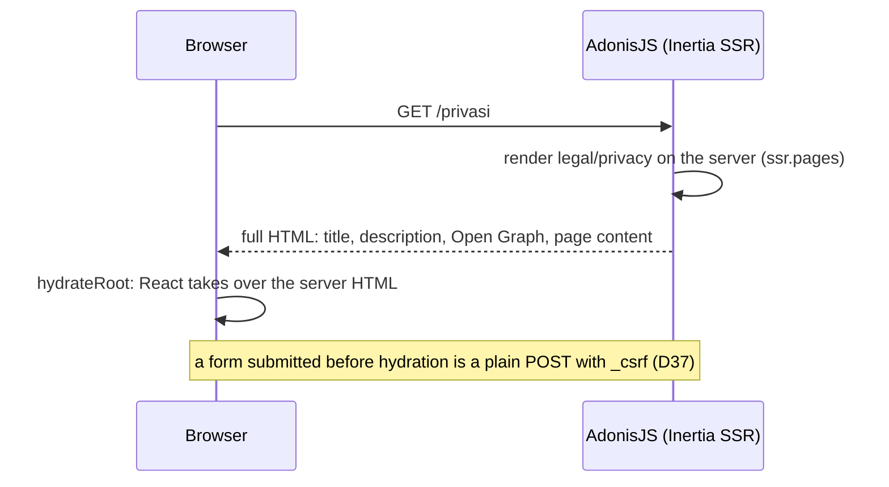

# M1c evidence: landing, legal pages, SEO (version 0.1.0)

Date: 2026-11-14. Ends milestone M1 with version **0.1.0**.

## 1. Summary

- **GUEST-1** (static parts): the landing with the hero (before/after photo comparison, the two licensed photos resized and stripped of metadata), the items we clean, how it works, customer reviews, frequently asked questions, and the one-line photo credit in the footer with each name linked to its source page. The price list and the service-area check join the page in M3 (`docs/PLAN.md`).
- **GUEST-2**: terms (`/syarat`) and privacy (`/privasi`), using the shop details (placeholder until the store settings in M3) and listing the outside services and the data each receives (`docs/PRD/shared.md` §11).
- **GUEST-3**: per-page title, description and Open Graph tags, a link preview image (`public/images/og.png`), `/sitemap.xml` (public pages only) and `/robots.txt`. The public pages are server-rendered (D36), and their forms work even before the scripts run (D37).
- **NFR-2**: axe (WCAG 2.1 A and AA) finds no violation on any page the milestone touches; no page scrolls sideways at 360 px; tap targets are at least 44 px; inputs are 16 px.
- **Docs**: `docs/CONVENTIONS.md` §9.1 (one light theme, text sizes, status labels) and the new §9.2 "Mobile and desktop" (the owner's UI principles); `docs/ARCHITECTURE.md` D36–D42; `docs/DEPENDENCIES.md` (`@axe-core/playwright`, the Playwright image, the processed photos); `CHANGELOG.md`; version 0.1.0.

## 2. How to run and see it

```sh
npm install
node ace migration:run
npm run dev
```

| URL                           | What                                                                                 |
| ----------------------------- | ------------------------------------------------------------------------------------ |
| `/`                           | Landing; drag the divider (or focus it and use the arrow keys) to compare the photos |
| `/syarat`, `/privasi`         | Terms and privacy                                                                    |
| `/robots.txt`, `/sitemap.xml` | For search engines                                                                   |
| `/_preview/og`                | The page behind the link preview image (outside production)                          |

To regenerate the link preview image, take a 1200 × 630 screenshot of `/_preview/og` into `public/images/og.png` (D38).

## 3. Screens

Chromium at 360 × 780 and 390 × 844 (both at 2×) and 1440 × 900; WebKit (the iOS Safari engine, run in the official Playwright image, D41) at 390 and 1440 for the main pages. Every request to a host other than `localhost` was aborted; none happened. No page was wider than its viewport.

| Page          | 360                              | 390                              | 1440                               | WebKit 390                              | WebKit 1440                               |
| ------------- | -------------------------------- | -------------------------------- | ---------------------------------- | --------------------------------------- | ----------------------------------------- |
| Landing       | [360](beranda-360.png)           | [390](beranda-390.png)           | [1440](beranda-1440.png)           | [390](beranda-webkit-390.png)           | [1440](beranda-webkit-1440.png)           |
| Sign in       | [360](masuk-360.png)             | [390](masuk-390.png)             | [1440](masuk-1440.png)             | [390](masuk-webkit-390.png)             | [1440](masuk-webkit-1440.png)             |
| Customer home | [360](pelanggan-beranda-360.png) | [390](pelanggan-beranda-390.png) | [1440](pelanggan-beranda-1440.png) | [390](pelanggan-beranda-webkit-390.png) | [1440](pelanggan-beranda-webkit-1440.png) |
| Terms         | [360](syarat-360.png)            | [390](syarat-390.png)            | [1440](syarat-1440.png)            |                                         |                                           |
| Privacy       | [360](privasi-360.png)           | [390](privasi-390.png)           | [1440](privasi-1440.png)           |                                         |                                           |
| Sign up       | [360](daftar-360.png)            | [390](daftar-390.png)            | [1440](daftar-1440.png)            |                                         |                                           |
| 404           | [360](404-360.png)               | [390](404-390.png)               | [1440](404-1440.png)               |                                         |                                           |
| 500           | [360](500-360.png)               | [390](500-390.png)               | [1440](500-1440.png)               |                                         |                                           |

## 4. How it works



`/robots.txt` and `/sitemap.xml` come from `SeoController`, which holds the list of public paths.

## 5. Code tour (reading order)

1. `inertia/components/atoms/{photo,note,stars,csrf_field}.tsx`
2. `inertia/components/molecules/{compare_slider,seo_head,photo_credit}.tsx`, `inertia/lib/page_title.ts`, `inertia/lib/reviews/google_reviews.ts`
3. `inertia/components/organisms/landing/{hero,laundry_items,how_it_works,reviews_section,faq_section}.tsx`
4. `inertia/components/organisms/legal_page.tsx`, `inertia/pages/legal/{terms,privacy}.tsx`
5. `inertia/pages/home.tsx`, `inertia/components/templates/public_layout.tsx`, `organisms/site_header.tsx`, `organisms/site_footer.tsx`
6. `config/inertia.ts`, `vite.config.ts`, `inertia/app.tsx`, `inertia/ssr.tsx` (SSR)
7. `app/middleware/inertia_middleware.ts` (`csrfToken`), the forms using `CsrfField`
8. `app/controllers/seo_controller.ts`, `start/routes.ts`, `resources/views/inertia_layout.edge`
9. `inertia/pages/og_image.tsx`, `public/images/og.png`, `public/images/landing/*`
10. `tests/browser/look.spec.ts`, `tests/browser/auth_flow.spec.ts`, `tests/functional/seo.spec.ts`
11. `eslint.config.js` (`head-key`), docs

## 6. Decisions and deviations

- D36–D42 in `docs/ARCHITECTURE.md` §7. No workaround added.
- **Copy adjusted to the PRD**: the hero says ordering needs an account (CUST-5); the FAQ drops a bulk discount (promotions are out of scope, summary §5), a "Mirror Shine Treatment" and minor repairs (not in the price list, SVC-5), and says where pickup is free and that helmets are cleaned at the shop (SVC-4); the link preview image doesn't claim helmets are picked up.
- **Reviews**: six Google Maps reviews, each linked to its source; phones show three.
- The privacy page names Google Maps and Waze as receiving a destination point when a courier opens navigation (STAFF-7), which `docs/PRD/shared.md` §11 does not list (open question in the report).
- Arbitrary Tailwind values: none added in M1c.

## 7. Evidence

[lint.log](lint.log), [typecheck.log](typecheck.log), [test.log](test.log) (spec reporter, every test by name):

```text
$ npm run lint
> eslint .
exit=0
$ npm run typecheck
> tsc --noEmit && tsc --noEmit --project inertia/tsconfig.json
exit=0
$ npm test -- --reporters spec
  ✔ / has no WCAG 2.1 AA violations (axe)
  ✔ /syarat has no WCAG 2.1 AA violations (axe)
  ✔ /privasi has no WCAG 2.1 AA violations (axe)
  ✔ /login has no WCAG 2.1 AA violations (axe)
  ✔ /signup has no WCAG 2.1 AA violations (axe)
  ✔ /_preview/404 has no WCAG 2.1 AA violations (axe)
  ✔ /_preview/500 has no WCAG 2.1 AA violations (axe)
  ✔ … does not scroll sideways at 360 px (11 pages)
 PASSED
Tests  49 passed (49)
exit=0
```

axe was proven to report on a deliberately broken page (`button-name`, `color-contrast`, `document-title`, `html-has-lang`, `image-alt`), so "no violations" is a real result.

Production build (`npm run build`, exit 0) started on port 3336:

```text
$ curl -s http://localhost:3336/privasi | grep -oE '<title[^>]*>[^<]*</title>|<h1[^>]*>[^<]*'
<title data-inertia="">Kebijakan privasi - Umima Clean</title>
<h1 class="text-3xl font-bold tracking-tight">Kebijakan privasi
home 200
nope 404
preview 404        (no /_preview routes in production)
```

A form submitted before hydration (dev server, click right after load): `POST http://localhost:3333/login native` → `url http://localhost:3333/dashboard`; before D37 the same click stayed on `/login`.

## 8. Open questions and known limitations

- The price list, the service-area check and the store settings behind the shop details come in M3.
- Sign-in is still by email with English validation messages until M2.
- The two hero photos show different shoes; they are placeholders until the shop's own photos.
