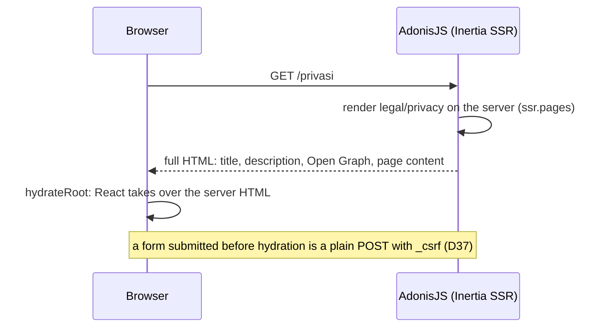

# M1c evidence: landing, legal pages, SEO (version 0.1.0)

Date: 2026-11-14. Ends milestone M1 with version **0.1.0**.

## 1. Summary

- **GUEST-1** (static parts): the landing with the hero (before/after photo comparison, the two licensed photos resized and stripped of metadata), the items we clean, how it works, customer reviews, frequently asked questions, and the one-line photo credit in the footer with each name linked to its source page. The price list and the service-area check join the page in M3 (`docs/PLAN.md`).
- **GUEST-2**: terms (`/syarat`) and privacy (`/privasi`), using the shop details (placeholder until the store settings in M3) and listing the outside services and the data each receives (`docs/PRD/shared.md` §11).
- **GUEST-3**: per-page title, description and Open Graph tags, a link preview image (`public/images/og.png`), `/sitemap.xml` (public pages only) and `/robots.txt`. The public pages are server-rendered (D36), and their forms work even before the scripts run (D37).
- **NFR-2**: axe (WCAG 2.1 A and AA) finds no violation on any page the milestone touches; no page scrolls sideways at 360 px; tap targets are at least 44 px; inputs are 16 px.
- **Docs**: `docs/CONVENTIONS.md` §9.1 (one light theme, text sizes, status labels) and the new §9.2 "Mobile and desktop" (the owner's UI principles); `docs/ARCHITECTURE.md` D36–D42; `docs/DEPENDENCIES.md` (`@axe-core/playwright`, the Playwright image, the processed photos); `CHANGELOG.md`; version 0.1.0.

## 2. How to run and see it

```sh
npm install
node ace migration:run
npm run dev
```

| URL                           | What                                                                                 |
| ----------------------------- | ------------------------------------------------------------------------------------ |
| `/`                           | Landing; drag the divider (or focus it and use the arrow keys) to compare the photos |
| `/syarat`, `/privasi`         | Terms and privacy                                                                    |
| `/robots.txt`, `/sitemap.xml` | For search engines                                                                   |
| `/_preview/og`                | The page behind the link preview image (outside production)                          |

To regenerate the link preview image, take a 1200 × 630 screenshot of `/_preview/og` into `public/images/og.png` (D38).

## 3. Screens

Chromium at 360 × 780 and 390 × 844 (both at 2×) and 1440 × 900; WebKit (the iOS Safari engine, run in the official Playwright image, D41) at 390 and 1440 for the main pages. Every request to a host other than `localhost` was aborted; none happened. No page was wider than its viewport.

| Page          | 360                              | 390                              | 1440                               | WebKit 390                              | WebKit 1440                               |
| ------------- | -------------------------------- | -------------------------------- | ---------------------------------- | --------------------------------------- | ----------------------------------------- |
| Landing       | [360](beranda-360.png)           | [390](beranda-390.png)           | [1440](beranda-1440.png)           | [390](beranda-webkit-390.png)           | [1440](beranda-webkit-1440.png)           |
| Sign in       | [360](masuk-360.png)             | [390](masuk-390.png)             | [1440](masuk-1440.png)             | [390](masuk-webkit-390.png)             | [1440](masuk-webkit-1440.png)             |
| Customer home | [360](pelanggan-beranda-360.png) | [390](pelanggan-beranda-390.png) | [1440](pelanggan-beranda-1440.png) | [390](pelanggan-beranda-webkit-390.png) | [1440](pelanggan-beranda-webkit-1440.png) |
| Terms         | [360](syarat-360.png)            | [390](syarat-390.png)            | [1440](syarat-1440.png)            |                                         |                                           |
| Privacy       | [360](privasi-360.png)           | [390](privasi-390.png)           | [1440](privasi-1440.png)           |                                         |                                           |
| Sign up       | [360](daftar-360.png)            | [390](daftar-390.png)            | [1440](daftar-1440.png)            |                                         |                                           |
| 404           | [360](404-360.png)               | [390](404-390.png)               | [1440](404-1440.png)               |                                         |                                           |
| 500           | [360](500-360.png)               | [390](500-390.png)               | [1440](500-1440.png)               |                                         |                                           |

## 4. How it works



`/robots.txt` and `/sitemap.xml` come from `SeoController`, which holds the list of public paths.

## 5. Code tour (reading order)

1. `inertia/components/atoms/{photo,note,stars,csrf_field}.tsx`
2. `inertia/components/molecules/{compare_slider,seo_head,photo_credit}.tsx`, `inertia/lib/page_title.ts`, `inertia/lib/reviews/google_reviews.ts`
3. `inertia/components/organisms/landing/{hero,laundry_items,how_it_works,reviews_section,faq_section}.tsx`
4. `inertia/components/organisms/legal_page.tsx`, `inertia/pages/legal/{terms,privacy}.tsx`
5. `inertia/pages/home.tsx`, `inertia/components/templates/public_layout.tsx`, `organisms/site_header.tsx`, `organisms/site_footer.tsx`
6. `config/inertia.ts`, `vite.config.ts`, `inertia/app.tsx`, `inertia/ssr.tsx` (SSR)
7. `app/middleware/inertia_middleware.ts` (`csrfToken`), the forms using `CsrfField`
8. `app/controllers/seo_controller.ts`, `start/routes.ts`, `resources/views/inertia_layout.edge`
9. `inertia/pages/og_image.tsx`, `public/images/og.png`, `public/images/landing/*`
10. `tests/browser/look.spec.ts`, `tests/browser/auth_flow.spec.ts`, `tests/functional/seo.spec.ts`
11. `eslint.config.js` (`head-key`), docs

## 6. Decisions and deviations

- D36–D42 in `docs/ARCHITECTURE.md` §7. No workaround added.
- **Copy adjusted to the PRD**: the hero says ordering needs an account (CUST-5); the FAQ drops a bulk discount (promotions are out of scope, summary §5), a "Mirror Shine Treatment" and minor repairs (not in the price list, SVC-5), and says where pickup is free and that helmets are cleaned at the shop (SVC-4); the link preview image doesn't claim helmets are picked up.
- **Reviews**: six Google Maps reviews, each linked to its source; phones show three.
- The privacy page names Google Maps and Waze as receiving a destination point when a courier opens navigation (STAFF-7), which `docs/PRD/shared.md` §11 does not list (open question in the report).
- Arbitrary Tailwind values: none added in M1c.

## 7. Evidence

[lint.log](lint.log), [typecheck.log](typecheck.log), [test.log](test.log) (spec reporter, every test by name):

```text
$ npm run lint
> eslint .
exit=0
$ npm run typecheck
> tsc --noEmit && tsc --noEmit --project inertia/tsconfig.json
exit=0
$ npm test -- --reporters spec
  ✔ / has no WCAG 2.1 AA violations (axe)
  ✔ /syarat has no WCAG 2.1 AA violations (axe)
  ✔ /privasi has no WCAG 2.1 AA violations (axe)
  ✔ /login has no WCAG 2.1 AA violations (axe)
  ✔ /signup has no WCAG 2.1 AA violations (axe)
  ✔ /_preview/404 has no WCAG 2.1 AA violations (axe)
  ✔ /_preview/500 has no WCAG 2.1 AA violations (axe)
  ✔ … does not scroll sideways at 360 px (11 pages)
 PASSED
Tests  49 passed (49)
exit=0
```

axe was proven to report on a deliberately broken page (`button-name`, `color-contrast`, `document-title`, `html-has-lang`, `image-alt`), so "no violations" is a real result.

Production build (`npm run build`, exit 0) started on port 3336:

```text
$ curl -s http://localhost:3336/privasi | grep -oE '<title[^>]*>[^<]*</title>|<h1[^>]*>[^<]*'
<title data-inertia="">Kebijakan privasi - Umima Clean</title>
<h1 class="text-3xl font-bold tracking-tight">Kebijakan privasi
home 200
nope 404
preview 404        (no /_preview routes in production)
```

A form submitted before hydration (dev server, click right after load): `POST http://localhost:3333/login native` → `url http://localhost:3333/dashboard`; before D37 the same click stayed on `/login`.

## 8. Open questions and known limitations

- The price list, the service-area check and the store settings behind the shop details come in M3.
- Sign-in is still by email with English validation messages until M2.
- The two hero photos show different shoes; they are placeholders until the shop's own photos.

---

## PATCH-0.1.2

## Evidence: Patch 0.1.2

Date: 2026-11-15. Patch release for version **0.1.2**.

### 1. Summary of Changes

1. **Item Photos Attribution (D39, DEPENDENCIES §4)**:
   - Documented the "Yang kami cuci" item photos as Unsplash stock photos under the Unsplash License (free commercial and non-commercial use, no attribution required).
   - Recorded shoes, bag and helmet as "source page not recorded".
   - Rewrote D39 in `docs/ARCHITECTURE.md`. Removed the duplicated photo row in `docs/DEPENDENCIES.md` and the duplicated D43 row in `docs/ARCHITECTURE.md`.

2. **Documentation Accuracy and Standards**:
   - Refined documentation across `docs/ARCHITECTURE.md`, `docs/DEPENDENCIES.md`, and `CHANGELOG.md` to focus strictly on current architecture and project specifications.

3. **Privacy Policy Clarification (GUEST-2)**:
   - In `inertia/pages/legal/privacy.tsx`, removed "secara anonim" and restored Google Maps / Waze as an explicit list item under "Pihak lain yang menerima data".
   - Explicitly clarified that when staff opens navigation, the map applications receive only destination coordinates, never customer name, phone number, or order details.

4. **shadcn Component Usage & Conventions**:
   - Preserved `Card` styling and semantic slots (`CardContent`, `CardFooter`) in `ReviewCard` (`reviews_section.tsx`) without class overrides cancelling its appearance (`border-0`, `bg-transparent`, `p-0`, `shadow-none`, `ring-0`).
   - Refactored `laundry_items.tsx` to use semantic `<figure>` and `<figcaption>` instead of `Card`.
   - Added convention in `docs/CONVENTIONS.md` §9 mandating using shadcn components for what they are with minimal overrides, avoiding class-by-class cancellations.

5. **Reviews Carousel Refactoring**:
   - Replaced arbitrary `basis-[84%]` with scale value `basis-5/6`.
   - Added braces to all `if` blocks.
   - Removed unnecessary `queueMicrotask` workaround by invoking `onSelect()` directly inside `useEffect` upon Embla API availability.
   - Removed what-comments.

6. **Zero Lint Warnings**:
   - Upgraded `tailwind-canonical-classes/tailwind-canonical-classes` from `'warn'` to `'error'` in `eslint.config.js` (recorded in ARCHITECTURE D44).

7. **SETUP.md Zero-to-Running Reproducibility**:
   - Removed premature `node ace db:seed` step.
   - Added `node ace generate:key` to Step 2.
   - Added `npx playwright install chromium` to Step 1.
   - Documented Protomaps build selection and availability in Step 5.
   - Consolidated map execution commands into `docs/SETUP.md`, with `docs/ARCHITECTURE.md` §6 explaining the pipeline and linking to `SETUP.md`.

---

### 2. Screens

Screenshots of the landing page captured fresh at 360 px, 390 px (deviceScaleFactor: 2), and 1440 px (deviceScaleFactor: 1):

| Viewport        | Screenshot Link                                  | Dimensions  |
| :-------------- | :----------------------------------------------- | :---------- |
| Mobile 360 px   | [beranda-0.1.2-360.png](beranda-0.1.2-360.png)   | 720 × 9142  |
| Mobile 390 px   | [beranda-0.1.2-390.png](beranda-0.1.2-390.png)   | 780 × 8986  |
| Desktop 1440 px | [beranda-0.1.2-1440.png](beranda-0.1.2-1440.png) | 1440 × 3010 |

---

### 3. Axe Accessibility Audit (Landing Page)

Audit executed using `@axe-core/playwright` across tags `wcag2a`, `wcag2aa`, `wcag21a`, `wcag21aa`:

```
[Axe] Landing violations: 0
[Axe] Landing passes: 29
```

Zero accessibility violations found on `/`.

---

### 4. Full SETUP.md Proof from Clean Clone

The following commands were executed in an empty scratch directory (`/tmp/clean-test/umimaclean`) with no `node_modules`, no pre-existing `.env`, and freshly created databases (`umimaclean_clean_dev` and `umimaclean_clean_test`):

#### Step 1: Install dependencies and Playwright browser

```sh
$ npm install
added 850 packages, and audited 857 packages in 9s
297 packages are looking for funding
  run `npm fund` for details
31 vulnerabilities (2 low, 29 moderate)

$ npx playwright install chromium
BEWARE: your OS is not officially supported by Playwright; downloading fallback build for ubuntu24.04-x64.
```

#### Step 2: Environment configuration & generate key

```sh
$ cp .env.example .env
$ node ace generate:key
DONE:    add APP_KEY to .env
```

#### Step 3: Database creation and extension enablement

```sh
$ podman compose --profile tools run --rm -T psql -d postgres
CREATE DATABASE umimaclean_clean_dev TEMPLATE template0;
CREATE DATABASE umimaclean_clean_test TEMPLATE template0;
\connect umimaclean_clean_dev
CREATE EXTENSION IF NOT EXISTS postgis;
CREATE EXTENSION IF NOT EXISTS pg_trgm;
CREATE EXTENSION IF NOT EXISTS unaccent;
\connect umimaclean_clean_test
CREATE EXTENSION IF NOT EXISTS postgis;
CREATE EXTENSION IF NOT EXISTS pg_trgm;
CREATE EXTENSION IF NOT EXISTS unaccent;
```

#### Step 4: Run migrations

```sh
$ node ace migration:run
[ info ] Upgrading migrations version from "1" to "2"
❯ migrating database/migrations/1761885935168_create_users_table
❯ migrated database/migrations/1761885935168_create_users_table

Migrated in 93 ms
❯ Scanned "postgres" database and found 1 tables
❯ Scanned table users
❯ Creating schema classes for scanned tables
[ success ] Schema classes generated (19 ms)
```

#### Step 5: Verification Suite (§3 of SETUP.md)

##### `npm run lint`

```sh
$ npm run lint

> umimaclean@0.1.2 lint
> eslint .
```

_(Exited with code 0, 0 errors, 0 warnings)_

##### `npm run typecheck`

```sh
$ npm run typecheck

> umimaclean@0.1.2 typecheck
> tsc --noEmit && tsc --noEmit --project inertia/tsconfig.json
```

_(Exited with code 0, 0 errors)_

##### `npm test`

```sh
$ npm test

> umimaclean@0.1.2 test
> node ace test

[ info ] loading hooks...
[ info ] generating indexes...
[ info ] codegen: created 6 file(s)
[ info ] booting application to run tests...
[ info ] Upgrading migrations version from "1" to "2"
❯ Executed 1 migrations (390 ms)

unit / AuthService (tests/unit/auth_service.spec.ts)
  ✔ registers a new user account with hashed password (21.72ms)
  ✔ verifies credentials successfully for valid user (17.09ms)
  ✔ fails verification for incorrect password (12.02ms)
  ✔ resolves RegisterController and SessionController with injected AuthService from container (2.62ms)

unit / One light theme (tests/unit/theme.spec.ts)
  ✔ the shadcn components carry no dark: classes (2.54ms)
  ✔ app.css defines no dark theme (0.41ms)

functional / Authentication Routes (tests/functional/auth.spec.ts)
1:09:42 AM [vite] (ssr) connected.
1:09:43 AM [vite] (client) [optimizer] bundling dependencies...
  ✔ POST /signup registers user and redirects to dashboard (1s)
  ✔ POST /login authenticates valid credentials and redirects to dashboard (201.71ms)
  ✔ POST /logout terminates user session and redirects to login (25.51ms)

functional / Search engines (GUEST-3) (tests/functional/seo.spec.ts)
  ✔ robots.txt keeps signed-in and development pages out and points to the sitemap (7.33ms)
  ✔ the sitemap lists the public pages only (4.92ms)
  ✔ a public page arrives server-rendered with its title, description and Open Graph tags (15.88ms)

browser / Authentication Browser Flow (tests/browser/auth_flow.spec.ts)
  ✔ home page renders and displays authentication entry points (482.88ms)
  ✔ login page displays login form with credentials fields (468.05ms)
  ✔ signup page displays registration form with all required fields (384.18ms)
  ✔ user logs in through browser form and lands on dashboard (490ms)
  ✔ sign-in also works before the page scripts run (server-rendered form) (195.04ms)

browser / Look and feel (tests/browser/look.spec.ts)
  ✔ / loads nothing from another host, in Indonesian, with one main heading (1s)
  ✔ /syarat loads nothing from another host, in Indonesian, with one main heading (1s)
  ✔ /privasi loads nothing from another host, in Indonesian, with one main heading (1s)
  ✔ /login loads nothing from another host, in Indonesian, with one main heading (1s)
  ✔ /signup loads nothing from another host, in Indonesian, with one main heading (987.46ms)
  ✔ /_preview/staf loads nothing from another host, in Indonesian, with one main heading (997.03ms)
  ✔ /_preview/admin loads nothing from another host, in Indonesian, with one main heading (1s)
  ✔ /_preview/alur loads nothing from another host, in Indonesian, with one main heading (1s)
  ✔ /_preview/cetak loads nothing from another host, in Indonesian, with one main heading (1s)
  ✔ /_preview/404 loads nothing from another host, in Indonesian, with one main heading (1s)
  ✔ /_preview/500 loads nothing from another host, in Indonesian, with one main heading (1s)
  ✔ stays light when the device prefers a dark theme (318.64ms)
  ✔ the first Tab press shows a visible focus ring (961.02ms)
  ✔ / has no WCAG 2.1 AA violations (axe) (2s)
  ✔ /syarat has no WCAG 2.1 AA violations (axe) (2s)
  ✔ /privasi has no WCAG 2.1 AA violations (axe) (2s)
  ✔ /login has no WCAG 2.1 AA violations (axe) (1s)
  ✔ /signup has no WCAG 2.1 AA violations (axe) (1s)
  ✔ /_preview/404 has no WCAG 2.1 AA violations (axe) (2s)
  ✔ /_preview/500 has no WCAG 2.1 AA violations (axe) (2s)
  ✔ / does not scroll sideways at 360 px (1s)
  ✔ /syarat does not scroll sideways at 360 px (949.23ms)
  ✔ /privasi does not scroll sideways at 360 px (923.88ms)
  ✔ /login does not scroll sideways at 360 px (984.59ms)
  ✔ /signup does not scroll sideways at 360 px (918.6ms)
  ✔ /_preview/staf does not scroll sideways at 360 px (931.8ms)
  ✔ /_preview/admin does not scroll sideways at 360 px (1s)
  ✔ /_preview/alur does not scroll sideways at 360 px (929.71ms)
  ✔ /_preview/cetak does not scroll sideways at 360 px (958.01ms)
  ✔ /_preview/404 does not scroll sideways at 360 px (1s)
  ✔ /_preview/500 does not scroll sideways at 360 px (1s)
  ✔ the before and after slider moves with the keyboard (472.19ms)
❯ Reverted 1 migrations (15 ms)

 PASSED

Tests  49 passed (49)
 Time  39s
```
