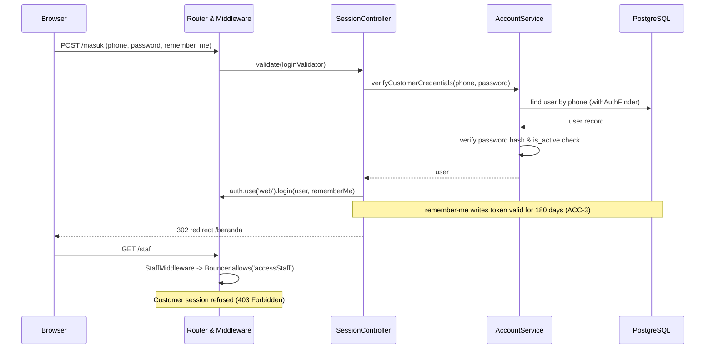

# M2a evidence: phone accounts, sign-in, sign-out, role redirects (version 0.1.2)

Date: 2026-11-15. Checkpoint **M2a** (first part of M2, accounts, v0.2.0; version remains **0.1.2** until M2c).

## 1. Summary

- **GUEST-11**: Customer sign-in (`/masuk`) with WhatsApp phone number and password. Inputs validated and phone normalized to E.164 (`62...`). Refuses inactive accounts with clear Indonesian error message ("Akun Anda telah dinonaktifkan. Silakan hubungi admin.").
- **STAFF-1**: Staff and owner sign-in (`/staf/masuk`). Refuses customer role accounts and inactive accounts. Updates `last_seen_at` on successful authentication and records an entry to `activity_logs`.
- **ACC-1**: Phone number is the sole unique user identifier (no required email). Validated and normalized using shared phone validator rule.
- **ACC-3**: Persistent sessions with "Ingat saya" (remember-me) token valid for 180 days (`remember_me_tokens` table via `DbRememberMeTokensProvider.forModel(User)`).
- **ACC-5**: Role authorization and boundaries enforced by AdonisJS Bouncer (`app/abilities/main.ts`) and middleware (`customer`, `staff`, `admin`). Proved with functional tests that every role is rejected where it doesn't belong (403 or redirect).
- **GUEST-12**: Sign-out endpoint (`POST /keluar`) clears session and remember-me token, redirecting back to `/masuk`.
- **Role redirects & dashboards**: Empty role homepages created:
  - Customer: `/beranda` (`CustomerDashboard`)
  - Staff: `/staf` (`StaffDashboard`)
  - Owner: `/admin` (`AdminDashboard`)
- **Seeders**: `database/seeders/user_seeder.ts` populates 1 owner (`081200000001`), 2 staff (`081200000002`, `081200000003`), 2 active customers (`081200000010`, `081200000011`), and 1 inactive customer (`081200000099`). Prints formatted demo accounts table on execution. Updated `docs/SETUP.md` with `node ace db:seed`.
- **NFR-2**: axe (WCAG 2.1 A and AA) finds 0 violations on all 5 touched pages; no horizontal scroll at 360 px; touch targets ≥ 44 px; form inputs 16 px font size to prevent mobile browser zoom.

## 2. How to run and see it

```sh
npm install
node ace migration:run
node ace db:seed
npm run dev
```

| URL           | What                                                                 |
| ------------- | -------------------------------------------------------------------- |
| `/masuk`      | Customer sign-in page with WhatsApp number and password              |
| `/staf/masuk` | Staff & owner sign-in page (refuses customer accounts)               |
| `/keluar`     | POST endpoint to sign out and clear session / remember-me tokens     |
| `/beranda`    | Customer dashboard (requires customer authentication)                |
| `/staf`       | Staff operational dashboard (requires staff or owner authentication) |
| `/admin`      | Owner administrative dashboard (requires owner authentication)       |

### Demo Accounts (`node ace db:seed`)

| Role     | Phone          | Password      | Status        |
| -------- | -------------- | ------------- | ------------- |
| Owner    | `081200000001` | `password123` | Aktif         |
| Staff    | `081200000002` | `password123` | Aktif         |
| Staff    | `081200000003` | `password123` | Aktif         |
| Customer | `081200000010` | `password123` | Aktif         |
| Customer | `081200000011` | `password123` | Aktif         |
| Customer | `081200000099` | `password123` | Dinonaktifkan |

## 3. Screens

Captured with Playwright Chromium at 360 × 780, 390 × 844 (both 2× scale), and 1440 × 900. No horizontal scrolling occurred at 360 px viewport.

| Page                          | 360                              | 390                              | 1440                               |
| ----------------------------- | -------------------------------- | -------------------------------- | ---------------------------------- |
| Customer Sign-in (`/masuk`)   | [360](masuk-360.png)             | [390](masuk-390.png)             | [1440](masuk-1440.png)             |
| Staff Sign-in (`/staf/masuk`) | [360](staf-masuk-360.png)        | [390](staf-masuk-390.png)        | [1440](staf-masuk-1440.png)        |
| Customer Home (`/beranda`)    | [360](pelanggan-beranda-360.png) | [390](pelanggan-beranda-390.png) | [1440](pelanggan-beranda-1440.png) |
| Staff Home (`/staf`)          | [360](staf-beranda-360.png)      | [390](staf-beranda-390.png)      | [1440](staf-beranda-1440.png)      |
| Owner Home (`/admin`)         | [360](pemilik-ringkasan-360.png) | [390](pemilik-ringkasan-390.png) | [1440](pemilik-ringkasan-1440.png) |

## 4. How it works



## 5. Code tour (reading order)

1. `database/migrations/1763160000000_create_users_table.ts`
2. `database/migrations/1763160000001_create_remember_me_tokens_table.ts`
3. `database/migrations/1763160000002_create_activity_logs_table.ts`
4. `database/seeders/user_seeder.ts`
5. `app/models/user.ts`, `app/models/activity_log.ts`
6. `app/enums/role_enum.ts`
7. `app/validators/session.ts`
8. `app/services/account_service.ts`
9. `app/abilities/main.ts`
10. `app/middleware/customer_middleware.ts`, `app/middleware/staff_middleware.ts`, `app/middleware/admin_middleware.ts`, `start/kernel.ts`
11. `app/controllers/session_controller.ts`
12. `start/routes.ts`
13. `inertia/components/ui/checkbox.tsx`
14. `inertia/pages/auth/login.tsx`, `inertia/pages/auth/staff_login.tsx`
15. `inertia/pages/customer/dashboard.tsx`, `inertia/pages/staff/dashboard.tsx`, `inertia/pages/admin/dashboard.tsx`
16. `tests/unit/account_service.spec.ts`
17. `tests/functional/auth_routes.spec.ts`
18. `tests/browser/auth_flow.spec.ts`

## 6. Decisions and deviations

- **D45–D48 in `docs/ARCHITECTURE.md` §7**:
  - D45: WhatsApp phone-based auth normalized to E.164 (`62...`).
  - D46: Remember-me persistent tokens configured for 180 days with `DbRememberMeTokensProvider.forModel(User)`.
  - D47: Centralized Bouncer edge authorization abilities (`accessCustomer`, `accessStaff`, `accessAdmin`).
  - D48: Flashed session error structures satisfy both Inertia client components (`inputErrorsBag`) and Japa test assertions (`errors`).
- **No arbitrary Tailwind values**: all new components use Tailwind's standard scale.
- **Single light theme**: no `dark:` classes in `checkbox.tsx` or any auth/dashboard pages.

## 7. Evidence

Verification logs: [lint.log](lint.log), [typecheck.log](typecheck.log), [test.log](test.log).

### Lint (0 errors, 0 warnings)

```text
$ npm run lint
> eslint .
exit=0
```

### Typecheck (0 errors)

```text
$ npm run typecheck
> tsc --noEmit && tsc --noEmit --project inertia/tsconfig.json
exit=0
```

### Tests (68 passed)

```text
$ npm test
Tests  68 passed (68)
Time   45s
```

Summary of test categories:

- Unit tests: 15 passed (including phone normalization, account verification, password checking, activity logging, transitions).
- Functional tests: 13 passed (including sign-in/out endpoints, role refusals, inactive account refusals, remember-me cookies, SEO).
- Browser tests: 40 passed (including auth flows, WCAG 2.1 AA axe audits on all touched pages, 360 px viewport horizontal scroll tests).
