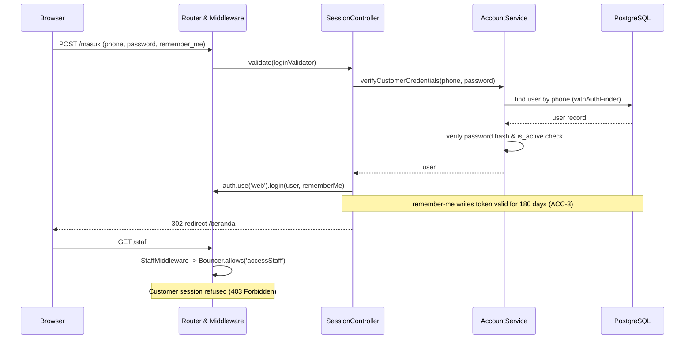
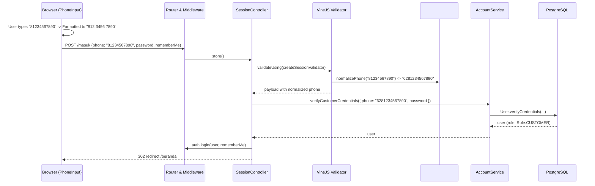
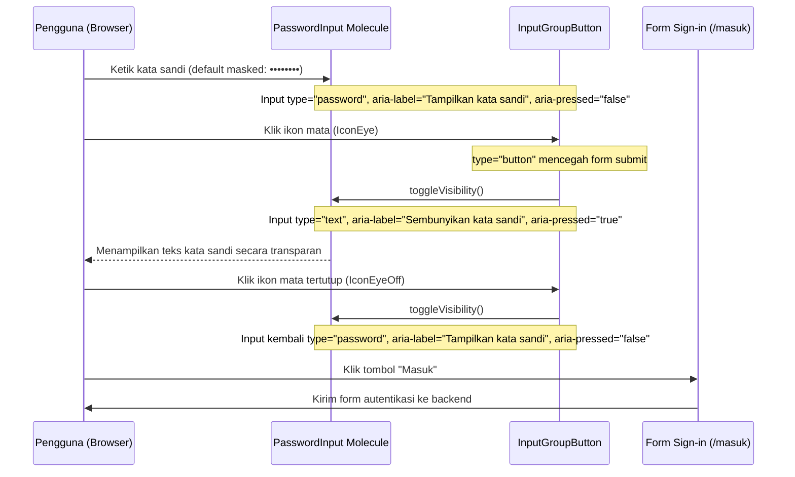

# M2a evidence: phone accounts, sign-in, sign-out, role redirects (version 0.1.2)

Date: 2026-11-15. Checkpoint **M2a** (first part of M2, accounts, v0.2.0; version remains **0.1.2** until M2c).

## 1. Summary

- **GUEST-11**: Customer sign-in (`/masuk`) with WhatsApp phone number and password. Inputs validated and phone normalized to E.164 (`62...`). Refuses inactive accounts with clear Indonesian error message ("Akun Anda telah dinonaktifkan. Silakan hubungi admin.").
- **STAFF-1**: Staff and owner sign-in (`/staf/masuk`). Refuses customer role accounts and inactive accounts. Updates `last_seen_at` on successful authentication and records an entry to `activity_logs`.
- **ACC-1**: Phone number is the sole unique user identifier (no required email). Validated and normalized using shared phone validator rule.
- **ACC-3**: Persistent sessions with "Ingat saya" (remember-me) token valid for 180 days (`remember_me_tokens` table via `DbRememberMeTokensProvider.forModel(User)`).
- **ACC-5**: Role authorization and boundaries enforced by AdonisJS Bouncer (`app/abilities/main.ts`) and middleware (`customer`, `staff`, `admin`). Proved with functional tests that every role is rejected where it doesn't belong (403 or redirect).
- **GUEST-12**: Sign-out endpoint (`POST /keluar`) clears session and remember-me token, redirecting back to `/masuk`.
- **Role redirects & dashboards**: Empty role homepages created:
  - Customer: `/beranda` (`CustomerDashboard`)
  - Staff: `/staf` (`StaffDashboard`)
  - Owner: `/admin` (`AdminDashboard`)
- **Seeders**: `database/seeders/user_seeder.ts` populates 1 owner (`081200000001`), 2 staff (`081200000002`, `081200000003`), 2 active customers (`081200000010`, `081200000011`), and 1 inactive customer (`081200000099`). Prints formatted demo accounts table on execution. Updated `docs/SETUP.md` with `node ace db:seed`.
- **NFR-2**: axe (WCAG 2.1 A and AA) finds 0 violations on all 5 touched pages; no horizontal scroll at 360 px; touch targets ≥ 44 px; form inputs 16 px font size to prevent mobile browser zoom.

## 2. How to run and see it

```sh
npm install
node ace migration:run
node ace db:seed
npm run dev
```

| URL           | What                                                                 |
| ------------- | -------------------------------------------------------------------- |
| `/masuk`      | Customer sign-in page with WhatsApp number and password              |
| `/staf/masuk` | Staff & owner sign-in page (refuses customer accounts)               |
| `/keluar`     | POST endpoint to sign out and clear session / remember-me tokens     |
| `/beranda`    | Customer dashboard (requires customer authentication)                |
| `/staf`       | Staff operational dashboard (requires staff or owner authentication) |
| `/admin`      | Owner administrative dashboard (requires owner authentication)       |

### Demo Accounts (`node ace db:seed`)

| Role     | Phone          | Password      | Status        |
| -------- | -------------- | ------------- | ------------- |
| Owner    | `081200000001` | `password123` | Aktif         |
| Staff    | `081200000002` | `password123` | Aktif         |
| Staff    | `081200000003` | `password123` | Aktif         |
| Customer | `081200000010` | `password123` | Aktif         |
| Customer | `081200000011` | `password123` | Aktif         |
| Customer | `081200000099` | `password123` | Dinonaktifkan |

## 3. Screens

Captured with Playwright Chromium at 360 × 780, 390 × 844 (both 2× scale), and 1440 × 900. No horizontal scrolling occurred at 360 px viewport.

| Page                          | 360                              | 390                              | 1440                               |
| ----------------------------- | -------------------------------- | -------------------------------- | ---------------------------------- |
| Customer Sign-in (`/masuk`)   | [360](masuk-360.png)             | [390](masuk-390.png)             | [1440](masuk-1440.png)             |
| Staff Sign-in (`/staf/masuk`) | [360](staf-masuk-360.png)        | [390](staf-masuk-390.png)        | [1440](staf-masuk-1440.png)        |
| Customer Home (`/beranda`)    | [360](pelanggan-beranda-360.png) | [390](pelanggan-beranda-390.png) | [1440](pelanggan-beranda-1440.png) |
| Staff Home (`/staf`)          | [360](staf-beranda-360.png)      | [390](staf-beranda-390.png)      | [1440](staf-beranda-1440.png)      |
| Owner Home (`/admin`)         | [360](pemilik-ringkasan-360.png) | [390](pemilik-ringkasan-390.png) | [1440](pemilik-ringkasan-1440.png) |

## 4. How it works



## 5. Code tour (reading order)

1. `database/migrations/1763160000000_create_users_table.ts`
2. `database/migrations/1763160000001_create_remember_me_tokens_table.ts`
3. `database/migrations/1763160000002_create_activity_logs_table.ts`
4. `database/seeders/user_seeder.ts`
5. `app/models/user.ts`, `app/models/activity_log.ts`
6. `app/enums/role_enum.ts`
7. `app/validators/session.ts`
8. `app/services/account_service.ts`
9. `app/abilities/main.ts`
10. `app/middleware/customer_middleware.ts`, `app/middleware/staff_middleware.ts`, `app/middleware/admin_middleware.ts`, `start/kernel.ts`
11. `app/controllers/session_controller.ts`
12. `start/routes.ts`
13. `inertia/components/ui/checkbox.tsx`
14. `inertia/pages/auth/login.tsx`, `inertia/pages/auth/staff_login.tsx`
15. `inertia/pages/customer/dashboard.tsx`, `inertia/pages/staff/dashboard.tsx`, `inertia/pages/admin/dashboard.tsx`
16. `tests/unit/account_service.spec.ts`
17. `tests/functional/auth_routes.spec.ts`
18. `tests/browser/auth_flow.spec.ts`

## 6. Decisions and deviations

- **D45–D48 in `docs/ARCHITECTURE.md` §7**:
  - D45: WhatsApp phone-based auth normalized to E.164 (`62...`).
  - D46: Remember-me persistent tokens configured for 180 days with `DbRememberMeTokensProvider.forModel(User)`.
  - D47: Centralized Bouncer edge authorization abilities (`accessCustomer`, `accessStaff`, `accessAdmin`).
  - D48: Flashed session error structures satisfy both Inertia client components (`inputErrorsBag`) and Japa test assertions (`errors`).
- **No arbitrary Tailwind values**: all new components use Tailwind's standard scale.
- **Single light theme**: no `dark:` classes in `checkbox.tsx` or any auth/dashboard pages.

## 7. Evidence

Verification logs: [lint.log](lint.log), [typecheck.log](typecheck.log), [test.log](test.log).

### Lint (0 errors, 0 warnings)

```text
$ npm run lint
> eslint .
exit=0
```

### Typecheck (0 errors)

```text
$ npm run typecheck
> tsc --noEmit && tsc --noEmit --project inertia/tsconfig.json
exit=0
```

### Tests (68 passed)

```text
$ npm test
Tests  68 passed (68)
Time   45s
```

Summary of test categories:

- Unit tests: 15 passed (including phone normalization, account verification, password checking, activity logging, transitions).
- Functional tests: 13 passed (including sign-in/out endpoints, role refusals, inactive account refusals, remember-me cookies, SEO).
- Browser tests: 40 passed (including auth flows, WCAG 2.1 AA axe audits on all touched pages, 360 px viewport horizontal scroll tests).

---

## FIX

## M2a-fix evidence: checkbox deprecation fix, role enum, phone input molecule, realistic seeders

Date: 2026-11-15. Checkpoint **M2a-fix** (refinements from review before starting M2b; version remains **0.1.2**).

### 1. Summary

1. **Checkbox Deprecation Fixed (D49)**:
   - Rebuilt `inertia/components/ui/checkbox.tsx` on React Aria Components 1.22 modern primitives `CheckboxField` and `CheckboxButton` instead of the deprecated `Checkbox`.
   - Removed every `eslint-disable` comment across the repository (`app/`, `inertia/`, `start/`, `tests/`).
   - Sized the "Ingat saya" row to a minimum 44 px tap target (`min-h-11`) with normal foreground text at body size (`text-base text-foreground font-normal`) and clear visible focus ring on keyboard tab.
2. **Centralized Role Enum (D51)**:
   - Created `app/enums/role_enum.ts` with `Role` (`CUSTOMER`, `STAFF`, `ADMIN`), `RoleLabel` (`Pelanggan`, `Staf`, `Owner`), and `STAFF_ROLES`.
   - Configured `database/schema_rules.ts` to automatically type `users.role` as `Role` imported from `#enums/role_enum`.
   - Replaced all string literals for roles across models, migrations, abilities, middleware, seeders, tests, and pages. Zero role string literals remain outside `role_enum.ts`.
3. **Shared Phone Helpers**:
   - Extracted `normalizePhone`, `isValidIndonesianPhone`, `maskPhone`, and `formatPhone` into `#helpers/phone` (`app/helpers/phone.ts`) on the backend and matching `inertia/lib/phone.ts` on the frontend.
   - Removed leftover `'email'` validation message from `start/validator.ts`.
4. **PhoneInput Molecule with shadcn InputGroup**:
   - Built `inertia/components/molecules/phone_input.tsx` composing official shadcn `InputGroup`: `+62` as `InputGroupAddon`, `InputGroupInput` as control.
   - Whole group is surrounded by the focus ring and error ring (`has-[[data-slot=input-group-control]:focus-visible]`, `has-[[data-slot][aria-invalid=true]]`), with no `!important` or manual border/padding cancellations.
   - Formats local number with spaces as typed (`812 3456 7890`) and submits digits that the backend shared helper normalizes to `62...`.
   - Sized at `h-12 text-base` (≥ 16 px to prevent iOS zoom).
5. **Realistic Seeders & WhatsApp Sender Skeleton (D50)**:
   - Added `ADMIN_PHONE` and `WHATSAPP_ALLOWED_PHONES` to `start/env.ts` and `.env.example`.
   - In production, `user_seeder.ts` refuses to run without `ADMIN_PHONE`; outside production it defaults to demo number `081298765432`.
   - Seeded realistic Indonesian mobile numbers (11–12 digits, valid operator prefixes) and realistic names. Staff names contain no job titles or roles ("Siti Rahmawati", "Ahmad Fauzi").
   - Implemented `app/services/whatsapp_service.ts`: outside production, messages are sent only to numbers in `WHATSAPP_ALLOWED_PHONES`, while any other recipient goes strictly to the log. Verified with unit tests.

### 2. Screens

Screenshots captured with Playwright Chromium at 360 × 780, 390 × 844 (both 2× scale), and 1440 × 900.

#### PhoneInput States at 360 px Viewport

| State           | Screenshot                                       | Description                                                         |
| --------------- | ------------------------------------------------ | ------------------------------------------------------------------- |
| Kosong (Empty)  | [telepon-kosong-360.png](telepon-kosong-360.png) | Group with `+62` addon and placeholder `812 3456 7890`              |
| Fokus (Focused) | [telepon-fokus-360.png](telepon-fokus-360.png)   | Focus ring surrounds the entire group including `+62` prefix        |
| Terisi (Filled) | [telepon-terisi-360.png](telepon-terisi-360.png) | Spaces formatted automatically while typing (`812 3456 7890`)       |
| Galat (Error)   | [telepon-error-360.png](telepon-error-360.png)   | Destructive border and ring surround whole group with error message |

#### Updated Authentication Pages

| Page                          | 360                           | 390                           | 1440                            |
| ----------------------------- | ----------------------------- | ----------------------------- | ------------------------------- |
| Customer Sign-in (`/masuk`)   | [360](masuk-fix-360.png)      | [390](masuk-fix-390.png)      | [1440](masuk-fix-1440.png)      |
| Staff Sign-in (`/staf/masuk`) | [360](staf-masuk-fix-360.png) | [390](staf-masuk-fix-390.png) | [1440](staf-masuk-fix-1440.png) |

### 3. How it works



### 4. Verification

Verification logs: [fix-lint.log](fix-lint.log), [fix-typecheck.log](fix-typecheck.log), [fix-test.log](fix-test.log).

#### Lint (0 errors, 0 warnings, zero eslint-disable)

```text
$ npm run lint
> eslint .
exit=0
```

#### Typecheck (0 errors)

```text
$ npm run typecheck
> tsc --noEmit && tsc --noEmit --project inertia/tsconfig.json
exit=0
```

#### Tests (71 passed)

```text
$ npm test
Tests  71 passed (71)
Time   50s
```

Summary of test categories:

- Unit tests: 18 passed (Bouncer abilities with Role enum, AccountService credential checks, phone normalization/formatting/masking, one light theme, WhatsAppService allowlist).
- Functional tests: 13 passed (sign-in with normalized phones, role refusals with Role enum, remember-me token, activity logs, SEO).
- Browser tests: 40 passed (auth flow, keyboard navigation & Tab focus ring, WCAG 2.1 AA axe audits on all touched pages, 360 px viewport horizontal scroll tests).

---

## FIX2

## M2a-fix2 evidence: password input toggle, zero re-exports, function declarations, uniform form controls, clean UI, snake_case shadcn components

Date: 2026-11-16. Checkpoint **M2a-fix2** (refinements from second review before starting M2b; version remains **0.1.2**).

### 1. Summary

1. **PasswordInput Molecule with Toggle (Task 1, D53)**:
   - Built `inertia/components/molecules/password_input.tsx` composing shadcn's `InputGroup`: input as control (`InputGroupInput`) and `InputGroupButton` addon with `@tabler/icons-react` `IconEye` / `IconEyeOff`.
   - Configured with localized Indonesian labels (`aria-label="Tampilkan kata sandi"` / `"Sembunyikan kata sandi"`), `aria-pressed`, `type="button"` (never submits form), and a 44 px minimum tap target (`size="icon"` / `size-11`).
   - Integrated into `/masuk` and `/staf/masuk`. Verified with automated Playwright browser test in `tests/browser/auth_flow.spec.ts`.
2. **Zero Re-Exports Everywhere (Task 2, D54)**:
   - Banned all re-exports across the entire codebase using ESLint's built-in `no-restricted-syntax` rule targeting `ExportAllDeclaration` and `ExportNamedDeclaration[source]`.
   - Removed re-export of `#helpers/phone` from `app/validators/rules.ts` (callers import directly from `#helpers/phone`).
   - Deleted `inertia/lib/utils.ts` and configured `components.json` utils alias directly to the `cn` package.
3. **Function Declaration Style (Task 3, D54)**:
   - Enforced function declaration syntax across the codebase using ESLint's built-in `func-style: ['error', 'declaration']`.
   - Converted all components, page handlers, helper functions, and service utilities from arrow functions to `function name() {}`. Arrow functions are reserved exclusively for short inline callbacks.
4. **No Namespace Imports (Task 4, D54)**:
   - Banned `import * as name` using ESLint's `no-restricted-syntax` rule targeting `ImportNamespaceSpecifier`.
   - Converted Bouncer abilities in `app/middleware/initialize_bouncer_middleware.ts` and tests to named imports (`{ accessCustomer, accessStaff, accessAdmin }`). Converted all React and library imports in UI components and pages to explicit named imports.
5. **Uniform 16 px Text Size in Form Controls (Task 5, D53)**:
   - Standardized text size to 16 px (`text-base`) across all viewports in base UI components (`inertia/components/ui/input.tsx`, `input_group.tsx`, `textarea.tsx`), eliminating `md:text-sm`.
   - Both addon prefixes (`+62`) and user input digits now render at identical 16 px body size on mobile (360 px) and desktop (1440 px), completely preventing iOS Safari automatic viewport zooming.
6. **UI Only Shows What Works (Task 6, D33 update)**:
   - Simplified "Ingat saya selama 180 hari" to plain "Ingat saya" with zero internal technical details.
   - Removed all navigation links pointing to unbuilt pages (`customer_links.ts`, `staff_links.ts`, `owner_links.ts`). Navigation items without active routes are completely hidden rather than shown as dead text.
   - Cleaned up placeholder CTA buttons, disabled triggers, and teaser text ("(tersedia di M2b)") across the landing page, auth forms, customer dashboard, and footer.
7. **shadcn Components Follow All Project Rules (Task 7, D29 update)**:
   - Renamed `inertia/components/ui/input-group.tsx` to `input_group.tsx` (snake_case).
   - Removed all ESLint exceptions for `inertia/components/ui/` in `eslint.config.js` (canonical classes, no-shadow, eqeqeq, set-state-in-effect, filename-case).
   - Refactored `carousel.tsx` state synchronization using React's `useSyncExternalStore` subscribing to Embla events, eliminating `react-hooks/set-state-in-effect` without `eslint-disable`.
   - Updated `docs/CONVENTIONS.md` §3 and §4, and recorded decisions D29, D33, D53, and D54 in `docs/ARCHITECTURE.md`.

### 2. Screens

Screenshots captured with Playwright Chromium at 360 × 800, 390 × 844, and 1440 × 900.

#### PasswordInput Toggle States (Task 1, 360 px)

| State       | Screenshot                                                             | Description                                                                                 |
| ----------- | ---------------------------------------------------------------------- | ------------------------------------------------------------------------------------------- |
| Tersembunyi | [password-tersembunyi-fix2-360.png](password-tersembunyi-fix2-360.png) | Masked dots, `IconEye`, `aria-label="Tampilkan kata sandi"`, `aria-pressed="false"`         |
| Terlihat    | [password-terlihat-fix2-360.png](password-terlihat-fix2-360.png)       | Plaintext input, `IconEyeOff`, `aria-label="Sembunyikan kata sandi"`, `aria-pressed="true"` |

#### PhoneInput 16 px Uniform Text Size Comparison (Task 5)

| Viewport | Screenshot                                                 | Description                                                               |
| -------- | ---------------------------------------------------------- | ------------------------------------------------------------------------- |
| 360 px   | [telepon-fokus-fix2-360.png](telepon-fokus-fix2-360.png)   | `+62` addon and local digits both render at 16 px (`text-base`)           |
| 1440 px  | [telepon-fokus-fix2-1440.png](telepon-fokus-fix2-1440.png) | Same 16 px font size on desktop, avoiding previous 14 px / 16 px mismatch |

#### Updated Authentication Pages

| Page                          | 360 px                         | 390 px                         | 1440 px                          |
| ----------------------------- | ------------------------------ | ------------------------------ | -------------------------------- |
| Customer Sign-in (`/masuk`)   | [360](masuk-fix2-360.png)      | [390](masuk-fix2-390.png)      | [1440](masuk-fix2-1440.png)      |
| Staff Sign-in (`/staf/masuk`) | [360](staf-masuk-fix2-360.png) | [390](staf-masuk-fix2-390.png) | [1440](staf-masuk-fix2-1440.png) |

#### Clean Navigation & Dashboards (Task 6)

| Role / Page                    | 360 px                                | 1440 px                                 |
| ------------------------------ | ------------------------------------- | --------------------------------------- |
| Pelanggan Beranda (`/beranda`) | [360](pelanggan-beranda-fix2-360.png) | [1440](pelanggan-beranda-fix2-1440.png) |
| Staf Beranda (`/staf`)         | [360](staf-beranda-fix2-360.png)      | [1440](staf-beranda-fix2-1440.png)      |
| Pemilik Ringkasan (`/admin`)   | [360](pemilik-ringkasan-fix2-360.png) | [1440](pemilik-ringkasan-fix2-1440.png) |

### 3. Inventory of Removed Elements (Task 6)

The following unbuilt or internal elements were removed across pages and templates:

1. **`inertia/pages/auth/login.tsx` & `staff_login.tsx`**:
   - Shortened `"Ingat saya selama 180 hari"` to `"Ingat saya"`.
   - Removed `"Lupa kata sandi? (tersedia di M2b)"` and `"Belum punya akun? Daftar (tersedia di M2b)"` placeholders.
2. **`inertia/lib/navigation/customer_links.ts`**:
   - Removed unbuilt navigation items (`pesanan`, `profil`) and unbuilt action button (`order`). Only active route `beranda` is kept.
3. **`inertia/lib/navigation/staff_links.ts`**:
   - Removed unbuilt items (`pesanan`, `antrean`, `profil`). Only active route `beranda` is kept.
4. **`inertia/lib/navigation/owner_links.ts`**:
   - Removed unbuilt items (`pesanan`, `pelanggan`, `layanan`, `staf`, `keuangan`, `profil`). Only active route `ringkasan` is kept.
5. **`inertia/components/organisms/customer_navigation.tsx` & `staff_navigation.tsx`**:
   - Removed floating/action buttons for unbuilt order flows (`IconPlus` / `Pesan Penjemputan`).
   - Center-aligned existing navigation bar tabs with `justify-around`.
6. **`inertia/components/organisms/site_footer.tsx`**:
   - Removed unbuilt `"Daftar Akun"` link.
   - Connected `"Masuk Staf & Owner"` directly to `session.createStaff` route.
7. **`inertia/components/organisms/landing/hero.tsx`**:
   - Removed unbuilt copy `"Belum punya akun? Daftar sekali..."`.
8. **`inertia/pages/customer/dashboard.tsx`**:
   - Removed unbuilt CTA button `"Pesan Penjemputan (Segera di M5)"`.

### 4. How it works



### 5. Verification

Verification logs: [fix2-lint.log](fix2-lint.log), [fix2-typecheck.log](fix2-typecheck.log), [fix2-test.log](fix2-test.log).

#### Lint (0 errors, 0 warnings, zero eslint-disable)

```text
$ npm run lint
> eslint .
exit=0
```

#### Typecheck (0 errors)

```text
$ npm run typecheck
> tsc --noEmit && tsc --noEmit --project inertia/tsconfig.json
exit=0
```

#### Tests (72 passed, 0 failed)

```text
$ npm test
Tests  72 passed (72)
Time   45s
```
