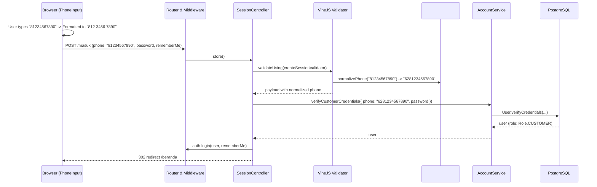

# M2a-fix evidence: checkbox deprecation fix, role enum, phone input molecule, realistic seeders

Date: 2026-11-15. Checkpoint **M2a-fix** (refinements from review before starting M2b; version remains **0.1.2**).

## 1. Summary

1. **Checkbox Deprecation Fixed (D49)**:
   - Rebuilt `inertia/components/ui/checkbox.tsx` on React Aria Components 1.22 modern primitives `CheckboxField` and `CheckboxButton` instead of the deprecated `Checkbox`.
   - Removed every `eslint-disable` comment across the repository (`app/`, `inertia/`, `start/`, `tests/`).
   - Sized the "Ingat saya" row to a minimum 44 px tap target (`min-h-11`) with normal foreground text at body size (`text-base text-foreground font-normal`) and clear visible focus ring on keyboard tab.
2. **Centralized Role Enum (D51)**:
   - Created `app/enums/role_enum.ts` with `Role` (`CUSTOMER`, `STAFF`, `ADMIN`), `RoleLabel` (`Pelanggan`, `Staf`, `Owner`), and `STAFF_ROLES`.
   - Configured `database/schema_rules.ts` to automatically type `users.role` as `Role` imported from `#enums/role_enum`.
   - Replaced all string literals for roles across models, migrations, abilities, middleware, seeders, tests, and pages. Zero role string literals remain outside `role_enum.ts`.
3. **Shared Phone Helpers**:
   - Extracted `normalizePhone`, `isValidIndonesianPhone`, `maskPhone`, and `formatPhone` into `#helpers/phone` (`app/helpers/phone.ts`) on the backend and matching `inertia/lib/phone.ts` on the frontend.
   - Removed leftover `'email'` validation message from `start/validator.ts`.
4. **PhoneInput Molecule with shadcn InputGroup**:
   - Built `inertia/components/molecules/phone_input.tsx` composing official shadcn `InputGroup`: `+62` as `InputGroupAddon`, `InputGroupInput` as control.
   - Whole group is surrounded by the focus ring and error ring (`has-[[data-slot=input-group-control]:focus-visible]`, `has-[[data-slot][aria-invalid=true]]`), with no `!important` or manual border/padding cancellations.
   - Formats local number with spaces as typed (`812 3456 7890`) and submits digits that the backend shared helper normalizes to `62...`.
   - Sized at `h-12 text-base` (≥ 16 px to prevent iOS zoom).
5. **Realistic Seeders & WhatsApp Sender Skeleton (D50)**:
   - Added `ADMIN_PHONE` and `WHATSAPP_ALLOWED_PHONES` to `start/env.ts` and `.env.example`.
   - In production, `user_seeder.ts` refuses to run without `ADMIN_PHONE`; outside production it defaults to demo number `081298765432`.
   - Seeded realistic Indonesian mobile numbers (11–12 digits, valid operator prefixes) and realistic names. Staff names contain no job titles or roles ("Siti Rahmawati", "Ahmad Fauzi").
   - Implemented `app/services/whatsapp_service.ts`: outside production, messages are sent only to numbers in `WHATSAPP_ALLOWED_PHONES`, while any other recipient goes strictly to the log. Verified with unit tests.

## 2. Screens

Screenshots captured with Playwright Chromium at 360 × 780, 390 × 844 (both 2× scale), and 1440 × 900.

### PhoneInput States at 360 px Viewport

| State           | Screenshot                                       | Description                                                         |
| --------------- | ------------------------------------------------ | ------------------------------------------------------------------- |
| Kosong (Empty)  | [telepon-kosong-360.png](telepon-kosong-360.png) | Group with `+62` addon and placeholder `812 3456 7890`              |
| Fokus (Focused) | [telepon-fokus-360.png](telepon-fokus-360.png)   | Focus ring surrounds the entire group including `+62` prefix        |
| Terisi (Filled) | [telepon-terisi-360.png](telepon-terisi-360.png) | Spaces formatted automatically while typing (`812 3456 7890`)       |
| Galat (Error)   | [telepon-error-360.png](telepon-error-360.png)   | Destructive border and ring surround whole group with error message |

### Updated Authentication Pages

| Page                          | 360                           | 390                           | 1440                            |
| ----------------------------- | ----------------------------- | ----------------------------- | ------------------------------- |
| Customer Sign-in (`/masuk`)   | [360](masuk-fix-360.png)      | [390](masuk-fix-390.png)      | [1440](masuk-fix-1440.png)      |
| Staff Sign-in (`/staf/masuk`) | [360](staf-masuk-fix-360.png) | [390](staf-masuk-fix-390.png) | [1440](staf-masuk-fix-1440.png) |

## 3. How it works



## 4. Verification

Verification logs: [fix-lint.log](fix-lint.log), [fix-typecheck.log](fix-typecheck.log), [fix-test.log](fix-test.log).

### Lint (0 errors, 0 warnings, zero eslint-disable)

```text
$ npm run lint
> eslint .
exit=0
```

### Typecheck (0 errors)

```text
$ npm run typecheck
> tsc --noEmit && tsc --noEmit --project inertia/tsconfig.json
exit=0
```

### Tests (71 passed)

```text
$ npm test
Tests  71 passed (71)
Time   50s
```

Summary of test categories:

- Unit tests: 18 passed (Bouncer abilities with Role enum, AccountService credential checks, phone normalization/formatting/masking, one light theme, WhatsAppService allowlist).
- Functional tests: 13 passed (sign-in with normalized phones, role refusals with Role enum, remember-me token, activity logs, SEO).
- Browser tests: 40 passed (auth flow, keyboard navigation & Tab focus ring, WCAG 2.1 AA axe audits on all touched pages, 360 px viewport horizontal scroll tests).
