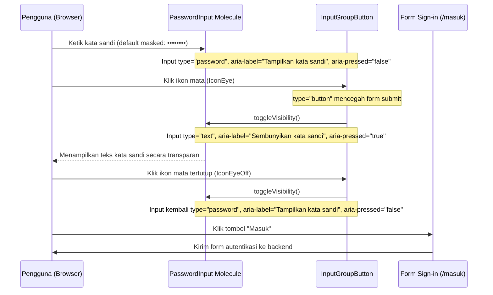

# M2a-fix2 evidence: password input toggle, zero re-exports, function declarations, uniform form controls, clean UI, snake_case shadcn components

Date: 2026-11-16. Checkpoint **M2a-fix2** (refinements from second review before starting M2b; version remains **0.1.2**).

## 1. Summary

1. **PasswordInput Molecule with Toggle (Task 1, D53)**:
   - Built `inertia/components/molecules/password_input.tsx` composing shadcn's `InputGroup`: input as control (`InputGroupInput`) and `InputGroupButton` addon with `@tabler/icons-react` `IconEye` / `IconEyeOff`.
   - Configured with localized Indonesian labels (`aria-label="Tampilkan kata sandi"` / `"Sembunyikan kata sandi"`), `aria-pressed`, `type="button"` (never submits form), and a 44 px minimum tap target (`size="icon"` / `size-11`).
   - Integrated into `/masuk` and `/staf/masuk`. Verified with automated Playwright browser test in `tests/browser/auth_flow.spec.ts`.
2. **Zero Re-Exports Everywhere (Task 2, D54)**:
   - Banned all re-exports across the entire codebase using ESLint's built-in `no-restricted-syntax` rule targeting `ExportAllDeclaration` and `ExportNamedDeclaration[source]`.
   - Removed re-export of `#helpers/phone` from `app/validators/rules.ts` (callers import directly from `#helpers/phone`).
   - Deleted `inertia/lib/utils.ts` and configured `components.json` utils alias directly to the `cn` package.
3. **Function Declaration Style (Task 3, D54)**:
   - Enforced function declaration syntax across the codebase using ESLint's built-in `func-style: ['error', 'declaration']`.
   - Converted all components, page handlers, helper functions, and service utilities from arrow functions to `function name() {}`. Arrow functions are reserved exclusively for short inline callbacks.
4. **No Namespace Imports (Task 4, D54)**:
   - Banned `import * as name` using ESLint's `no-restricted-syntax` rule targeting `ImportNamespaceSpecifier`.
   - Converted Bouncer abilities in `app/middleware/initialize_bouncer_middleware.ts` and tests to named imports (`{ accessCustomer, accessStaff, accessAdmin }`). Converted all React and library imports in UI components and pages to explicit named imports.
5. **Uniform 16 px Text Size in Form Controls (Task 5, D53)**:
   - Standardized text size to 16 px (`text-base`) across all viewports in base UI components (`inertia/components/ui/input.tsx`, `input_group.tsx`, `textarea.tsx`), eliminating `md:text-sm`.
   - Both addon prefixes (`+62`) and user input digits now render at identical 16 px body size on mobile (360 px) and desktop (1440 px), completely preventing iOS Safari automatic viewport zooming.
6. **UI Only Shows What Works (Task 6, D33 update)**:
   - Simplified "Ingat saya selama 180 hari" to plain "Ingat saya" with zero internal technical details.
   - Removed all navigation links pointing to unbuilt pages (`customer_links.ts`, `staff_links.ts`, `owner_links.ts`). Navigation items without active routes are completely hidden rather than shown as dead text.
   - Cleaned up placeholder CTA buttons, disabled triggers, and teaser text ("(tersedia di M2b)") across the landing page, auth forms, customer dashboard, and footer.
7. **shadcn Components Follow All Project Rules (Task 7, D29 update)**:
   - Renamed `inertia/components/ui/input-group.tsx` to `input_group.tsx` (snake_case).
   - Removed all ESLint exceptions for `inertia/components/ui/` in `eslint.config.js` (canonical classes, no-shadow, eqeqeq, set-state-in-effect, filename-case).
   - Refactored `carousel.tsx` state synchronization using React's `useSyncExternalStore` subscribing to Embla events, eliminating `react-hooks/set-state-in-effect` without `eslint-disable`.
   - Updated `docs/CONVENTIONS.md` §3 and §4, and recorded decisions D29, D33, D53, and D54 in `docs/ARCHITECTURE.md`.

## 2. Screens

Screenshots captured with Playwright Chromium at 360 × 800, 390 × 844, and 1440 × 900.

### PasswordInput Toggle States (Task 1, 360 px)

| State       | Screenshot                                                             | Description                                                                                 |
| ----------- | ---------------------------------------------------------------------- | ------------------------------------------------------------------------------------------- |
| Tersembunyi | [password-tersembunyi-fix2-360.png](password-tersembunyi-fix2-360.png) | Masked dots, `IconEye`, `aria-label="Tampilkan kata sandi"`, `aria-pressed="false"`         |
| Terlihat    | [password-terlihat-fix2-360.png](password-terlihat-fix2-360.png)       | Plaintext input, `IconEyeOff`, `aria-label="Sembunyikan kata sandi"`, `aria-pressed="true"` |

### PhoneInput 16 px Uniform Text Size Comparison (Task 5)

| Viewport | Screenshot                                                 | Description                                                               |
| -------- | ---------------------------------------------------------- | ------------------------------------------------------------------------- |
| 360 px   | [telepon-fokus-fix2-360.png](telepon-fokus-fix2-360.png)   | `+62` addon and local digits both render at 16 px (`text-base`)           |
| 1440 px  | [telepon-fokus-fix2-1440.png](telepon-fokus-fix2-1440.png) | Same 16 px font size on desktop, avoiding previous 14 px / 16 px mismatch |

### Updated Authentication Pages

| Page                          | 360 px                         | 390 px                         | 1440 px                          |
| ----------------------------- | ------------------------------ | ------------------------------ | -------------------------------- |
| Customer Sign-in (`/masuk`)   | [360](masuk-fix2-360.png)      | [390](masuk-fix2-390.png)      | [1440](masuk-fix2-1440.png)      |
| Staff Sign-in (`/staf/masuk`) | [360](staf-masuk-fix2-360.png) | [390](staf-masuk-fix2-390.png) | [1440](staf-masuk-fix2-1440.png) |

### Clean Navigation & Dashboards (Task 6)

| Role / Page                    | 360 px                                | 1440 px                                 |
| ------------------------------ | ------------------------------------- | --------------------------------------- |
| Pelanggan Beranda (`/beranda`) | [360](pelanggan-beranda-fix2-360.png) | [1440](pelanggan-beranda-fix2-1440.png) |
| Staf Beranda (`/staf`)         | [360](staf-beranda-fix2-360.png)      | [1440](staf-beranda-fix2-1440.png)      |
| Pemilik Ringkasan (`/admin`)   | [360](pemilik-ringkasan-fix2-360.png) | [1440](pemilik-ringkasan-fix2-1440.png) |

## 3. Inventory of Removed Elements (Task 6)

The following unbuilt or internal elements were removed across pages and templates:

1. **`inertia/pages/auth/login.tsx` & `staff_login.tsx`**:
   - Shortened `"Ingat saya selama 180 hari"` to `"Ingat saya"`.
   - Removed `"Lupa kata sandi? (tersedia di M2b)"` and `"Belum punya akun? Daftar (tersedia di M2b)"` placeholders.
2. **`inertia/lib/navigation/customer_links.ts`**:
   - Removed unbuilt navigation items (`pesanan`, `profil`) and unbuilt action button (`order`). Only active route `beranda` is kept.
3. **`inertia/lib/navigation/staff_links.ts`**:
   - Removed unbuilt items (`pesanan`, `antrean`, `profil`). Only active route `beranda` is kept.
4. **`inertia/lib/navigation/owner_links.ts`**:
   - Removed unbuilt items (`pesanan`, `pelanggan`, `layanan`, `staf`, `keuangan`, `profil`). Only active route `ringkasan` is kept.
5. **`inertia/components/organisms/customer_navigation.tsx` & `staff_navigation.tsx`**:
   - Removed floating/action buttons for unbuilt order flows (`IconPlus` / `Pesan Penjemputan`).
   - Center-aligned existing navigation bar tabs with `justify-around`.
6. **`inertia/components/organisms/site_footer.tsx`**:
   - Removed unbuilt `"Daftar Akun"` link.
   - Connected `"Masuk Staf & Owner"` directly to `session.createStaff` route.
7. **`inertia/components/organisms/landing/hero.tsx`**:
   - Removed unbuilt copy `"Belum punya akun? Daftar sekali..."`.
8. **`inertia/pages/customer/dashboard.tsx`**:
   - Removed unbuilt CTA button `"Pesan Penjemputan (Segera di M5)"`.

## 4. How it works



## 5. Verification

Verification logs: [fix2-lint.log](fix2-lint.log), [fix2-typecheck.log](fix2-typecheck.log), [fix2-test.log](fix2-test.log).

### Lint (0 errors, 0 warnings, zero eslint-disable)

```text
$ npm run lint
> eslint .
exit=0
```

### Typecheck (0 errors)

```text
$ npm run typecheck
> tsc --noEmit && tsc --noEmit --project inertia/tsconfig.json
exit=0
```

### Tests (72 passed, 0 failed)

```text
$ npm test
Tests  72 passed (72)
Time   45s
```
