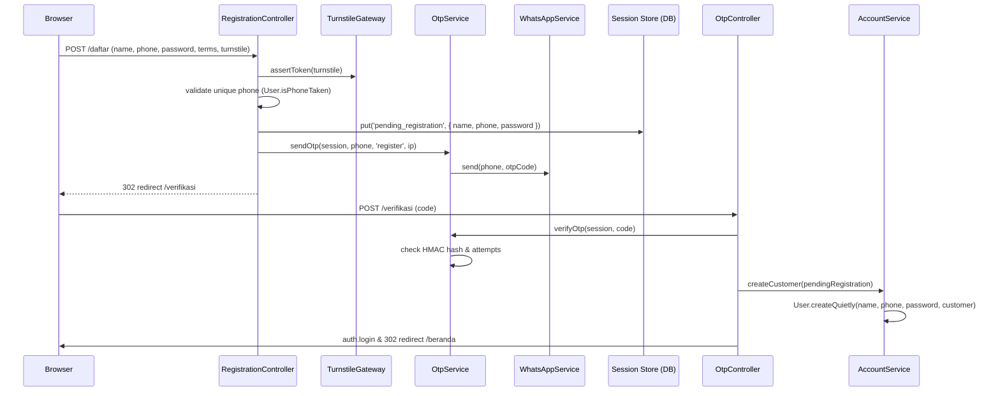
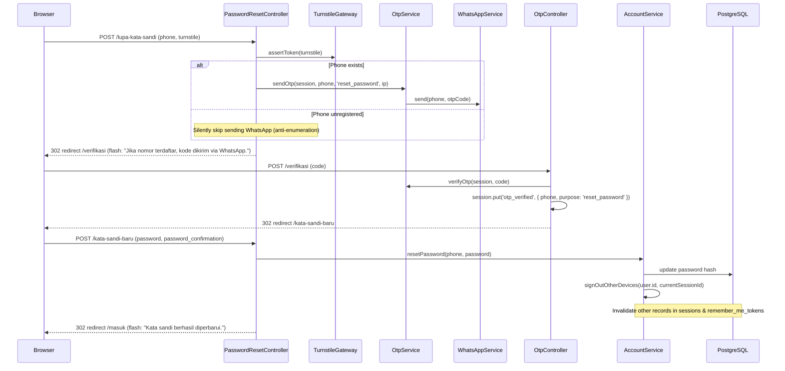

# M2b evidence: Registration, WhatsApp OTP, password reset, Turnstile (version 0.1.2)

Date: 2026-11-16. Checkpoint **M2b** (second part of M2, accounts, v0.2.0; version remains **0.1.2** until M2c).

## 1. Summary

- **GUEST-10**: Customer registration (`/daftar`) with name, WhatsApp phone number (`PhoneInput`), password and confirmation (`PasswordInput`), terms checkbox (`Checkbox`), and Cloudflare Turnstile bot verification (`TurnstileWidget`). Refuses existing phone numbers, mismatched passwords, or unchecked terms. Pending sign-up state lives exclusively in the database session store (`shared.md` §12), never in a cookie or hidden form field. Account is created only after OTP confirmation on `/verifikasi`, landing signed in on `/beranda`.
- **ACC-2**: Universal WhatsApp OTP verification service supporting `register` and `reset_password` flows (and extensible to `change_phone`).
  - 6-digit numeric codes with 5 minutes validity.
  - Stored only as keyed HMAC-SHA256 (`crypto.createHmac('sha256', appKey)`) and compared in constant time (`crypto.timingSafeEqual`), never logged.
  - Locked permanently after 5 wrong attempts.
  - 60-second resend cooldown (`POST /verifikasi/kirim-ulang`).
  - Hourly rate limits enforced via `@adonisjs/limiter` database storage: at most 5 sends per phone number and 20 sends per IP per hour.
  - Outgoing delivery via `WhatsAppService` using Fonnte, with the `WHATSAPP_ALLOWED_PHONES` guard outside production and the test log driver when no token is configured. WhatsApp failures never crash the HTTP request (`MSG-3`), returning user-friendly error feedback.
- **GUEST-12**: Forgot password flow (`/lupa-kata-sandi` → `/verifikasi` → `/kata-sandi-baru`). The response to `/lupa-kata-sandi` never reveals whether the phone number is registered, displaying the exact PRD sentence: *"Jika nomor terdaftar, kode dikirim via WhatsApp."*. Unregistered numbers trigger no WhatsApp send.
- **ACC-5**: Successful password reset updates user password hash, invalidates all other active sessions in the `sessions` table, and removes all `remember_me_tokens` for that user.
- **Cloudflare Turnstile**: Verified server-side via `TurnstileGateway` for both `/daftar` and `/lupa-kata-sandi`. Cloudflare test keys used in development; disabled via `TURNSTILE_ENABLED=false` in tests. In browser tests, `challenges.cloudflare.com` is the only external host allowed, and the Turnstile iframe is excluded from Axe accessibility audits.
- **Navigation (D33)**: Added links to `/daftar` and `/lupa-kata-sandi` from `/masuk`, the landing hero ("Daftar Sekarang" button), and the site footer.
- **Test path reporting**: Updated browser test runner in `tests/browser/look.spec.ts` to output the exact page path (e.g. `authenticated page /beranda`) instead of `authenticated page [object Object]`.

## 2. How to run and see it

```sh
npm install
node ace migration:run
node ace db:seed
npm run dev
```

| URL                 | What                                                                                 |
| ------------------- | ------------------------------------------------------------------------------------ |
| `/daftar`           | Registration form with name, WhatsApp phone, password, terms checkbox, and Turnstile |
| `/verifikasi`       | Accessible 6-digit OTP verification form with countdown timer and resend button      |
| `/lupa-kata-sandi`  | Request password reset by entering WhatsApp phone number and completing Turnstile    |
| `/kata-sandi-baru`  | Set new password and confirmation after OTP verification has been granted            |

## 3. Screens

Captured with Playwright Chromium at 360 × 780, 390 × 844 (both 2× scale), and 1440 × 900. No horizontal scrolling occurred at 360 px viewport. All pages pass WCAG 2.1 A and AA rules (axe-core).

| State / Screen                         | 360                                      | 390                                      | 1440                                       |
| -------------------------------------- | ---------------------------------------- | ---------------------------------------- | ------------------------------------------ |
| Registration (`/daftar`)               | [360](daftar-360.png)                    | [390](daftar-390.png)                    | [1440](daftar-1440.png)                    |
| Registration Validation Error          | [360](daftar-error-360.png)              | [390](daftar-error-390.png)              | [1440](daftar-error-1440.png)              |
| Verification Fresh (`/verifikasi`)     | [360](verifikasi-fresh-360.png)          | [390](verifikasi-fresh-390.png)          | [1440](verifikasi-fresh-1440.png)          |
| Verification Wrong Code Error          | [360](verifikasi-error-360.png)          | [390](verifikasi-error-390.png)          | [1440](verifikasi-error-1440.png)          |
| Verification Locked (5 Wrong Tries)    | [360](verifikasi-locked-360.png)         | [390](verifikasi-locked-390.png)         | [1440](verifikasi-locked-1440.png)         |
| Forgot Password (`/lupa-kata-sandi`)   | [360](lupa-kata-sandi-360.png)           | [390](lupa-kata-sandi-390.png)           | [1440](lupa-kata-sandi-1440.png)           |
| Forgot Password Validation Error       | [360](lupa-kata-sandi-error-360.png)     | [390](lupa-kata-sandi-error-390.png)     | [1440](lupa-kata-sandi-error-1440.png)     |
| New Password (`/kata-sandi-baru`)      | [360](kata-sandi-baru-360.png)           | [390](kata-sandi-baru-390.png)           | [1440](kata-sandi-baru-1440.png)           |
| New Password Validation Error          | [360](kata-sandi-baru-error-360.png)     | [390](kata-sandi-baru-error-390.png)     | [1440](kata-sandi-baru-error-1440.png)     |

## 4. How it works

### Registration Journey (GUEST-10 & ACC-2)



### Password Reset Journey (GUEST-12 & ACC-5)



## 5. Code tour (reading order)

1. `database/migrations/1761885935171_create_sessions_table.ts`
2. `database/migrations/1761885935172_create_rate_limits_table.ts`
3. `database/migrations/1761885935173_create_otp_codes_table.ts`
4. `app/enums/otp_purpose_enum.ts`
5. `app/models/otp_code.ts`, `app/models/user.ts` (extended with `isPhoneTaken`)
6. `app/services/turnstile_gateway.ts`
7. `app/services/whatsapp_service.ts`
8. `app/services/otp_service.ts`
9. `app/services/account_service.ts` (added `createCustomer`, `resetPassword`, `signOutOtherDevices`)
10. `app/validators/registration_validator.ts`, `app/validators/otp_validator.ts`, `app/validators/password_reset_validator.ts`
11. `app/controllers/registration_controller.ts`
12. `app/controllers/otp_controller.ts`
13. `app/controllers/password_reset_controller.ts`
14. `start/routes.ts`
15. `inertia/lib/shared/turnstile.ts`, `inertia/lib/shared/countdown.ts`
16. `inertia/components/molecules/turnstile_widget.tsx`, `inertia/components/molecules/otp_input.tsx`, `inertia/components/molecules/form_field.tsx`
17. `inertia/pages/auth/register.tsx`, `inertia/pages/auth/otp.tsx`, `inertia/pages/auth/forgot_password.tsx`, `inertia/pages/auth/reset_password.tsx`
18. `inertia/pages/auth/login.tsx`, `inertia/components/organisms/landing/hero.tsx`, `inertia/components/organisms/site_footer.tsx` (D33 navigation links)
19. `tests/unit/turnstile_gateway.spec.ts`, `tests/unit/otp_service.spec.ts`
20. `tests/functional/registration.spec.ts`, `tests/functional/otp.spec.ts`, `tests/functional/password_reset.spec.ts`
21. `tests/browser/auth_flow.spec.ts`, `tests/browser/look.spec.ts`

## 6. Decisions and deviations

- **D55–D59 in `docs/ARCHITECTURE.md` §7**:
  - D55: Server-side database session store (`pending_registration`) protects pending sign-up data without relying on cookies or client-controlled hidden inputs (`shared.md` §12).
  - D56: OTP codes are stored as HMAC-SHA256 keyed hashes with `timingSafeEqual` comparison. Codes are never stored as plain text or logged (ACC-2).
  - D57: Multi-layer rate limiting: max 5 wrong attempts per OTP session (locks permanently), 60-second cooldown on resends, max 5 sends per phone number per hour, and max 20 sends per IP per hour (`@adonisjs/limiter`).
  - D58: Server-side Turnstile verification for all public forms with test-key bypass during automated testing (`TURNSTILE_ENABLED=false`).
  - D59: Browser tests exclude Cloudflare Turnstile iframe from Axe audits and wait for `load` event to prevent third-party network polling hangs.
- **No arbitrary Tailwind values**: standard Tailwind typography and spacing scale utilized throughout.
- **One light theme**: zero `dark:` classes in new components or auth pages.

## 7. Evidence

Verification logs: [lint.log](lint.log), [typecheck.log](typecheck.log), [test.log](test.log).
